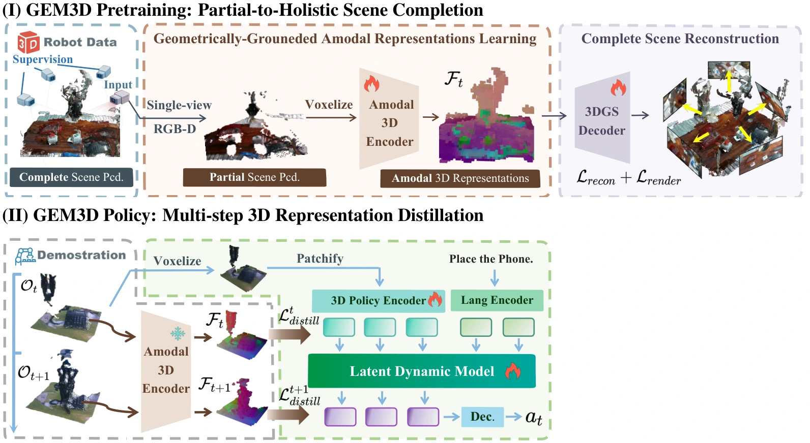

<!-- Generated by scripts/generate.py; edit data/works.json and data/media.json. -->

[← Back to the Awesome index](../../../README.md) · [Interactive website](https://chang-xinhai.github.io/Awesome-RGBDT-Manipulation/?collection=policy&item=gem3d#library)

# GEM3D

Learning Geometrically-Grounded Amodal 3D Representations for View-Generalizable Robotic Manipulation

**2026-01-30 · arXiv preprint · Tongji University; University of Hong Kong; Shanghai Jiao Tong University**

**[Paper](https://arxiv.org/abs/2601.22988)**

Multi-view reconstruction supervision distills amodal geometry into a calibrated single-view RGB-D manipulation policy.

*GEM3D authors · [Figure source](https://arxiv.org/abs/2601.22988) · Original rights retained.*

| Field | Reported value and source scope |
| :-- | :-- |
| Record type | policy |
| Policy family | Transformer / BC [1](https://arxiv.org/abs/2601.22988)  |
| Base model and architecture | PerceiverIO / PerAct-style keyframe policy; DINOv2 volumetric 3D U-Net teacher trained with point reconstruction and feed-forward Gaussian splatting. [1](https://arxiv.org/abs/2601.22988)  |
| Model size and component | Not reported in the inspected primary-source sections [1](https://arxiv.org/abs/2601.22988)  |
| Deployment inputs | Single RGB-D view, intrinsics/extrinsics, language and robot state. [1](https://arxiv.org/abs/2601.22988)  |
| Action outputs and horizon | Keyframe manipulation actions. [1](https://arxiv.org/abs/2601.22988)  |
| Training method | Amodal 3D representation pretraining and multi-step geometric distillation during imitation. [1](https://arxiv.org/abs/2601.22988)  |
| Training data | Pretraining: 50 demos with eight views; policy: 20 demonstrations per single task in Table B.2. [1](https://arxiv.org/abs/2601.22988)  |
| Training duration | Pretraining 50K steps; single-task policy 12K steps; wall-clock not reported [1](https://arxiv.org/abs/2601.22988)  |
| Training hardware | Eight GPUs in pretraining table; GPU model not reported [1](https://arxiv.org/abs/2601.22988)  |
| Inference and control rates | 1.28 Hz on RTX 3090 in RLBench open-drawer profiling. [1](https://arxiv.org/abs/2601.22988)  |
| Evaluation scope | Twelve RLBench tasks, view-shift evaluation subsets, and three physical tasks across three viewpoints; subset counts vary between manuscript versions. [1](https://arxiv.org/abs/2601.22988)  |
| Observations / modalities | RGB · Depth · Point cloud · Proprioception |
| Evaluation domain | Simulation · Real world |
| Embodiment | Parallel-jaw gripper |
| Release: code | Not verified |
| Release: weights | Not verified |
| Release: data | Not verified |
| Release: license | Not verified |
| Release: notes | Code, data and weights are checked independently; an upstream pretrained model is not a released task policy. |

**Scope and qualifications**

- Single-view means one calibrated RGB-D view, not RGB-only sensing.
- Point reconstruction/rendering teachers are training-only; measured depth is still required at rollout.

**Primary evidence**

1. [Original manuscript and first submission history](https://arxiv.org/abs/2601.22988) — Full author HTML method/evaluation/appendix inspected; depth observations, pseudo-labels and generated outputs retain distinct roles.
