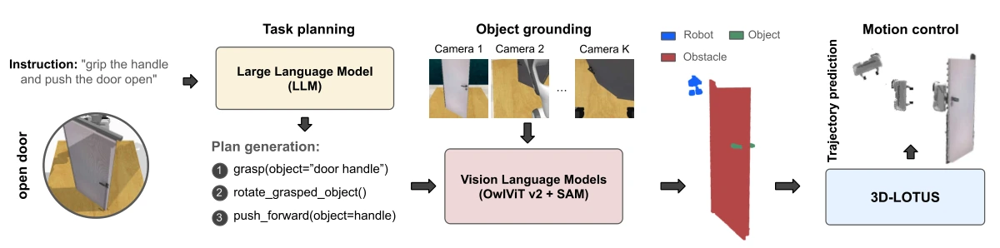

<!-- Generated by scripts/generate.py; edit data/works.json and data/media.json. -->

[← Back to the Awesome index](../../../README.md) · [Interactive website](https://chang-xinhai.github.io/Awesome-RGBDT-Manipulation/?collection=policy&item=gembench-3d-lotus#library)

# 3D-LOTUS / 3D-LOTUS++

Towards Generalizable Vision-Language Robotic Manipulation: A Benchmark and LLM-guided 3D Policy

**2024-10-02 · ICRA 2025 · Inria; École normale supérieure; CNRS; PSL Research University**

**[Paper](https://arxiv.org/abs/2410.01345)** · [Project](https://www.di.ens.fr/willow/research/gembench/) · [Code](https://github.com/vlc-robot/robot-3dlotus) · [Data](https://huggingface.co/datasets/rjgpinel/GEMBench) · [Weights](https://huggingface.co/rjgpinel/3dlotus)

A calibrated 3D point-transformer policy is combined with language planning and open-vocabulary object grounding for task generalization.

*GemBench / 3D-LOTUS++ authors · [Figure source](https://arxiv.org/html/2410.01345) · Original rights retained.*

| Field | Reported value and source scope |
| :-- | :-- |
| Record type | policy |
| Policy family | Planning / hybrid [1](https://arxiv.org/abs/2410.01345)  |
| Base model and architecture | 3D-LOTUS: language-conditioned Point Transformer v3; ++ adds LLM planning, OWLv2/SAM object grounding and trajectory prediction. [1](https://arxiv.org/abs/2410.01345)  |
| Model size and component | Not reported in the inspected primary-source sections [1](https://arxiv.org/abs/2410.01345)  |
| Deployment inputs | Calibrated four-view RGB-D, language and robot proprioception. [1](https://arxiv.org/abs/2410.01345)  |
| Action outputs and horizon | Gripper pose/rotation/open-state keyframes; ++ composes primitive trajectories. [1](https://arxiv.org/abs/2410.01345)  |
| Training method | Behavior cloning; frozen foundation models provide decomposition and grounding. [1](https://arxiv.org/abs/2410.01345)  |
| Training data | GemBench: 3,100 training demonstrations across 31 task variations; separate validation episodes. [1](https://arxiv.org/abs/2410.01345)  |
| Training duration | Paper: 150K iterations, about 11 hours on one A100. Current release README estimates approximately 14 hours for policy training; these are different source scopes. [1](https://arxiv.org/abs/2410.01345)  |
| Training hardware | Single NVIDIA A100 for GemBench training [1](https://arxiv.org/abs/2410.01345)  |
| Inference and control rates | Not reported in the inspected primary-source sections [1](https://arxiv.org/abs/2410.01345)  |
| Evaluation scope | RLBench 18-task and four GemBench generalization levels. [1](https://arxiv.org/abs/2410.01345)  |
| Observations / modalities | RGB · Depth · Point cloud · Proprioception |
| Evaluation domain | Simulation |
| Embodiment | Parallel-jaw gripper |
| Release: code | Available [2](https://www.di.ens.fr/willow/research/gembench/) [4](https://github.com/vlc-robot/robot-3dlotus) [5](https://github.com/vlc-robot/robot-3dlotus/tree/main)  |
| Release: weights | Available [2](https://www.di.ens.fr/willow/research/gembench/) [4](https://github.com/vlc-robot/robot-3dlotus) [12](https://huggingface.co/rjgpinel/3dlotus/tree/main)  |
| Release: data | Available [2](https://www.di.ens.fr/willow/research/gembench/) [4](https://github.com/vlc-robot/robot-3dlotus) [6](https://huggingface.co/datasets/rjgpinel/GEMBench)  |
| Release: license | Not verified [2](https://www.di.ens.fr/willow/research/gembench/) [4](https://github.com/vlc-robot/robot-3dlotus)  |
| Release: notes | Official source code, GemBench dataset, 3D-LOTUS and 3D-LOTUS++ checkpoints are public. Actual Hugging Face inventories contain model checkpoints and training/test dataset files. Repository-wide license not verified; upstream components retain their terms. [2](https://www.di.ens.fr/willow/research/gembench/) [4](https://github.com/vlc-robot/robot-3dlotus)  |

**Scope and qualifications**

- LLM/VLM grounding modules and motion-policy training have separate costs.
- Author-reported task counts and per-level counts overlap; task variations are the evaluation units.

**Primary evidence**

1. [Original manuscript and first submission history](https://arxiv.org/abs/2410.01345) — Full author HTML method/evaluation/appendix inspected; depth observations, pseudo-labels and generated outputs retain distinct roles.
2. [Official author project](https://www.di.ens.fr/willow/research/gembench/) — Public author-linked project; figure and downstream scope verified separately.
3. [Original GemBench protocol, SectionIII / V-A and AppendixVI-A TableVIII](https://arxiv.org/html/2410.01345) — Author-reported totals retained; per-level task counts overlap. No new independent task count inferred from names.
4. [Official current implementation linked by author project](https://github.com/vlc-robot/robot-3dlotus) — Actual runnable release and model artifacts checked independently.
5. [Actual repository content inventory](https://github.com/vlc-robot/robot-3dlotus/tree/main) — 139 tracked paths inspected; code release is distinguished from a README/project/figure-only repository.
6. [Official data release destination](https://huggingface.co/datasets/rjgpinel/GEMBench) — Destination linked by the official project/repository; component release scope is retained in release notes.
7. [Released simulator installation recipe](https://github.com/vlc-robot/robot-3dlotus/blob/main/INSTALL.md) — CoppeliaSim 4.1.0 is a current release installation example, not a version claim from the manuscript.
8. [Official train task-variation registry](https://github.com/vlc-robot/robot-3dlotus/blob/main/assets/taskvars_train.json) — The four registries contain 92 variations over 44 unique task function IDs; level task counts overlap.
9. [Official test_l2 task-variation registry](https://github.com/vlc-robot/robot-3dlotus/blob/main/assets/taskvars_test_l2.json) — The four registries contain 92 variations over 44 unique task function IDs; level task counts overlap.
10. [Official test_l3 task-variation registry](https://github.com/vlc-robot/robot-3dlotus/blob/main/assets/taskvars_test_l3.json) — The four registries contain 92 variations over 44 unique task function IDs; level task counts overlap.
11. [Official test_l4 task-variation registry](https://github.com/vlc-robot/robot-3dlotus/blob/main/assets/taskvars_test_l4.json) — The four registries contain 92 variations over 44 unique task function IDs; level task counts overlap.
12. [Actual 3D-LOTUS checkpoint inventory](https://huggingface.co/rjgpinel/3dlotus/tree/main) — Contains GemBench model_step_150000.pt and RLBench model_step_300000.pt checkpoint files.
13. [Actual 3D-LOTUS++ checkpoint inventory](https://huggingface.co/rjgpinel/3dlotusplus/tree/main) — Contains GemBench model_step_140000.pt and RealRobot model_step_50000.pt checkpoint files.
14. [Actual GemBench dataset inventory](https://huggingface.co/datasets/rjgpinel/GEMBench/tree/main) — Contains released LMDB training episodes and the test microsteps archive.
