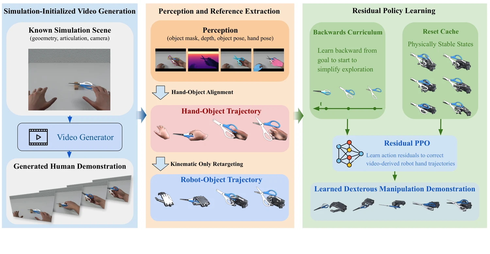

<!-- Generated by scripts/generate.py; edit data/works.json and data/media.json. -->

[← Back to the Awesome index](../../../README.md) · [Interactive website](https://chang-xinhai.github.io/Awesome-RGBDT-Manipulation/?collection=policy&item=gen2dex#library)

# Gen2Dex

Gen2Dex: Learning Dexterous Manipulation from Simulation-Initialized Generated Video Demonstrations

**2026-10-17 · Preprint · University of Massachusetts Amherst**

**[Paper](https://arxiv.org/abs/2610.24392)**

Known simulated scene geometry anchors generated-video hand/object recovery, followed by residual RL that repairs retargeted dexterous trajectories.

*Gen2Dex authors; original rights retained · [Figure source](https://arxiv.org/abs/2610.24392) · Original rights retained.*

| Field | Reported value and source scope |
| :-- | :-- |
| Record type | policy |
| Policy family | Reinforcement learning [1](https://arxiv.org/html/2610.24392)  |
| Base model and architecture | Foundation-feature object tracker, hand-object alignment/retargeting and residual PPO with reset-state cache. [1](https://arxiv.org/html/2610.24392)  |
| Model size and component | Not reported [1](https://arxiv.org/html/2610.24392)  |
| Deployment inputs | Generated/reference video and known scene for recovery; reference motion and robot/simulator state for residual control. [1](https://arxiv.org/html/2610.24392)  |
| Action outputs and horizon | Physically grounded dexterous robot demonstrations/optimized hand-arm trajectories. [1](https://arxiv.org/html/2610.24392)  |
| Training method | Backward-curriculum residual PPO repairs retargeted references while preserving the video strategy; cache physically valid reset states. [1](https://arxiv.org/html/2610.24392)  |
| Training data | Simulation-initialized generated videos and clean ARCTIC references. [1](https://arxiv.org/html/2610.24392)  |
| Training duration | Not reported [1](https://arxiv.org/html/2610.24392)  |
| Training hardware | Not reported [1](https://arxiv.org/html/2610.24392)  |
| Inference and control rates | Not reported [1](https://arxiv.org/html/2610.24392)  |
| Evaluation scope | Genesis with Shadow/Wuji/Sharpa in separate settings; rigid/articulated tasks and open-loop Wuji+xArm physical transfer. [1](https://arxiv.org/html/2610.24392)  |
| Observations / modalities | RGB · Proprioception |
| Evaluation domain | Simulation · Real world |
| Embodiment | Dexterous hand |
| Release: code | Not verified |
| Release: weights | Not verified |
| Release: data | Not verified |
| Release: license | Not verified |
| Release: notes | The inspected primary sources do not establish a public implementation, model checkpoint or dataset download. Paper figures retain their original rights. |

**Scope and qualifications**

- Known scene geometry, articulation, camera parameters and generated/estimated depth support reference extraction; this is not measured RGB-D deployment.
- Physical Wuji+xArm demonstrations execute optimized trajectories open loop. Simulation residual control does not establish a feedback-driven real robot policy.
- Generated video is not automatically a physically valid demonstration.

**Primary evidence**

1. [Original full paper, methods and evaluation](https://arxiv.org/html/2610.24392) — Publication date is arXiv v1; implementation and deployment observations are distinguished from training supervision, generated geometry and base-model identity.
