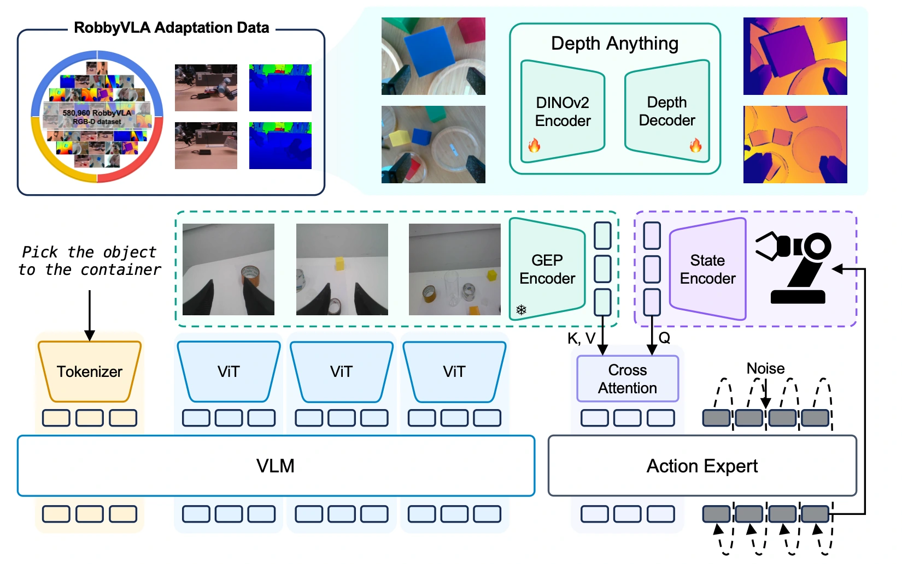

<!-- Generated by scripts/generate.py; edit data/works.json and data/media.json. -->

[← Back to the Awesome index](../../../README.md) · [Interactive website](https://chang-xinhai.github.io/Awesome-RGBDT-Manipulation/?collection=policy&item=geoalign#library)

# GeoAlign

GeoAlign: Beyond Semantics with State-Guided Spatial Alignment in VLA Models

**2026-06-02 · arXiv preprint · Tongji University; Shanghai Innovation Institute; Shanghai Jiao Tong University; collaborating universities and HONOR**

**[Paper](https://arxiv.org/abs/2606.03240)** · [Project](https://chenyizhi123.github.io/geoalign-project/)

State-conditioned queries select RGB-derived geometry tokens for action generation after robot-domain depth-supervised pretraining.

*GeoAlign authors · [Figure source](https://arxiv.org/html/2606.03240) · Original rights retained.*

| Field | Reported value and source scope |
| :-- | :-- |
| Record type | policy |
| Policy family | VLA [1](https://arxiv.org/abs/2606.03240)  |
| Base model and architecture | GR00T N1.6-3B / Eagle-Block2A-2B; frozen DA-V2-S geometry encoder and state-query cross-attention. [1](https://arxiv.org/abs/2606.03240)  |
| Model size and component | GR00T 3B backbone; geometry encoder 24.8M [1](https://arxiv.org/abs/2606.03240)  |
| Deployment inputs | RGB, language and proprioception; no measured or predicted depth maps at policy rollout. [1](https://arxiv.org/abs/2606.03240)  |
| Action outputs and horizon | Flow-matching action chunks. [1](https://arxiv.org/abs/2606.03240)  |
| Training method | Metric-depth post-training followed by policy learning; depth head discarded. [1](https://arxiv.org/abs/2606.03240)  |
| Training data | 580,960 RobbyVLA RGB-D frames for geometry training; separate target robot demonstrations. [1](https://arxiv.org/abs/2606.03240)  |
| Training duration | Not reported in the inspected primary-source sections [1](https://arxiv.org/abs/2606.03240)  |
| Training hardware | Not reported in the inspected primary-source sections [1](https://arxiv.org/abs/2606.03240)  |
| Inference and control rates | Not reported in the inspected primary-source sections [1](https://arxiv.org/abs/2606.03240)  |
| Evaluation scope | LIBERO, three SimplerEnv-Fractal task families and eight real ALOHA tasks. [1](https://arxiv.org/abs/2606.03240)  |
| Observations / modalities | RGB · Language · Proprioception |
| Evaluation domain | Simulation · Real world |
| Embodiment | Parallel-jaw gripper |
| Release: code | Not released [2](https://chenyizhi123.github.io/geoalign-project/)  |
| Release: weights | Not verified [2](https://chenyizhi123.github.io/geoalign-project/)  |
| Release: data | Not verified [2](https://chenyizhi123.github.io/geoalign-project/)  |
| Release: license | Not verified [2](https://chenyizhi123.github.io/geoalign-project/)  |
| Release: notes | Official project labels code coming soon; upstream GR00T/DA-V2 artifacts do not constitute GeoAlign checkpoints. [2](https://chenyizhi123.github.io/geoalign-project/)  |

**Scope and qualifications**

- Depth is offline supervision; deployment geometry features are inferred from RGB.
- Additional RGB-D pretraining data differs from RGB-only baselines.

**Primary evidence**

1. [Original manuscript and first submission history](https://arxiv.org/abs/2606.03240) — Full author HTML method/evaluation/appendix inspected; depth observations, pseudo-labels and generated outputs retain distinct roles.
2. [Official author project](https://chenyizhi123.github.io/geoalign-project/) — Public author-linked project; figure and downstream scope verified separately.
