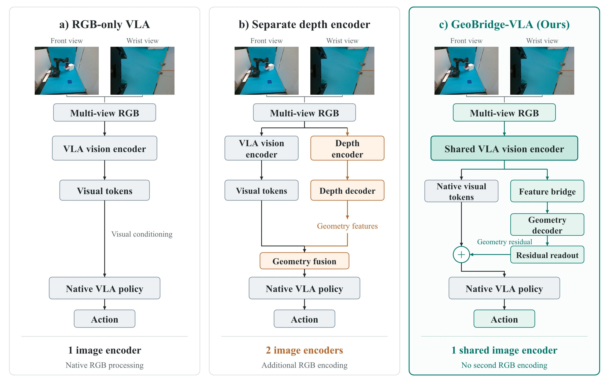

<!-- Generated by scripts/generate.py; edit data/works.json and data/media.json. -->

[← Back to the Awesome index](../../../README.md) · [Interactive website](https://chang-xinhai.github.io/Awesome-RGBDT-Manipulation/?collection=policy&item=geobridge-vla#library)

# GeoBridge-VLA

GeoBridge-VLA: Geometry-Aware Residual Adaptation for Vision-Language-Action Models

**2026-10-04 · arXiv preprint · Gachon University, School of Computing / iRASC Lab**

**[Paper](https://arxiv.org/abs/2610.05026)**

A depth-trained bridge adds geometric residuals to frozen VLA visual tokens without a second image encoder at deployment.

*GeoBridge-VLA authors · [Figure source](https://arxiv.org/html/2610.05026) · Original rights retained.*

| Field | Reported value and source scope |
| :-- | :-- |
| Record type | policy |
| Policy family | VLA [1](https://arxiv.org/abs/2610.05026)  |
| Base model and architecture | SmolVLA visual encoder; K4 geometry decoder, feature bridge and gated residual action interface. [1](https://arxiv.org/abs/2610.05026)  |
| Model size and component | Not reported in the inspected primary-source sections [1](https://arxiv.org/abs/2610.05026)  |
| Deployment inputs | RGB, language, robot state; no rollout depth stream. [1](https://arxiv.org/abs/2610.05026)  |
| Action outputs and horizon | Continuous action chunks. [1](https://arxiv.org/abs/2610.05026)  |
| Training method | Depth adaptation followed by frozen geometry modules and action-side residual training. [1](https://arxiv.org/abs/2610.05026)  |
| Training data | Stage-specific depth supervision and LIBERO / OMY manipulation demonstrations. [1](https://arxiv.org/abs/2610.05026)  |
| Training duration | Not reported in the inspected primary-source sections [1](https://arxiv.org/abs/2610.05026)  |
| Training hardware | Not reported in the inspected primary-source sections [1](https://arxiv.org/abs/2610.05026)  |
| Inference and control rates | Not reported in the inspected primary-source sections [1](https://arxiv.org/abs/2610.05026)  |
| Evaluation scope | Matched LIBERO suites and four physical ROBOTIS OMY tasks; 200 real trials. [1](https://arxiv.org/abs/2610.05026)  |
| Observations / modalities | RGB · Language · Proprioception |
| Evaluation domain | Simulation · Real world |
| Embodiment | Parallel-jaw gripper |
| Release: code | Not verified |
| Release: weights | Not verified |
| Release: data | Not verified |
| Release: license | Not verified |
| Release: notes | Code, data and weights are checked independently; an upstream pretrained model is not a released task policy. |

**Scope and qualifications**

- Geometric conditioning is learned from depth supervision, not measured at deployment.
- Disabling the residual within the same trained checkpoint gives a much smaller effect than the between-model headline comparison.

**Primary evidence**

1. [Original manuscript and first submission history](https://arxiv.org/abs/2610.05026) — Full author HTML method/evaluation/appendix inspected; depth observations, pseudo-labels and generated outputs retain distinct roles.
