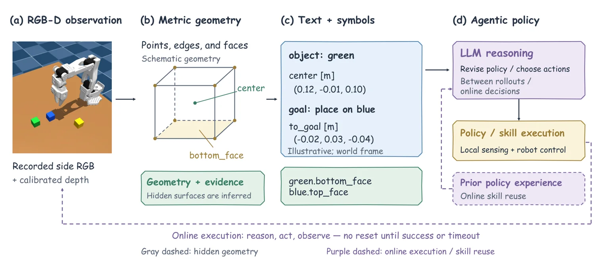

<!-- Generated by scripts/generate.py; edit data/works.json and data/media.json. -->

[← Back to the Awesome index](../../../README.md) · [Interactive website](https://chang-xinhai.github.io/Awesome-RGBDT-Manipulation/?collection=policy&item=geometric-abstraction-agent#library)

# Geometric Abstraction

Do Agentic Policies Need to Look at Every Step? Geometric Abstraction for Reasoning and Action

**2026-11-03 · Preprint · Independent Researcher; Georgia Institute of Technology; HKUST**

**[Paper](https://arxiv.org/abs/2611.05058)** · [Project](https://geometric-abstraction.github.io/) · [Code](https://github.com/Spectraorder/geometric-abstraction)

An agent uses calibrated RGB-D and geometric scene abstractions for spatial reasoning and manipulation.

*Geometric Abstraction authors · [Figure source](https://arxiv.org/abs/2611.05058) · Original rights retained.*

| Field | Reported value and source scope |
| :-- | :-- |
| Record type | policy |
| Policy family | Robot agent [1](https://arxiv.org/html/2611.05058v1)  |
| Base model and architecture | Multimodal language model with geometric tools [1](https://arxiv.org/html/2611.05058v1)  |
| Model size and component | Not reported [1](https://arxiv.org/html/2611.05058v1)  |
| Deployment inputs | Side and wrist RGB-D observations, task instructions and geometric references [1](https://arxiv.org/html/2611.05058v1)  |
| Action outputs and horizon | Grounded manipulation actions [1](https://arxiv.org/html/2611.05058v1)  |
| Training method | Geometric abstraction provides a symbolic interface for agent reasoning. [1](https://arxiv.org/html/2611.05058v1)  |
| Training data | See original paper for dataset and protocol. [1](https://arxiv.org/html/2611.05058v1)  |
| Training duration | Not reported [1](https://arxiv.org/html/2611.05058v1)  |
| Training hardware | Not reported [1](https://arxiv.org/html/2611.05058v1)  |
| Inference and control rates | Not reported [1](https://arxiv.org/html/2611.05058v1)  |
| Evaluation scope | Simulated SO-100 manipulation experiments. [1](https://arxiv.org/html/2611.05058v1)  |
| Observations / modalities | RGB · Depth · Language |
| Evaluation domain | Simulation |
| Embodiment | Not reported |
| Release: code | Available — official source repository [2](https://github.com/Spectraorder/geometric-abstraction)  |
| Release: weights | Not verified [2](https://github.com/Spectraorder/geometric-abstraction)  |
| Release: data | Not verified [2](https://github.com/Spectraorder/geometric-abstraction)  |
| Release: license | MIT [2](https://github.com/Spectraorder/geometric-abstraction)  |
| Release: notes | Release status checked against author artifacts on 2026-11-05. [2](https://github.com/Spectraorder/geometric-abstraction)  |

**Scope and qualifications**

- Evaluation is simulation; geometric abstractions do not establish physical-robot performance.

**Primary evidence**

1. [Original paper: method, inputs and evaluation](https://arxiv.org/html/2611.05058v1) — Results and sensing claims are scoped to the authors’ evaluation and deployment setting.
2. [Official repository, source files and license](https://github.com/Spectraorder/geometric-abstraction)
