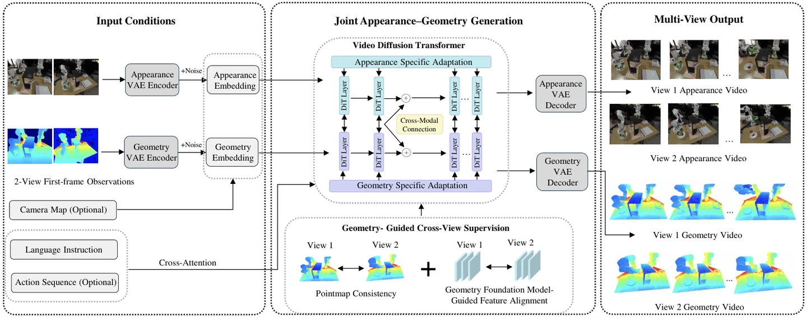

<!-- Generated by scripts/generate.py; edit data/works.json and data/media.json. -->

[← Back to the Awesome index](../../../README.md) · [Interactive website](https://chang-xinhai.github.io/Awesome-RGBDT-Manipulation/?collection=policy&item=geomvgen#library)

# GeoMVGen

GeoMVGen: Joint Appearance-Geometry Modeling for Multi-View Video Generation in Robotic Manipulation

**2026-11-23 · Preprint · Huawei Noah’s Ark Lab; University of Waterloo**

**[Paper](https://arxiv.org/abs/2611.31689)**

Jointly generates multi-view RGB and scene pointmap futures for robotic manipulation video.

*Qiaoqiao Jia and coauthors · [Figure source](https://arxiv.org/html/2611.31689v1) · Original rights retained.*

| Field | Reported value and source scope |
| :-- | :-- |
| Record type | model |
| Model role and downstream interface | Multi-view appearance and geometry world model [1](https://arxiv.org/html/2611.31689v1)  |
| Model family | GeoMVGen [1](https://arxiv.org/html/2611.31689v1)  |
| Model architecture | Shared video diffusion transformer with modality-specific RGB/pointmap streams. [1](https://arxiv.org/html/2611.31689v1)  |
| Model size and component | Not reported [1](https://arxiv.org/html/2611.31689v1)  |
| Model inputs | Initial multi-view RGB and aligned pointmaps, text, optional temporally aligned actions and optional target camera parameters. [1](https://arxiv.org/html/2611.31689v1)  |
| Model outputs | Synchronized future RGB clips and world-aligned pointmaps; action sequences are optional conditions. [1](https://arxiv.org/html/2611.31689v1)  |
| Training method | Cross-modal residual exchange, pointmap consistency supervision and query-based cross-view alignment. [1](https://arxiv.org/html/2611.31689v1)  |
| Training data and scale | Paper states separate synthetic and real-world robotic manipulation clips, with missing/estimated geometries handled by the dataset pipeline. [1](https://arxiv.org/html/2611.31689v1)  |
| Training duration | Not reported [1](https://arxiv.org/html/2611.31689v1)  |
| Training hardware | Not reported [1](https://arxiv.org/html/2611.31689v1)  |
| Inference setting and runtime | Not reported [1](https://arxiv.org/html/2611.31689v1)  |
| Downstream evaluation and scope | Compared on video quality, geometric accuracy and cross-view consistency. [1](https://arxiv.org/html/2611.31689v1)  |
| Observations / modalities | RGB · Point cloud · Language |
| Evaluation domain | Simulation · Real world |
| Embodiment | Parallel-jaw gripper |
| Release: code | Not verified |
| Release: weights | Not verified |
| Release: data | Not verified |
| Release: license | Not verified |
| Release: notes | Paper or official project reviewed. Code, weights and data are tracked independently. |

**Scope and qualifications**

- Pointmaps may arise from simulated or processed geometry. The model predicts image and geometry sequences rather than controlling the robot.

**Primary evidence**

1. [Original paper and evaluation settings](https://arxiv.org/html/2611.31689v1)
