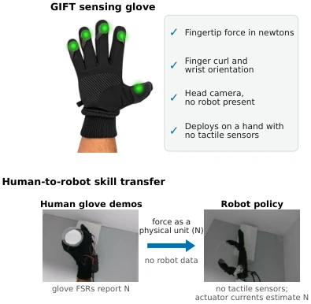

<!-- Generated by scripts/generate.py; edit data/works.json and data/media.json. -->

[← Back to the Awesome index](../../../README.md) · [Interactive website](https://chang-xinhai.github.io/Awesome-RGBDT-Manipulation/?collection=policy&item=gift-force-transfer#library)

# GIFT

GIFT: Glove-Inferred Force Transfer: Force-Aware Human-to-Robot Skill Transfer from a Wearable Sensing Glove to a Robot Hand Without Tactile Sensors

**2026-09-12 · Preprint · Independent author; institutional affiliation Not reported**

**[Paper](https://arxiv.org/abs/2609.14173)** · [Project](https://tzahsarusi.github.io)

Calibrated human glove force and motor-current-derived robot force provide a common physical interface for skill transfer.

*GIFT: Glove-Inferred Force Transfer: Force-Aware Human-to-Robot Skill Transfer from a Wearable Sensing Glove to a Robot Hand Without Tactile Sensors authors · [Figure source](https://arxiv.org/abs/2609.14173) · Original rights retained.*

| Field | Reported value and source scope |
| :-- | :-- |
| Record type | policy |
| Policy family | ACT [1](https://arxiv.org/abs/2609.14173)  |
| Base model and architecture | ACT/LeRobot with 13 Dglove-state conditioning andforce-aware hand actions. [1](https://arxiv.org/abs/2609.14173)  |
| Model size and component | Not reported [1](https://arxiv.org/abs/2609.14173)  |
| Deployment inputs | Egocentric RGB, finger flexion, wrist orientation and five fingertip force estimates; robot forces derive from actuator current residuals. [1](https://arxiv.org/abs/2609.14173)  |
| Action outputs and horizon | Five hand joint targets; arm follows a preprogrammed wrist trajectory. [1](https://arxiv.org/abs/2609.14173)  |
| Training method | Behavior cloning with calibrated newton-scale force interface and deployment current baseline. [1](https://arxiv.org/abs/2609.14173)  |
| Training data | Human-only glove demonstrations; same corpus and 20 k training steps for with/without force ladder. [1](https://arxiv.org/abs/2609.14173)  |
| Training duration | 20,000 steps; wall-clock Not reported. [1](https://arxiv.org/abs/2609.14173)  |
| Training hardware | Not reported [1](https://arxiv.org/abs/2609.14173)  |
| Inference and control rates | Not reported [1](https://arxiv.org/abs/2609.14173)  |
| Evaluation scope | Aero Hand onSO101:grasp/lift cup under force-aware control. [1](https://arxiv.org/abs/2609.14173)  |
| Observations / modalities | RGB · Force/Torque · Proprioception |
| Evaluation domain | Real world |
| Embodiment | Dexterous hand |
| Release: code | Not verified [2](https://tzahsarusi.github.io)  |
| Release: weights | Not verified [2](https://tzahsarusi.github.io)  |
| Release: data | Not verified [2](https://tzahsarusi.github.io)  |
| Release: license | Not verified [2](https://tzahsarusi.github.io)  |
| Release: notes | Original paper reviewed; claimed future releases are not treated as currently available. [2](https://tzahsarusi.github.io)  |

**Scope and qualifications**

- Robot has no tactile sensors; runtime contact force is estimated from motor currents, not directly measured glove pressure.
- Policy control shand only; programmed arm lift should not be claimed as learned full-arm policy.

**Primary evidence**

1. [Original paper and supplementary implementation details](https://arxiv.org/abs/2609.14173) — Primary full text reviewed; dataset, deployment modalities and training-only privileges are scoped separately.
2. [Official author project](https://tzahsarusi.github.io) — Live project artifact links inspected on2026-10-17.
