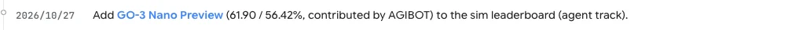

<!-- Generated by scripts/generate.py; edit data/works.json and data/media.json. -->

[← Back to the Awesome index](../../../README.md) · [Interactive website](https://chang-xinhai.github.io/Awesome-RGBDT-Manipulation/?collection=policy&item=go3-nano-preview#library)

# GO-3 Nano Preview

GO-3 Nano Preview

**2026-10-27 · Leaderboard / preview · AGIBOT**

**[Project](https://robodojo-benchmark.com/leaderboard?bench=sim)**

Preview system entered on RoboDojo’s agent-and-world-action-model simulation track.

*RoboDojo benchmark team · [Figure source](https://robodojo-benchmark.com/) · Original rights retained.*

| Field | Reported value and source scope |
| :-- | :-- |
| Record type | policy |
| Policy family | Robot agent |
| Base model and architecture | Not reported |
| Model size and component | Not reported |
| Deployment inputs | Not verified |
| Action outputs and horizon | Not verified |
| Training method | Not verified |
| Training data | Not reported |
| Training duration | Not reported |
| Training hardware | Not reported |
| Inference and control rates | Not reported |
| Evaluation scope | Official RoboDojo simulation snapshot 30 October 2026: score 61.90; success 56.42%. [2](https://robodojo-benchmark.com/data/leaderboard.generated.json)  |
| Observations / modalities |  |
| Evaluation domain | Simulation |
| Embodiment |  |
| Release: code | Not verified |
| Release: weights | Not verified |
| Release: data | Not verified |
| Release: license | Not verified |
| Release: notes | A scored leaderboard row does not establish a public implementation or checkpoint. |

**Scope and qualifications**

- This is the Nano Preview submission, not a score for GO-3 Preview.
- Detailed architecture, training and accessible artifacts have not been verified; do not infer deployment inputs from a benchmark track.

**Primary evidence**

1. [Official RoboDojo announcement](https://robodojo-benchmark.com/) — Oct 27 announcement dates the public leaderboard entry, not a technical paper.
2. [Official RoboDojo simulation results](https://robodojo-benchmark.com/data/leaderboard.generated.json) — The official app labels this entry Agent + WAM.
