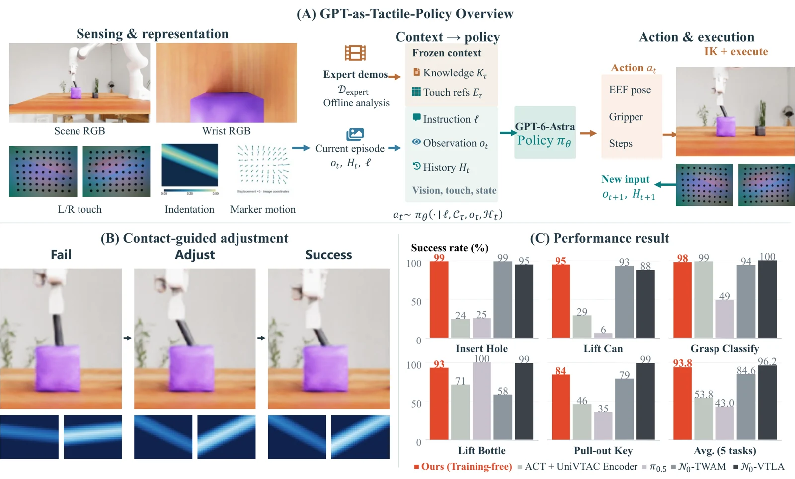

<!-- Generated by scripts/generate.py; edit data/works.json and data/media.json. -->

[← Back to the Awesome index](../../../README.md) · [Interactive website](https://chang-xinhai.github.io/Awesome-RGBDT-Manipulation/?collection=policy&item=gpt-as-tactile-policy#library)

# GPT-as-Tactile-Policy

GPT-6-Astra Understands Touch and Outperform Vision--Tactile--Language--Action Models

**2026-10-20 · Preprint · Sun Yat-sen University**

**[Paper](https://arxiv.org/abs/2610.28457)** · [Project](https://gpt-as-tactile-policy.github.io/)

A frozen multimodal model uses demonstration-derived task knowledge, tactile references and interaction history to choose contact-responsive actions.

*GPT-as-Tactile-Policy authors · [Figure source](https://arxiv.org/abs/2610.28457) · Original rights retained.*

| Field | Reported value and source scope |
| :-- | :-- |
| Record type | policy |
| Policy family | Robot agent [1](https://arxiv.org/abs/2610.28457)  |
| Base model and architecture | Frozen GPT-6-Astra as sole action-decision model. [1](https://arxiv.org/abs/2610.28457)  |
| Model size and component | Not reported [1](https://arxiv.org/abs/2610.28457)  |
| Deployment inputs | Scene/wrist RGB, proprioception and bilateral fingertip tactile observations; fixed task skill and tactile reference context. [1](https://arxiv.org/abs/2610.28457)  |
| Action outputs and horizon | Numerical end-effector/gripper targets with a short execution horizon through generic IK control. [1](https://arxiv.org/abs/2610.28457)  |
| Training method | Summarize demonstrations offline into fixed task context; online feedback revises action decisions without robot-specific pretraining or task fine-tuning. [1](https://arxiv.org/abs/2610.28457)  |
| Training data | 50 expert demonstrations/task split 40 context-construction /10 offline-validation; test episodes separate. [1](https://arxiv.org/abs/2610.28457)  |
| Training duration | Not reported [1](https://arxiv.org/abs/2610.28457)  |
| Training hardware | Not reported [1](https://arxiv.org/abs/2610.28457)  |
| Inference and control rates | Not reported [1](https://arxiv.org/abs/2610.28457)  |
| Evaluation scope | Five UniVTAC simulation tasks, 100 fixedepisodes/task: 93.8% task mean; paired InsertHole tactile ablation 31% to 99%. [1](https://arxiv.org/abs/2610.28457)  |
| Observations / modalities | RGB · Tactile · Proprioception · Language |
| Evaluation domain | Simulation |
| Embodiment | Parallel-jaw gripper |
| Release: code | Not released [2](https://gpt-as-tactile-policy.github.io/)  |
| Release: weights | Not verified [2](https://gpt-as-tactile-policy.github.io/)  |
| Release: data | Not verified [2](https://gpt-as-tactile-policy.github.io/)  |
| Release: license | Not verified [2](https://gpt-as-tactile-policy.github.io/)  |
| Release: notes | Official project marks code coming soon. No author method weights or full context/data corpus is released. [2](https://gpt-as-tactile-policy.github.io/)  |

**Scope and qualifications**

- Distinct from TacTalent: five UniVTAC tasks rather than TacTalent’s eight+eleven task suites.
- Simulation tactile observations do not establish a physical-robot release or real tactile success.
- Tactile ablation also changes corresponding fixed task guidance.

**Primary evidence**

1. [Primary manuscript and first-submission history](https://arxiv.org/abs/2610.28457) — Current primary manuscript reviewed; first-public date uses arXiv v1. Observations, training privileges and deployed interfaces retain their separate scopes.
2. [Official project source and actual artifact inventory](https://gpt-as-tactile-policy.github.io/) — Reviewed 26 October 2026. Availability and licensing apply only to the described released component, independently of paper results.
