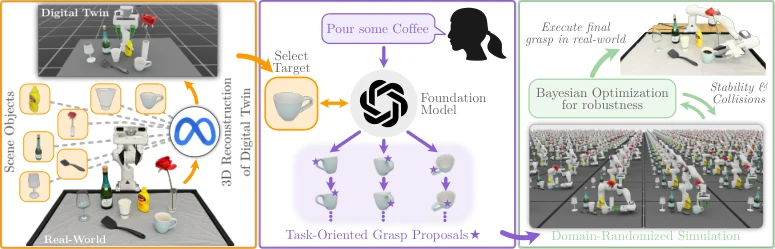

<!-- Generated by scripts/generate.py; edit data/works.json and data/media.json. -->

[← Back to the Awesome index](../../../README.md) · [Interactive website](https://chang-xinhai.github.io/Awesome-RGBDT-Manipulation/?collection=policy&item=grasptwin#library)

# GraspTwin

GraspTwin: Zero-Shot Task-Oriented Grasp Optimization via a Digital Twin

**2026-09-24 · Preprint · Virginia Tech**

**[Paper](https://arxiv.org/abs/2609.30543)** · [Code](https://github.com/VT-Collab/GraspTwin) · [Data](https://huggingface.co/datasets/devans-tech/GraspTwin)

A VLM seeds semantic grasp candidates in a reconstructed digital twin, then Thompson-sampling optimization tests physical robustness before robot execution.

*GraspTwin authors; original rights retained · [Figure source](https://arxiv.org/abs/2609.30543) · Original rights retained.*

| Field | Reported value and source scope |
| :-- | :-- |
| Record type | model |
| Model role and downstream interface | Task-oriented grasp proposal/refinement pipeline, with separately scoped physical execution. [1](https://arxiv.org/html/2609.30543)  |
| Model family | Grasp synthesis [1](https://arxiv.org/html/2609.30543)  |
| Model architecture | SAM3D digital twin, Gemini Robotics ER semantic seed, Thompson-sampling/Bayesian pose optimizer and cuRobo motion planning. [1](https://arxiv.org/html/2609.30543)  |
| Model size and component | Not reported [1](https://arxiv.org/html/2609.30543)  |
| Model inputs | One RGB-D observation, task instruction, camera calibration and robot/gripper state. [1](https://arxiv.org/html/2609.30543)  |
| Model outputs | Robust 6-DoF grasp candidates and planned execution trajectories. [1](https://arxiv.org/html/2609.30543)  |
| Training method | Zero-shot semantic proposals followed by physics simulation/domain-randomized optimization; no method-specific robot-model fine-tuning or in-context demonstrations. [1](https://arxiv.org/html/2609.30543)  |
| Training data and scale | Released digital-twin scene JSON andGLB meshes; these are not policy-training trajectories. [1](https://arxiv.org/html/2609.30543)  |
| Training duration | Not reported [1](https://arxiv.org/html/2609.30543)  |
| Training hardware | Two L40S in reported setup. [1](https://arxiv.org/html/2609.30543)  |
| Inference setting and runtime | Isaac Sim 4.5.0/Python 3.10 reference implementation; separate hardware servers are required. [1](https://arxiv.org/html/2609.30543)  |
| Downstream evaluation and scope | 30standardized simulated tasks and a separate physical subset on Franka Emika Panda (7 DoF)+UMI parallel gripper. [1](https://arxiv.org/html/2609.30543)  |
| Observations / modalities | RGB · Depth · Proprioception · Language |
| Evaluation domain | Simulation · Real world |
| Embodiment | Parallel-jaw gripper |
| Release: code | Partial — client, perception/IK/simulation/optimization stack [2](https://github.com/VT-Collab/GraspTwin)  |
| Release: weights | Not applicable — external pretrained perception/VLM components [2](https://github.com/VT-Collab/GraspTwin)  |
| Release: data | Available — digital-twin scenes; not robot training trajectories [2](https://github.com/VT-Collab/GraspTwin)  |
| Release: license | MIT original code and published scene dataset card; external SAM3D, simulator, perception models and object assets retain separate terms. [2](https://github.com/VT-Collab/GraspTwin)  |
| Release: notes | Actual simulation, perception, IK and optimization modules are public. The hardware RGB-D camera server and robot-PC trajectory-replay server are excluded; only their client message contracts are supplied. [2](https://github.com/VT-Collab/GraspTwin)  |

**Scope and qualifications**

- Grasp generation and physics-based optimization are not a recursive self-improvement agent or long-horizon closed-loop VLA.
- The standardized simulation benchmark has 30 tasks; the real deployment is a separately selected subset, not all 30 real tasks.
- The reported 33 percentage-point physical gain is an absolute difference, not 33% relative improvement.
- SAM3D reconstruction is grounded by actual RGB-D; generated geometry is not an additional measured sensor stream.

**Primary evidence**

1. [Original full paper, methods and evaluation](https://arxiv.org/html/2609.30543) — Publication date is arXiv v1; implementation and deployment observations are distinguished from training supervision, generated geometry and base-model identity.
2. [Official artifact: actual source files, inventory and license](https://github.com/VT-Collab/GraspTwin) — 40 actual files include semantic_grasp camera/robot/IK modules and servers; actual root MIT LICENSE. HF scene JSON/GLB inventory is public/ungated with an MIT card.
