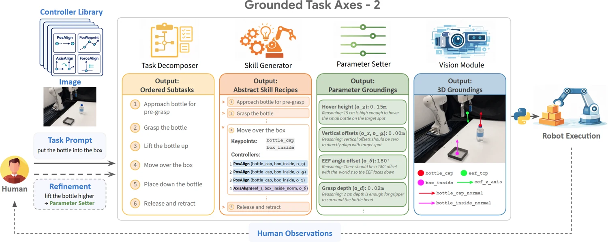

<!-- Generated by scripts/generate.py; edit data/works.json and data/media.json. -->

[← Back to the Awesome index](../../../README.md) · [Interactive website](https://chang-xinhai.github.io/Awesome-RGBDT-Manipulation/?collection=policy&item=gta2#library)

# GTA-2

GTA-2: A Multi-VLM Framework for Synthesizing Robot Manipulation Skills via Grounded Task Axes

**2026-09-09 · Preprint · Carnegie Mellon University**

**[Paper](https://arxiv.org/abs/2609.09808)** · [Project](https://gta2-project.github.io/) · [Code](https://github.com/gta2-project/GTA-2)

Four VLM agents turn manipulation instructions into grounded task axes, parameterized skills and executable compositions of robot controllers.

*GTA-2 authors; original rights retained · [Figure source](https://arxiv.org/abs/2609.09808) · Original rights retained.*

| Field | Reported value and source scope |
| :-- | :-- |
| Record type | policy |
| Policy family | Robot agent [1](https://arxiv.org/html/2609.09808)  |
| Base model and architecture | Gemini 3.1 Pro across task-decomposer, skill-generator, parameter-setter and vision agents. [1](https://arxiv.org/html/2609.09808)  |
| Model size and component | Not reported [1](https://arxiv.org/html/2609.09808)  |
| Deployment inputs | Task and current RGB-D; calibrated ZED2i stereo depth lifts semantic keypoints/axes into metric 3D, alongside robot state. [1](https://arxiv.org/html/2609.09808)  |
| Action outputs and horizon | Priority-composed position, orientation, force and gripper controllers with grounded task axes and executable parameters. [1](https://arxiv.org/html/2609.09808)  |
| Training method | Frozen VLM reasoning and controller synthesis; targeted human correction is an additional evaluation setting, not policy fine-tuning. [1](https://arxiv.org/html/2609.09808)  |
| Training data | No target-task robot demonstration or policy-weight training in the zero-shot setting. [1](https://arxiv.org/html/2609.09808)  |
| Training duration | Not reported [1](https://arxiv.org/html/2609.09808)  |
| Training hardware | Not reported [1](https://arxiv.org/html/2609.09808)  |
| Inference and control rates | Not reported [1](https://arxiv.org/html/2609.09808)  |
| Evaluation scope | UR5e with Robotiq2F85 and fixed ZED2i:14 real tasks,73.9% zero-shot mean success;90.7% after targeted One-Success human refinement. [1](https://arxiv.org/html/2609.09808)  |
| Observations / modalities | RGB · Depth · Proprioception · Language |
| Evaluation domain | Real world |
| Embodiment | Parallel-jaw gripper |
| Release: code | Available — reference ROS2 hardware integration [2](https://github.com/gta2-project/GTA-2)  |
| Release: weights | Not applicable — external hosted VLM [2](https://github.com/gta2-project/GTA-2)  |
| Release: data | Not verified [2](https://github.com/gta2-project/GTA-2)  |
| Release: license | PolyForm Noncommercial License 1.0.0 for the repository; external model/tool licenses remain separate. [2](https://github.com/gta2-project/GTA-2)  |
| Release: notes | Actual task-decomposition, skill-generation, parameter-setting and vision agents plus UR5e/Robotiq/ZED integration are public. The image-only tutorial is not a physics simulator; deployment requires model API access and the hardware stack. [2](https://github.com/gta2-project/GTA-2)  |

**Scope and qualifications**

- Four cooperating VLM agents do not imply online model-weight training; the target-task protocol uses no policy fine-tuning or demonstrations.
- Force-controller output commands do not establish measured force/torque or skin-tactile observation input.
- One-Success human refinement and zero-shot evaluation have distinct protocols.

**Primary evidence**

1. [Original full paper, methods and evaluation](https://arxiv.org/html/2609.09808) — Publication date is arXiv v1; implementation and deployment observations are distinguished from training supervision, generated geometry and base-model identity.
2. [Official artifact: actual source files, inventory and license](https://github.com/gta2-project/GTA-2) — 232 actual files including four agent implementations and ROS2 integrations; actual root LICENSE is PolyForm Noncommercial 1.0.0, not MIT/Apache.
