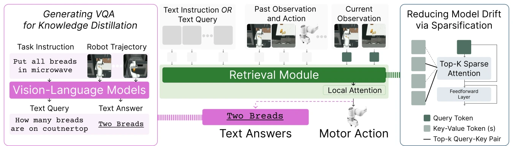

<!-- Generated by scripts/generate.py; edit data/works.json and data/media.json. -->

[← Back to the Awesome index](../../../README.md) · [Interactive website](https://chang-xinhai.github.io/Awesome-RGBDT-Manipulation/?collection=policy&item=halo#library)

# HALO

Memory Retrieval in Visuomotor Policies for Long-Horizon Robot Control

**2026-06-23 · RSS 2026 · The University of Texas at Austin**

**[Paper](https://arxiv.org/abs/2606.25136)** · [Project](https://robin-lab.cs.utexas.edu/HALO) · [Code](https://github.com/UT-Austin-RobIn/HALO) · [Data](https://huggingface.co/datasets/Rutav/ReMemBench-Dataset)

Attention-based memory retrieval learns long-horizon visuomotor control using VLM-derived memory questions and online-policy data.

*HALO authors · [Figure source](https://robin-lab.cs.utexas.edu/HALO) · Original rights retained.*

| Field | Reported value and source scope |
| :-- | :-- |
| Record type | policy |
| Policy family | Transformer policy [1](https://arxiv.org/abs/2606.25136)  |
| Base model and architecture | Frozen CrossMAE-RTX vision encoder, local/top-k attention transformer, MLP 32-action head and auxiliary text-answer decoder. [1](https://arxiv.org/abs/2606.25136)  |
| Model size and component | Not reported [1](https://arxiv.org/abs/2606.25136)  |
| Deployment inputs | RGB observations, proprioception, prior actions and long-horizon retrieved memory. [1](https://arxiv.org/abs/2606.25136)  |
| Action outputs and horizon | 32 future actions; auxiliary memory-question answers regularize learned representations. [1](https://arxiv.org/abs/2606.25136)  |
| Training method | Imitation learning with attention retrieval, distilled VLM memory priors and data augmentation addressing memory drift. [1](https://arxiv.org/abs/2606.25136)  |
| Training data | ReMemBench demonstrations and policy-rollout data; VLM-generated memory QA labels supply auxiliary supervision. [1](https://arxiv.org/abs/2606.25136)  |
| Training duration | Not reported [1](https://arxiv.org/abs/2606.25136)  |
| Training hardware | Not reported [1](https://arxiv.org/abs/2606.25136)  |
| Inference and control rates | Not reported [1](https://arxiv.org/abs/2606.25136)  |
| Evaluation scope | Memory-dependent long-horizon simulation and real-world robot control. [1](https://arxiv.org/abs/2606.25136)  |
| Observations / modalities | RGB · Proprioception |
| Evaluation domain | Simulation · Real world |
| Embodiment | Parallel-jaw gripper |
| Release: code | Available [2](https://robin-lab.cs.utexas.edu/HALO) [3](https://github.com/UT-Austin-RobIn/HALO)  |
| Release: weights | Not verified [2](https://robin-lab.cs.utexas.edu/HALO) [3](https://github.com/UT-Austin-RobIn/HALO)  |
| Release: data | Available [2](https://robin-lab.cs.utexas.edu/HALO) [3](https://github.com/UT-Austin-RobIn/HALO)  |
| Release: license | Not verified [2](https://robin-lab.cs.utexas.edu/HALO) [3](https://github.com/UT-Austin-RobIn/HALO)  |
| Release: notes | Official training/evaluation code and ReMemBench dataset are public; an upstream visual encoder checkpoint is not the final HALO policy checkpoint. [2](https://robin-lab.cs.utexas.edu/HALO) [3](https://github.com/UT-Austin-RobIn/HALO)  |

**Scope and qualifications**

- Memory QA is training supervision; runtime need not query the teacher VLM for every action.

**Primary evidence**

1. [Original paper / author report](https://arxiv.org/abs/2606.25136) — Original full paper and supplementary experimental / implementation details; deployment inputs are separated from supervision and benchmark state.
2. [Official project](https://robin-lab.cs.utexas.edu/HALO) — Author-linked project and current release checked on the catalog cutoff.
3. [Official code / release documentation](https://github.com/UT-Austin-RobIn/HALO) — Current repository documentation; paper settings and subsequently released artifacts are distinguished.
