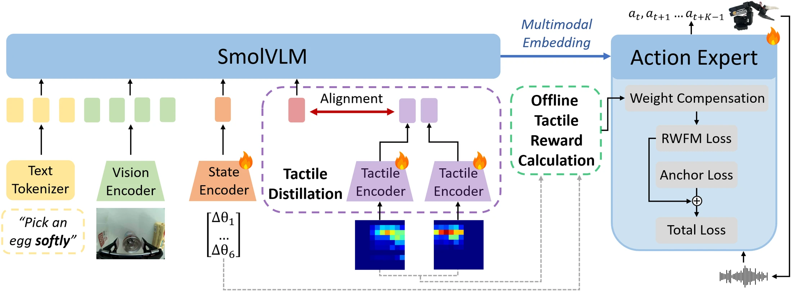

<!-- Generated by scripts/generate.py; edit data/works.json and data/media.json. -->

[← Back to the Awesome index](../../../README.md) · [Interactive website](https://chang-xinhai.github.io/Awesome-RGBDT-Manipulation/?collection=policy&item=hapticvla#library)

# HapticVLA

HapticVLA: Contact-Rich Manipulation via Vision-Language-Action Model without Inference-Time Tactile Sensing

**2026-03-16 · Preprint · Skolkovo Institute of Science and Technology**

**[Paper](https://arxiv.org/abs/2603.15257)** · [Project](https://advanced-robotic-manipulation.github.io/websites/websites/hapticvla/)

Tactile reward-weighted training and distillation produce a deployable VLA that does not require tactile sensors at inference.

*HapticVLA: Contact-Rich Manipulation via Vision-Language-Action Model without Inference-Time Tactile Sensing authors · [Figure source](https://arxiv.org/abs/2603.15257) · Original rights retained.*

| Field | Reported value and source scope |
| :-- | :-- |
| Record type | policy |
| Policy family | VLA [1](https://arxiv.org/abs/2603.15257)  |
| Base model and architecture | SmolVLA flow-matching teacher/student; safety-aware reward-weighted flow matching and offline tactile distillation. [1](https://arxiv.org/abs/2603.15257)  |
| Model size and component | Not reported [1](https://arxiv.org/abs/2603.15257)  |
| Deployment inputs | Deployed student: RGB, language and proprioception. Tactile feedback is used by teacher/reward construction during training only. [1](https://arxiv.org/abs/2603.15257)  |
| Action outputs and horizon | Robot action chunks for contact-sensitive manipulation. [1](https://arxiv.org/abs/2603.15257)  |
| Training method | Safety-aware reward-weighted flow matching; offline teacher action targets blended with demonstration targets; student removes tactile encoder. [1](https://arxiv.org/abs/2603.15257)  |
| Training data | 310 real episodes: each of two single-arm tasks 70 successful +20 faulty; bimanual task 100 successful +30 faulty. [1](https://arxiv.org/abs/2603.15257)  |
| Training duration | Not reported [1](https://arxiv.org/abs/2603.15257)  |
| Training hardware | Not reported [1](https://arxiv.org/abs/2603.15257)  |
| Inference and control rates | Not reported [1](https://arxiv.org/abs/2603.15257)  |
| Evaluation scope | Three real tasks, including fragile/deformable-object pick-and-place and bimanual manipulation. [1](https://arxiv.org/abs/2603.15257)  |
| Observations / modalities | RGB · Proprioception · Language |
| Evaluation domain | Real world |
| Embodiment | Parallel-jaw gripper · Bimanual |
| Release: code | Not verified [2](https://advanced-robotic-manipulation.github.io/websites/websites/hapticvla/)  |
| Release: weights | Not verified [2](https://advanced-robotic-manipulation.github.io/websites/websites/hapticvla/)  |
| Release: data | Not verified [2](https://advanced-robotic-manipulation.github.io/websites/websites/hapticvla/)  |
| Release: license | Not verified [2](https://advanced-robotic-manipulation.github.io/websites/websites/hapticvla/)  |
| Release: notes | Original paper reviewed; claimed future releases are not treated as currently available. [2](https://advanced-robotic-manipulation.github.io/websites/websites/hapticvla/)  |

**Scope and qualifications**

- Catalog deployment modalities exclude tactile: full teacher tactile states and reward labels are unavailable to the final student at runtime.

**Primary evidence**

1. [Original paper and supplementary implementation details](https://arxiv.org/abs/2603.15257) — Primary full text reviewed; dataset, deployment modalities and training-only privileges are scoped separately.
2. [Official author project](https://advanced-robotic-manipulation.github.io/websites/websites/hapticvla/) — Live project artifact links inspected on2026-10-17.
