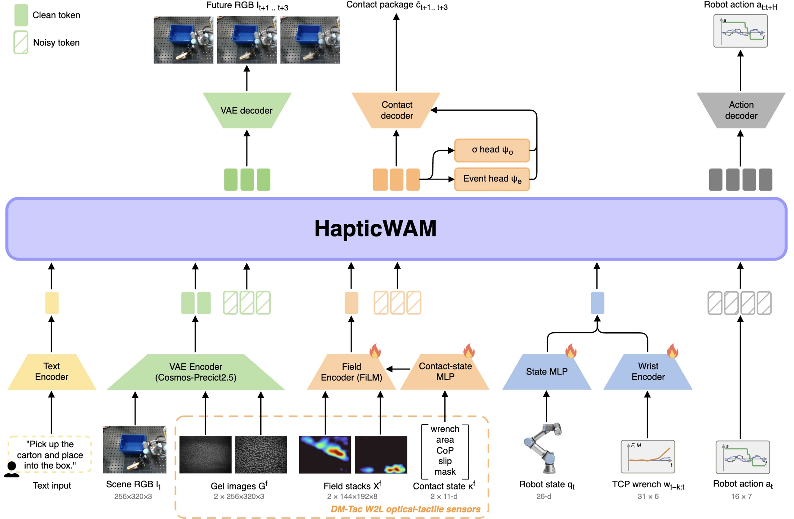

<!-- Generated by scripts/generate.py; edit data/works.json and data/media.json. -->

[← Back to the Awesome index](../../../README.md) · [Interactive website](https://chang-xinhai.github.io/Awesome-RGBDT-Manipulation/?collection=policy&item=hapticwam#library)

# HapticWAM

HapticWAM: Distilling Imagined Touch into a World-Action Model without Inference-Time Tactile Sensing

**2026-09-20 · Preprint · Skolkovo Institute of Science and Technology**

**[Paper](https://arxiv.org/abs/2609.23888)** · [Project](https://advanced-robotic-manipulation.github.io/websites/hapticwam/) · [Code](https://github.com/Advanced-Robotic-Manipulation/HapticWAM) · [Data](https://huggingface.co/datasets/armteam/hapticwam-teleop-dataset) · [Weights](https://huggingface.co/armteam/hapticwam-student)

A tactile-teacher world-action model distills generated contact futures into a student without fingertip observations.

*HapticWAM: Distilling Imagined Touch into a World-Action Model without Inference-Time Tactile Sensing authors · [Figure source](https://arxiv.org/abs/2609.23888) · Original rights retained.*

| Field | Reported value and source scope |
| :-- | :-- |
| Record type | policy |
| Policy family | World-action model [1](https://arxiv.org/abs/2609.23888)  |
| Base model and architecture | Frozen Cosmos-Predict 2.5-2 B backbone with rank 16 LoRA, anticipated-contact conditioning and haptic imagination distillation. [1](https://arxiv.org/abs/2609.23888)  |
| Model size and component | 2 B frozen backbone;27.9 M trainable teacher and 26.4 M student parameters. [1](https://arxiv.org/abs/2609.23888)  |
| Deployment inputs | Deployed student: current RGB, language, proprioception and arm-side wrench history estimated from motor currents; no fingertip tactile frames. [1](https://arxiv.org/abs/2609.23888)  |
| Action outputs and horizon | 16-step end-effector delta-pose/absolute-gripper chunks plus generated video and typed contact futures. [1](https://arxiv.org/abs/2609.23888)  |
| Training method | Teacher 20 k updates; student 1 k offline distillation updates with generated contact/event targets; failed examples do not supervise ground-truth action reproduction. [1](https://arxiv.org/abs/2609.23888)  |
| Training data | 855 collected demonstration episodes=285/task, split 761 training 94 validation; student 860 episodes=761 train+99 earlier teacher/student rollouts; baseline export 876 excludes deliberate failures, so training corpora are not identical. [1](https://arxiv.org/abs/2609.23888)  |
| Training duration | Teacher 20,000 +student 1,000 updates; wall-clock Not reported. [1](https://arxiv.org/abs/2609.23888)  |
| Training hardware | Teacher one 24 GB GPU, model Not reported; student one NVIDIA H100. [1](https://arxiv.org/abs/2609.23888)  |
| Inference and control rates | Action targets 10 Hz, 16-step/1.6 s horizon; collection robot 125 Hz, touch 8 Hz, RGB15 Hz. [1](https://arxiv.org/abs/2609.23888)  |
| Evaluation scope | UR3/Robotiq 2 F-85: waffles, carton, egg pick-and-place; contact-representation clamping intervention and matched-start robot evaluation. [1](https://arxiv.org/abs/2609.23888)  |
| Observations / modalities | RGB · Force/Torque · Proprioception · Language |
| Evaluation domain | Real world |
| Embodiment | Parallel-jaw gripper |
| Release: code | Available [2](https://advanced-robotic-manipulation.github.io/websites/hapticwam/) [3](https://github.com/Advanced-Robotic-Manipulation/HapticWAM) [4](https://huggingface.co/armteam/hapticwam-student)  |
| Release: weights | Available [2](https://advanced-robotic-manipulation.github.io/websites/hapticwam/) [3](https://github.com/Advanced-Robotic-Manipulation/HapticWAM) [4](https://huggingface.co/armteam/hapticwam-student)  |
| Release: data | Available [2](https://advanced-robotic-manipulation.github.io/websites/hapticwam/) [3](https://github.com/Advanced-Robotic-Manipulation/HapticWAM) [4](https://huggingface.co/armteam/hapticwam-student)  |
| Release: license | Apache-2.0 [2](https://advanced-robotic-manipulation.github.io/websites/hapticwam/) [3](https://github.com/Advanced-Robotic-Manipulation/HapticWAM) [4](https://huggingface.co/armteam/hapticwam-student)  |
| Release: notes | Author-linked repository and actual LICENSE inspected; code, checkpoints anddatasets have independent availability. [2](https://advanced-robotic-manipulation.github.io/websites/hapticwam/) [3](https://github.com/Advanced-Robotic-Manipulation/HapticWAM) [4](https://huggingface.co/armteam/hapticwam-student)  |

**Scope and qualifications**

- No fingertip sensing does not mean vision-only: motor-current-derived arm wrench remains a runtime input.
- Wrench is estimated, not measured by a dedicated wrist F/T sensor.
- Contact-clamping evaluates dependence on generated contact content, not an isolated demonstration that tactile distillation outperforms action-only distillation.

**Primary evidence**

1. [Original paper and supplementary implementation details](https://arxiv.org/abs/2609.23888) — Primary full text reviewed; dataset, deployment modalities and training-only privileges are scoped separately.
2. [Official author project](https://advanced-robotic-manipulation.github.io/websites/hapticwam/) — Live artifact status reviewed separately from paper claims.
3. [Official released implementation and LICENSE](https://github.com/Advanced-Robotic-Manipulation/HapticWAM) — Repository metadata,README and actualLICENSE inspected; availability scoped to the listed component.
4. [Author-linked released model](https://huggingface.co/armteam/hapticwam-student) — Public repository file inventory inspected; component/data scope follows model/dataset card.
5. [Author-linked released dataset](https://huggingface.co/datasets/armteam/hapticwam-teleop-dataset) — Public repository file inventory inspected; component/data scope follows model/dataset card.
