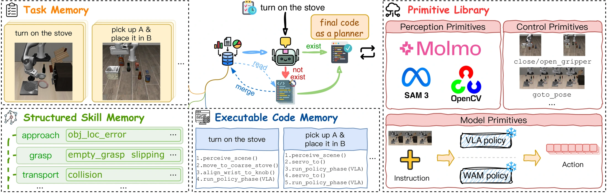

<!-- Generated by scripts/generate.py; edit data/works.json and data/media.json. -->

[← Back to the Awesome index](../../../README.md) · [Interactive website](https://chang-xinhai.github.io/Awesome-RGBDT-Manipulation/?collection=policy&item=harnesspai#library)

# HarnessPAI

HarnessPAI: An Evolving Harness for Physical AI

**2026-09-24 · Preprint · Not reported**

**[Paper](https://arxiv.org/abs/2609.29166)** · [Project](https://darwin-agent.github.io/HarnessPAI/) · [Code](https://github.com/Darwin-Agent/HarnessPAI)

Evolves reusable executable control harnesses across robot platforms while keeping action models fixed within the described adaptation.

*HarnessPAI authors · [Figure source](https://arxiv.org/abs/2609.29166) · Original rights retained.*

| Field | Reported value and source scope |
| :-- | :-- |
| Record type | policy |
| Policy family | Hybrid [1](https://arxiv.org/abs/2609.29166)  |
| Base model and architecture | Platform-specific frozen action models, including WorldDreamer for RoboCasa and GraspNet-based household manipulation tools. [1](https://arxiv.org/abs/2609.29166)  |
| Model size and component | Not reported [1](https://arxiv.org/abs/2609.29166)  |
| Deployment inputs | Task, platform observations, execution feedback and reusable harness artifacts; perception and action APIs vary by robot. [1](https://arxiv.org/abs/2609.29166)  |
| Action outputs and horizon | Executable control programs that coordinate fixed action models, check progress and recover from failures. [1](https://arxiv.org/abs/2609.29166)  |
| Training method | Program source is fixed within each rollout and evolves across rollouts. The frozen zero-shot test and re-adapted test variants are separate protocols. [1](https://arxiv.org/abs/2609.29166)  |
| Training data | Across-rollout evolution and retained code / skills; some reported variants re-adapt on previously failed evaluation seeds. [1](https://arxiv.org/abs/2609.29166)  |
| Training duration | Not reported [1](https://arxiv.org/abs/2609.29166)  |
| Training hardware | Not reported [1](https://arxiv.org/abs/2609.29166)  |
| Inference and control rates | Not reported [1](https://arxiv.org/abs/2609.29166)  |
| Evaluation scope | RoboCasa, BEHAVIOR-1K and diverse physical platforms, including desktop arms, vacuum / mobile systems and legged robots. [1](https://arxiv.org/abs/2609.29166)  |
| Observations / modalities | RGB · Proprioception · Language |
| Evaluation domain | Simulation · Real world |
| Embodiment | Parallel-jaw gripper · Mobile manipulator · Legged robot · Humanoid |
| Release: code | Available — official executable harness and environment integrations [2](https://github.com/Darwin-Agent/HarnessPAI)  |
| Release: weights | Not verified [2](https://github.com/Darwin-Agent/HarnessPAI)  |
| Release: data | Not verified [2](https://github.com/Darwin-Agent/HarnessPAI)  |
| Release: license | Not verified — no root LICENSE found [2](https://github.com/Darwin-Agent/HarnessPAI)  |
| Release: notes | Official repository now contains harness, configurations and environment integration source; backend models and external simulators have separate requirements. [2](https://github.com/Darwin-Agent/HarnessPAI)  |

**Scope and qualifications**

- BEHAVIOR zero-shot and adapted variants have different test access: the latter re-evolves on previously failing test seeds.
- A heterogeneous framework does not imply one identical observation or action interface across platforms.
- The reference harness is now public; its underlying models, external assets, and simulators have independent availability and terms.

**Primary evidence**

1. [Primary paper, full text](https://arxiv.org/abs/2609.29166) — Publication date is the first arXiv submission. Policy fields distinguish model calls, controller execution and learning.
2. [Official repository: implementation files and current release scope](https://github.com/Darwin-Agent/HarnessPAI) — Repository source files and root license checked on 2026-11-05; installation and external artifact requirements remain separate.
