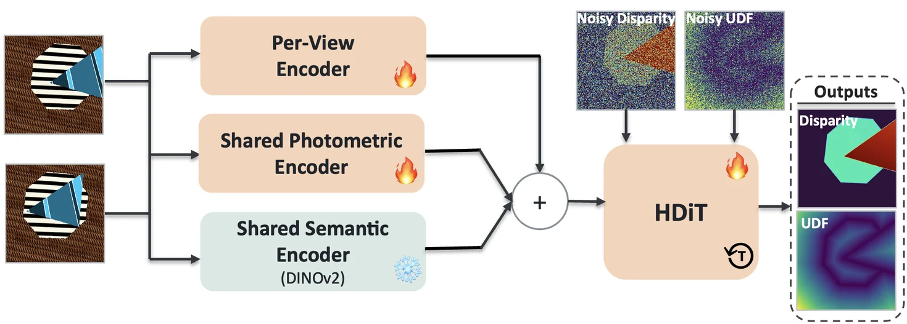

<!-- Generated by scripts/generate.py; edit data/works.json and data/media.json. -->

[← Back to the Awesome index](../../../README.md) · [Interactive website](https://chang-xinhai.github.io/Awesome-RGBDT-Manipulation/?collection=policy&item=hdit-stereo#library)

# HDiT-Stereo

Do Deep Stereo Models Learn Shape Priors?

**2026-11-18 · Preprint · Harvard University**

**[Paper](https://arxiv.org/abs/2611.25113)**

Controlled stereo experiments isolate shape priors and weak boundary evidence. A conditional generator jointly models disparity and object boundaries.

*Linbo Tang, Aneel Damaraju and Todd Zickler · [Figure source](https://arxiv.org/html/2611.25113v1) · Original rights retained.*

| Field | Reported value and source scope |
| :-- | :-- |
| Record type | model |
| Model role and downstream interface | Geometry perception model [1](https://arxiv.org/html/2611.25113v1)  |
| Model family | Generative stereo disparity and boundary estimation [1](https://arxiv.org/html/2611.25113v1)  |
| Model architecture | Conditional HDiT with DINOv2 alongside learned photometric correspondence features. [1](https://arxiv.org/html/2611.25113v1)  |
| Model size and component | Not reported [1](https://arxiv.org/html/2611.25113v1)  |
| Model inputs | Rectified synthetic stereo RGB images. [1](https://arxiv.org/html/2611.25113v1)  |
| Model outputs | Dense disparity and an unsigned object-boundary distance field on the left-view grid; repeated samples give an uncertainty cue. [1](https://arxiv.org/html/2611.25113v1)  |
| Training method | Joint diffusion over disparity and boundary labels, evaluated against trained or fine-tuned discriminative stereo methods. [1](https://arxiv.org/html/2611.25113v1)  |
| Training data and scale | Paper reports 25,000 synthetic training images with planar slanted polygons and controlled appearance, boundary and depth cues. [1](https://arxiv.org/html/2611.25113v1)  |
| Training duration | Not reported [1](https://arxiv.org/html/2611.25113v1)  |
| Training hardware | Not reported [1](https://arxiv.org/html/2611.25113v1)  |
| Inference setting and runtime | Not reported [1](https://arxiv.org/html/2611.25113v1)  |
| Downstream evaluation and scope | Controlled boundary error and disparity evaluations under weak local stereo cues; shape regularity is measured separately. [1](https://arxiv.org/html/2611.25113v1)  |
| Observations / modalities | RGB |
| Evaluation domain | Simulation |
| Embodiment |  |
| Release: code | Not verified |
| Release: weights | Not verified |
| Release: data | Not verified |
| Release: license | Not verified |
| Release: notes | Paper and figures are public. Implementation, weights and downloadable dataset were not verified. |

**Scope and qualifications**

- Synthetic planar shapes isolate a failure mechanism; results do not establish general scene performance.

**Primary evidence**

1. [Original author paper or dataset description](https://arxiv.org/html/2611.25113v1)
