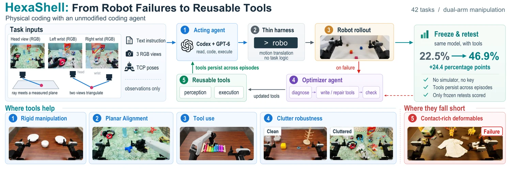

<!-- Generated by scripts/generate.py; edit data/works.json and data/media.json. -->

[← Back to the Awesome index](../../../README.md) · [Interactive website](https://chang-xinhai.github.io/Awesome-RGBDT-Manipulation/?collection=policy&item=hexashell#library)

# HexaShell / Preview

HexaShell: A Thin Harness for Exploring the Limits of VLM Agents as Robot Coding Agents

**2026-10-16 · Preprint · HexaFuture**

**[Paper](https://arxiv.org/abs/2610.23479)** · [Project](https://github.com/HexaFuture/HexaShell) · [Code](https://github.com/HexaFuture/HexaShell) · [Leaderboard](https://robodojo-benchmark.com/leaderboard)

A coding agent drives a robot from calibrated RGB images and preserves failure-driven repairs as reusable Python tools; a separate repair agent improves tools while model weights stay frozen.

*HexaShell / Preview authors; original rights retained · [Figure source](https://arxiv.org/abs/2610.23479) · Original rights retained.*

| Field | Reported value and source scope |
| :-- | :-- |
| Record type | policy |
| Policy family | Robot agent [1](https://arxiv.org/html/2610.23479)  |
| Base model and architecture | Codex with GPT-6-Astra for both execution and repair agents [1](https://arxiv.org/html/2610.23479)  |
| Model size and component | Not reported [1](https://arxiv.org/html/2610.23479)  |
| Deployment inputs | Task instruction/recipe/notes, three calibrated RGB views, robot state and execution logs. [1](https://arxiv.org/html/2610.23479)  |
| Action outputs and horizon | robo CLI calls and generated Python perception/motion tools drive dual-arm ARX X5. [1](https://arxiv.org/html/2610.23479)  |
| Training method | Same-layout failure review repairs code/tools; freeze all artifacts before evaluation. Eight Open tasks share one tool set without per-task notes. [1](https://arxiv.org/html/2610.23479)  |
| Training data | Tools developed on ten seed-0 layouts per task; frozen official evaluation uses an independent hidden seed. [1](https://arxiv.org/html/2610.23479)  |
| Training duration | Not reported [1](https://arxiv.org/html/2610.23479)  |
| Training hardware | Not reported [1](https://arxiv.org/html/2610.23479)  |
| Inference and control rates | Not reported [1](https://arxiv.org/html/2610.23479)  |
| Evaluation scope | Official RoboDojo: 42 tasks × 50 episodes; Generalization is 25 standard +25 cluttered. October 20 board: Score 53.18, success 46.85%. Author new-layout retest: Score 48.0, success 39.7%; not the same test. [1](https://arxiv.org/html/2610.23479)  |
| Observations / modalities | RGB · Proprioception · Language |
| Evaluation domain | Simulation |
| Embodiment | Bimanual · Parallel-jaw gripper |
| Release: code | Partial — frozen tools, shared Open setup and interface contracts [2](https://github.com/HexaFuture/HexaShell)  |
| Release: weights | Not applicable [2](https://github.com/HexaFuture/HexaShell)  |
| Release: data | Partial — per-task result JSON/Markdown and recipes [2](https://github.com/HexaFuture/HexaShell)  |
| Release: license | Apache-2.0 root code and separately attributed RoboProbe recipes. Hosted-model and simulator terms are external. [2](https://github.com/HexaFuture/HexaShell)  |
| Release: notes | 196 frozen tools for 34 non-Open tasks, shared Open tools and server import contracts are public. The executable server, agent container, executor and evolution loop are not included; hexashell/server/*.py are constants/helpers, not the complete harness. [2](https://github.com/HexaFuture/HexaShell)  |

**Scope and qualifications**

- No measured depth input: geometry comes from calibrated RGB ray triangulation, ray–plane intersections and active wrist views. A depth-network variant is an ablation.
- Official held-out-seed evaluation and author new-layout/development retests have different protocols and Open tool configurations.
- The official board’s precise 53.18 Score / 46.85% success differs from the README’s rounded 53.2 / 46.9.
- No real-robot transfer is established; tools and API calls are not learned policy weights.

**Primary evidence**

1. [Original full paper, methods and evaluation](https://arxiv.org/html/2610.23479) — Publication date is arXiv v1; implementation and deployment observations are distinguished from training supervision, generated geometry and base-model identity.
2. [Official artifact: actual source files, inventory and license](https://github.com/HexaFuture/HexaShell) — 597 real files; frozen task tools, results and import contracts inspected; root LICENSE is Apache-2.0.
