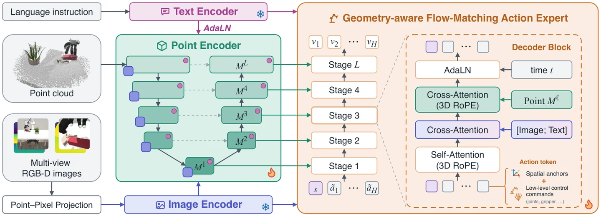

<!-- Generated by scripts/generate.py; edit data/works.json and data/media.json. -->

[← Back to the Awesome index](../../../README.md) · [Interactive website](https://chang-xinhai.github.io/Awesome-RGBDT-Manipulation/?collection=policy&item=hi3r-vla#library)

# Hi3R-VLA

Hi3R-VLA: Grounding Semantics and Actions in 3D

**2026-11-23 · Preprint · Inria; École normale supérieure; CNRS; PSL Research University**

**[Paper](https://arxiv.org/abs/2611.31535)** · [Project](https://cshizhe.github.io/projects/hi3r_vla.html) · [Data](https://huggingface.co/datasets/cshizhe/hi3r_robot_rgbd_data) · [Weights](https://huggingface.co/cshizhe/hi3r_vla)

Fuses multi-view RGB features with metric point clouds and predicts actions in the same coordinate frame for precision and dexterous control.

*Shizhe Chen and coauthors · [Figure source](https://arxiv.org/html/2611.31535v1) · Original rights retained.*

| Field | Reported value and source scope |
| :-- | :-- |
| Record type | policy |
| Policy family | Hi3R-VLA [1](https://arxiv.org/html/2611.31535v1)  |
| Base model and architecture | Frozen SigLIP2 image/text encoders, hierarchical point encoder and flow-based action model [1](https://arxiv.org/html/2611.31535v1)  |
| Model size and component | Fewer than 250 million trainable parameters; frozen encoders excluded. [1](https://arxiv.org/html/2611.31535v1)  |
| Deployment inputs | Multi-view RGB, calibrated RGB-D point back-projection, robot state and text. Physical UR5 tests use a fixed Orbbec Femto Mega RGB-D and joint state. [1](https://arxiv.org/html/2611.31535v1)  |
| Action outputs and horizon | Low-level joint or pose/gripper action chunks represented in a common spatial frame with point features. [1](https://arxiv.org/html/2611.31535v1)  |
| Training method | Pretrain with DROID-derived RGB-D and curate task instructions, then train benchmark- or embodiment-specific action models. [1](https://arxiv.org/html/2611.31535v1)  |
| Training data | DROID pretraining uses 35,238 curated trajectories per paper. Stereo-estimated metric depth and optimized extrinsics from PointWorld augment raw DROID; original wrist RGB lacks aligned depth. [1](https://arxiv.org/html/2611.31535v1)  |
| Training duration | Not reported [1](https://arxiv.org/html/2611.31535v1)  |
| Training hardware | Not reported [1](https://arxiv.org/html/2611.31535v1)  |
| Inference and control rates | Not reported [1](https://arxiv.org/html/2611.31535v1)  |
| Evaluation scope | RoboCasa, RLBench, RoboTwin2, DexJoCo, DexSuite, and separate physical UR5/Weiss WSG50 trials for five tasks. [1](https://arxiv.org/html/2611.31535v1)  |
| Observations / modalities | RGB · Depth · Point cloud · Proprioception · Language |
| Evaluation domain | Simulation · Real world |
| Embodiment | Parallel-jaw gripper · Dexterous hand · Bimanual |
| Release: code | Announced — linked repository returned 404 on review; no implementation verified |
| Release: weights | Available — public benchmark-specific safetensors [3](https://huggingface.co/cshizhe/hi3r_vla/tree/main)  |
| Release: data | Partial — verified robot RGB-D tar archives; full derived DROID pretraining corpus not verified [4](https://huggingface.co/datasets/cshizhe/hi3r_robot_rgbd_data/tree/main)  |
| Release: license | No dataset or checkpoint license was independently verified. |
| Release: notes | Public paper verified. Code, task weights and data are tracked separately. |

**Scope and qualifications**

- DROID training depth is stereo-derived on separate views. Physical evaluation uses measured RGB-D input.
- A released checkpoint and data archives do not establish that the linked implementation is accessible.

**Primary evidence**

1. [Original author paper with methods, evaluation and scope](https://arxiv.org/html/2611.31535v1)
2. [Public author project with method and evaluation examples](https://cshizhe.github.io/projects/hi3r_vla.html)
3. [Model files and per-benchmark definitions](https://huggingface.co/cshizhe/hi3r_vla/tree/main)
4. [Author RGB-D archives](https://huggingface.co/datasets/cshizhe/hi3r_robot_rgbd_data/tree/main)
