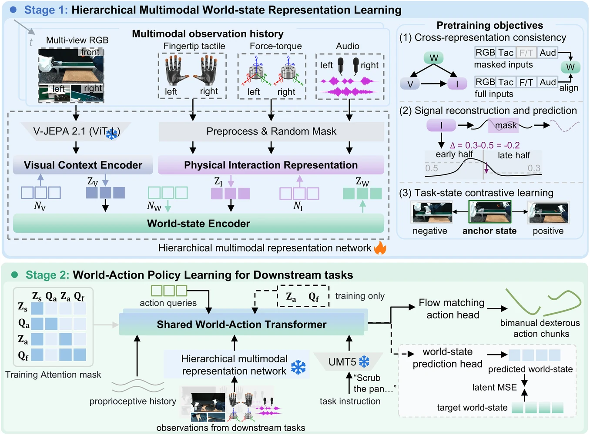

<!-- Generated by scripts/generate.py; edit data/works.json and data/media.json. -->

[← Back to the Awesome index](../../../README.md) · [Interactive website](https://chang-xinhai.github.io/Awesome-RGBDT-Manipulation/?collection=policy&item=himodex#library)

# HiMoDex

Many Senses, One World: Learning Hierarchical Multimodal World Representations for Bimanual Dexterous Manipulation

**2026-11-24 · Preprint · Xi’an Jiaotong University; National Key Laboratory of Human-Machine Hybrid Augmented Intelligence**

**[Paper](https://arxiv.org/abs/2611.31782)**

Uses frozen world-state embeddings built from front/wrist vision, fingertip touch, wrist wrench and audio to condition a bimanual world-action policy.

*Jin Yang and coauthors · [Figure source](https://arxiv.org/html/2611.31782v1) · Original rights retained.*

| Field | Reported value and source scope |
| :-- | :-- |
| Record type | policy |
| Policy family | HiMoDex [1](https://arxiv.org/html/2611.31782v1)  |
| Base model and architecture | Not reported [1](https://arxiv.org/html/2611.31782v1)  |
| Model size and component | Not reported [1](https://arxiv.org/html/2611.31782v1)  |
| Deployment inputs | Three RGB views, fingertip tactile, six-axis force/torque from both wrists, audio history, robot state and task instruction. [1](https://arxiv.org/html/2611.31782v1)  |
| Action outputs and horizon | Bimanual dexterous action chunks and predicted visual/interaction latent targets during learning. [1](https://arxiv.org/html/2611.31782v1)  |
| Training method | Hierarchical multimodal pretraining using masked cross-representation, prediction and task-progress objectives; freeze encoder then fit a shared world-action transformer. [1](https://arxiv.org/html/2611.31782v1)  |
| Training data | 1.19 million synchronized pretraining time steps reported and separate task-specific expert demonstrations. [1](https://arxiv.org/html/2611.31782v1)  |
| Training duration | Not reported [1](https://arxiv.org/html/2611.31782v1)  |
| Training hardware | Not reported [1](https://arxiv.org/html/2611.31782v1)  |
| Inference and control rates | Not reported [1](https://arxiv.org/html/2611.31782v1)  |
| Evaluation scope | Five real tasks at 30 trials each in the main comparisons, with 10 per task for ablations; includes plug insertion and M2 screw work. [1](https://arxiv.org/html/2611.31782v1)  |
| Observations / modalities | RGB · Tactile · Force/Torque · Audio · Proprioception · Language |
| Evaluation domain | Real world |
| Embodiment | Dexterous hand · Bimanual |
| Release: code | Not verified |
| Release: weights | Not verified |
| Release: data | Not verified |
| Release: license | Not verified |
| Release: notes | Public paper verified. Code, task weights and data are tracked separately. |

**Scope and qualifications**

- Thirty hertz refers to front-camera data alignment. Audio is a two-second history window. No measured depth stream is listed.
- Synchronized time-step count is not an episode count; downloadable corpus was not verified.

**Primary evidence**

1. [Original author paper with methods, evaluation and scope](https://arxiv.org/html/2611.31782v1)
