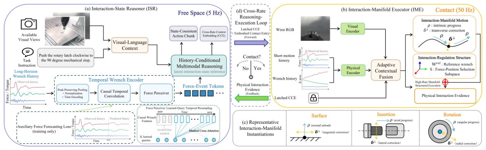

<!-- Generated by scripts/generate.py; edit data/works.json and data/media.json. -->

[← Back to the Awesome index](../../../README.md) · [Interactive website](https://chang-xinhai.github.io/Awesome-RGBDT-Manipulation/?collection=policy&item=hire#library)

# HIRE

HIRE: History-Conditioned Interaction Reasoning and High-Rate Execution for Visually Aliased Precision Manipulation

**2026-09-25 · Preprint · Institute of Automation, Chinese Academy of Sciences / Shanghai Jiao Tong University**

**[Paper](https://arxiv.org/abs/2609.30828)**

History-conditioned force reasoning and a high-rate interaction executor jointly resolve visual aliasing in precision manipulation.

*HIRE authors · [Figure source](https://arxiv.org/abs/2609.30828) · Original rights retained.*

| Field | Reported value and source scope |
| :-- | :-- |
| Record type | policy |
| Policy family | VLA [1](https://arxiv.org/abs/2609.30828)  |
| Base model and architecture | π0.5-initialized Interaction-State Reasoner, temporal wrench encoder / Force Perceiver and learned Interaction-Manifold Executor. [1](https://arxiv.org/abs/2609.30828)  |
| Model size and component | Not reported [1](https://arxiv.org/abs/2609.30828)  |
| Deployment inputs | Global/wrist RGB observations, language, proprioception and ordered six-axis wrench history; insertion uses wrist view only. [1](https://arxiv.org/abs/2609.30828)  |
| Action outputs and horizon | Reasoner continuous actions plus cross-rate context; executor predicts intrinsic progress, transverse correction, reference wrench and interaction regulation. [1](https://arxiv.org/abs/2609.30828)  |
| Training method | Imitation learning of history-conditioned reasoning and manifold-structured execution with physical progress/correction/wrench targets. [1](https://arxiv.org/abs/2609.30828)  |
| Training data | 300 synchronized real-robot demonstrations per task, containing visual observations, wrench histories and executed actions. Learning-based baselines use the same demonstrations. [1](https://arxiv.org/abs/2609.30828)  |
| Training duration | Not reported [1](https://arxiv.org/abs/2609.30828)  |
| Training hardware | Not reported [1](https://arxiv.org/abs/2609.30828)  |
| Inference and control rates | Interaction-State Reasoner at 5 Hz; Interaction-Manifold Executor at 50 Hz. [1](https://arxiv.org/abs/2609.30828)  |
| Evaluation scope | Flexiv Rizon 4S / two-finger gripper: transparent-object pick-and-place, EV connector mating/demating and quarter-turn latch actuation; stage-wise completion over 30 trials. [1](https://arxiv.org/abs/2609.30828)  |
| Observations / modalities | RGB · Force/Torque · Proprioception · Language |
| Evaluation domain | Real world |
| Embodiment | Parallel-jaw gripper |
| Release: code | Not released |
| Release: weights | Not released |
| Release: data | Not released |
| Release: license | Not verified |
| Release: notes | Original abstract states code will be released upon publication. |

**Scope and qualifications**

- Uses six-axis wrench sensing, not skin tactile.
- RGB-D cameras are present, but the paper’s runtime reasoning/execution inputs do not establish a depth stream.
- Large external-view execution images in Figure 3 are visualization views, not policy camera observations.

**Primary evidence**

1. [Original paper / author report](https://arxiv.org/abs/2609.30828) — Original full paper and supplementary experimental / implementation details; deployment inputs are separated from supervision and benchmark state.
