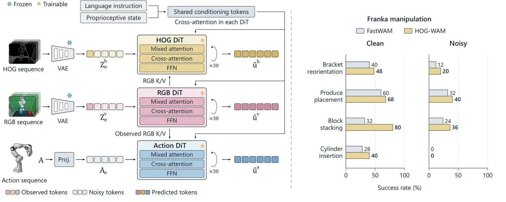

<!-- Generated by scripts/generate.py; edit data/works.json and data/media.json. -->

[← Back to the Awesome index](../../../README.md) · [Interactive website](https://chang-xinhai.github.io/Awesome-RGBDT-Manipulation/?collection=policy&item=hog-wam#library)

# HOG-WAM

HOG-WAM: Improving Visual Robustness through Future Gradient Prediction

**2026-11-25 · Preprint · Peking University**

**[Paper](https://arxiv.org/abs/2611.34811)** · [Code](https://github.com/iPPLab/HOG-WAM) · [Data](https://huggingface.co/datasets/yuanty/robotwin2.0-fastwam) · [Weights](https://huggingface.co/ipplab/HOG-WAM-RoboTwin-Uncond)

Adds image-gradient supervision to a world-action policy during training to improve robustness without increasing the deployed sensor set.

*Boxuan Dong and coauthors · [Figure source](https://arxiv.org/html/2611.34811v1) · Original rights retained.*

| Field | Reported value and source scope |
| :-- | :-- |
| Record type | policy |
| Policy family | HOG-WAM [1](https://arxiv.org/html/2611.34811v1)  |
| Base model and architecture | FastWAM-JAX with training-only HOG prediction branch [1](https://arxiv.org/html/2611.34811v1)  |
| Model size and component | Not reported [1](https://arxiv.org/html/2611.34811v1)  |
| Deployment inputs | RGB, language and robot state through the FastWAM-style action interface. HOG targets are derived from training images. [1](https://arxiv.org/html/2611.34811v1)  |
| Action outputs and horizon | Action chunks. The auxiliary HOG diffusion module is removed at inference. [1](https://arxiv.org/html/2611.34811v1)  |
| Training method | Future-gradient auxiliary flow matching using asymmetric attention from the HOG branch to RGB features. [1](https://arxiv.org/html/2611.34811v1)  |
| Training data | FastWAM RoboTwin 2.0 release (27,500 demonstrations per bundled configuration documentation) and separate LIBERO/Franka experiments. [1](https://arxiv.org/html/2611.34811v1)  |
| Training duration | Not reported [1](https://arxiv.org/html/2611.34811v1)  |
| Training hardware | Not reported [1](https://arxiv.org/html/2611.34811v1)  |
| Inference and control rates | Not reported [1](https://arxiv.org/html/2611.34811v1)  |
| Evaluation scope | Author-reported RoboTwin-Plus visual corruptions, LIBERO-Plus and four Franka tasks. Mixed-noise RoboTwin-Plus increases from 78.86% to 82.86% relative to the cited FastWAM baseline. [1](https://arxiv.org/html/2611.34811v1)  |
| Observations / modalities | RGB · Language · Proprioception |
| Evaluation domain | Simulation · Real world |
| Embodiment | Parallel-jaw gripper |
| Release: code | Available — recipes and evaluation [2](https://github.com/iPPLab/HOG-WAM#readme)  |
| Release: weights | Partial — public RoboTwin HOG-WAM and matching FastWAM comparator files [2](https://github.com/iPPLab/HOG-WAM#readme) [3](https://huggingface.co/ipplab/HOG-WAM-RoboTwin-Uncond/tree/main)  |
| Release: data | Reuses public upstream FastWAM RoboTwin demonstrations; full real-robot corpus not verified [2](https://github.com/iPPLab/HOG-WAM#readme)  |
| Release: license | MIT for original repository code; checkpoint, Wan and upstream terms are separate. [2](https://github.com/iPPLab/HOG-WAM#readme)  |
| Release: notes | Public paper verified. Code, task weights and data are tracked separately. [2](https://github.com/iPPLab/HOG-WAM#readme)  |

**Scope and qualifications**

- Histogram-of-gradient targets use RGB-derived texture and edges, not an added depth, event or tactile channel.
- RoboTwin-Plus here is the paper’s corruption setup; benchmark names with similar wording do not establish compatible protocols.

**Primary evidence**

1. [Original author paper with methods, evaluation and scope](https://arxiv.org/html/2611.34811v1)
2. [Public source, pinned baseline and test recipes](https://github.com/iPPLab/HOG-WAM#readme)
3. [Public Orbax checkpoints](https://huggingface.co/ipplab/HOG-WAM-RoboTwin-Uncond/tree/main)
