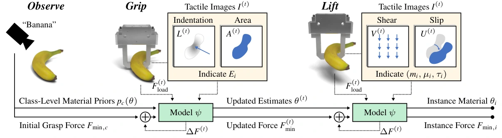

<!-- Generated by scripts/generate.py; edit data/works.json and data/media.json. -->

[← Back to the Awesome index](../../../README.md) · [Interactive website](https://chang-xinhai.github.io/Awesome-RGBDT-Manipulation/?collection=policy&item=how-firm-grasp#library)

# How Firm Should a Grasp Be?

How Firm Should a Grasp Be?

**2026-10-08 · Preprint · Columbia University**

**[Paper](https://arxiv.org/abs/2610.11221)** · [Project](https://cave.cs.columbia.edu/projects/categories/project?cid=Physics-Based+Vision&pid=How+Firm+Should+a+Grasp+Be)

Material-property estimation from evolving visuotactile contact selects the minimum grasp force required for gentle lifting.

*How Firm Should a Grasp Be? authors · [Figure source](https://arxiv.org/abs/2610.11221) · Original rights retained.*

| Field | Reported value and source scope |
| :-- | :-- |
| Record type | policy |
| Policy family | Hybrid [1](https://arxiv.org/abs/2610.11221)  |
| Base model and architecture | Sequence model trained on IPC/UIPC grasp simulations; material-aware force controller. [1](https://arxiv.org/abs/2610.11221)  |
| Model size and component | Not reported [1](https://arxiv.org/abs/2610.11221)  |
| Deployment inputs | Tactile images and load-cell/contact force history with object class priors. [1](https://arxiv.org/abs/2610.11221)  |
| Action outputs and horizon | Estimated mass, elasticity/friction parameters and minimum grasp-force command. [1](https://arxiv.org/abs/2610.11221)  |
| Training method | Simulated haptic sequence learning for 500 epochs then online property-based force control. [1](https://arxiv.org/abs/2610.11221)  |
| Training data | Squash:270 measured fruit/vegetable samples across 52 classes;200 k simulated pickups with property augmentation. [1](https://arxiv.org/abs/2610.11221)  |
| Training duration | Approximately 48 h,500 epochs. [1](https://arxiv.org/abs/2610.11221)  |
| Training hardware | 8 NVIDIA RTX6000Ada Generation GPUs. [1](https://arxiv.org/abs/2610.11221)  |
| Inference and control rates | 250 Hz material-aware force control. [1](https://arxiv.org/abs/2610.11221)  |
| Evaluation scope | UR5/WSG50-110/Gel Sight gentle grasping of real fruits and vegetables. [1](https://arxiv.org/abs/2610.11221)  |
| Observations / modalities | Tactile · Force/Torque · Proprioception |
| Evaluation domain | Simulation · Real world |
| Embodiment | Parallel-jaw gripper |
| Release: code | Not verified [2](https://cave.cs.columbia.edu/projects/categories/project?cid=Physics-Based+Vision&pid=How+Firm+Should+a+Grasp+Be)  |
| Release: weights | Not verified [2](https://cave.cs.columbia.edu/projects/categories/project?cid=Physics-Based+Vision&pid=How+Firm+Should+a+Grasp+Be)  |
| Release: data | Not verified [2](https://cave.cs.columbia.edu/projects/categories/project?cid=Physics-Based+Vision&pid=How+Firm+Should+a+Grasp+Be)  |
| Release: license | Not verified [2](https://cave.cs.columbia.edu/projects/categories/project?cid=Physics-Based+Vision&pid=How+Firm+Should+a+Grasp+Be)  |
| Release: notes | Original paper reviewed; claimed future releases are not treated as currently available. [2](https://cave.cs.columbia.edu/projects/categories/project?cid=Physics-Based+Vision&pid=How+Firm+Should+a+Grasp+Be)  |

**Scope and qualifications**

- Object class priors and simulated material augmentations are part of the method; notan unrestricted unknown-material guarantee.

**Primary evidence**

1. [Original paper and supplementary implementation details](https://arxiv.org/abs/2610.11221) — Primary full text reviewed; dataset, deployment modalities and training-only privileges are scoped separately.
2. [Official author project](https://cave.cs.columbia.edu/projects/categories/project?cid=Physics-Based+Vision&pid=How+Firm+Should+a+Grasp+Be) — Live project artifact links inspected on2026-10-17.
