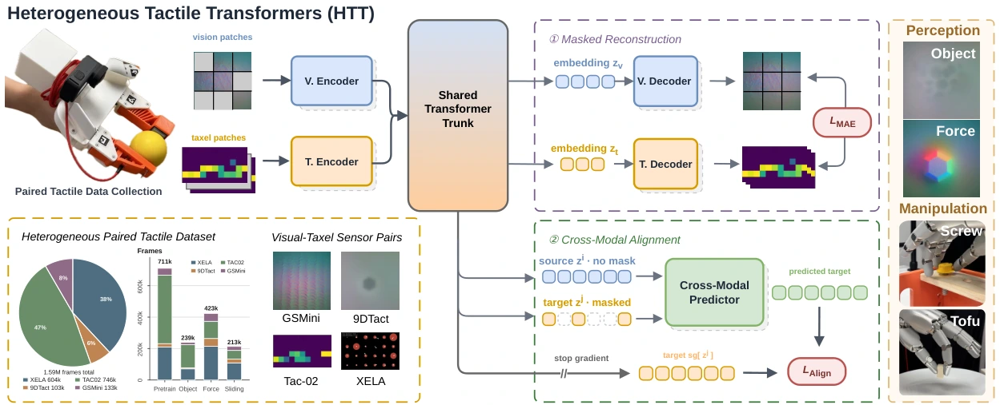

<!-- Generated by scripts/generate.py; edit data/works.json and data/media.json. -->

[← Back to the Awesome index](../../../README.md) · [Interactive website](https://chang-xinhai.github.io/Awesome-RGBDT-Manipulation/?collection=policy&item=htt#library)

# HTT / Heterogeneous Tactile Transformer

Heterogeneous Tactile Transformer

**2026-06-29 · CoRL 2026 (official repository) · National University of Singapore; Carnegie Mellon University**

**[Paper](https://arxiv.org/abs/2606.29948)** · [Project](https://jxbi1010.github.io/htt-gh-page/) · [Code](https://github.com/jxbi1010/HTT) · [Data](https://huggingface.co/datasets/AllenBi21/HTT-dataset) · [Weights](https://huggingface.co/datasets/AllenBi21/HTT-dataset/resolve/main/htt_4sensors_best.pth)

Shares a transformer trunk across optical and taxel-array tactile sensors through sensor-specific tokenizers and paired masked objectives.

*htt authors; original paper figure · [Figure source](https://arxiv.org/html/2606.29948#S1.F1) · Original rights retained.*

| Field | Reported value and source scope |
| :-- | :-- |
| Record type | model |
| Model role and downstream interface | Reusable representation or perception model; downstream controllers are separate systems [1](https://arxiv.org/abs/2606.29948)  |
| Model family | Tactile encoder [1](https://arxiv.org/abs/2606.29948)  |
| Model architecture | Sensor-specific spatial/temporal encoders + shared transformer trunk; per-sensor reconstruction and cross-sensor predictors [1](https://arxiv.org/abs/2606.29948)  |
| Model size and component | Embedding width 192 with 3 heads; shared trunk depth 9; sensor-specific frontend and decoder modules additional. Total parameter count not reported. [1](https://arxiv.org/abs/2606.29948)  |
| Model inputs | Optical tactile images or high-rate tactile array windows from Xela, TAC-02, 9DTact or GelSight Mini [1](https://arxiv.org/abs/2606.29948)  |
| Model outputs | Sensor-shared tactile embeddings and downstream force, slip, object or policy features [1](https://arxiv.org/abs/2606.29948)  |
| Training method | Per-modality masked reconstruction and bidirectional cross-sensor latent prediction [1](https://arxiv.org/abs/2606.29948)  |
| Training data and scale | HPT: 1.6M paired frames across four sensors; unlabeled pretraining and labeled object/force/slip splits separated [1](https://arxiv.org/abs/2606.29948)  |
| Training duration | 50,000 pretraining steps; alignment weight ramps during first 20,000; wall-clock not reported [1](https://arxiv.org/abs/2606.29948)  |
| Training hardware | Not reported [1](https://arxiv.org/abs/2606.29948)  |
| Inference setting and runtime | Not reported [1](https://arxiv.org/abs/2606.29948)  |
| Downstream evaluation and scope | Object classification, force/slip perception, unseen-sensor transfer and physical/simulated robot policy learning in ManiFeel settings. [1](https://arxiv.org/abs/2606.29948)  |
| Observations / modalities | Tactile |
| Evaluation domain | Simulation · Real world |
| Embodiment |  |
| Release: code | Available [2](https://jxbi1010.github.io/htt-gh-page/) [3](https://github.com/jxbi1010/HTT)  |
| Release: weights | Available — official download link [2](https://jxbi1010.github.io/htt-gh-page/) [3](https://github.com/jxbi1010/HTT)  |
| Release: data | Available — official resource link [2](https://jxbi1010.github.io/htt-gh-page/) [3](https://github.com/jxbi1010/HTT)  |
| Release: license | CC BY-NC 4.0 repository LICENSE; upstream assets retain their own notices [2](https://jxbi1010.github.io/htt-gh-page/) [3](https://github.com/jxbi1010/HTT) [4](https://github.com/jxbi1010/HTT/blob/main/LICENSE)  |
| Release: notes | Code, pretrained encoders and downstream task data are separate artifacts; no policy checkpoint is implied by an encoder release. [2](https://jxbi1010.github.io/htt-gh-page/) [3](https://github.com/jxbi1010/HTT)  |

**Scope and qualifications**

- Model metadata reflects arXiv v2 of 2026-10-13; first-public date remains 2026-06-29.
- HPT paired-frame count is not the number of independent demonstrations or benchmark tasks.

**Primary evidence**

1. [Original model paper and first submission](https://arxiv.org/abs/2606.29948) — Method, experiments and implementation sections; specifications retain component and evaluation scope.
2. [Official project](https://jxbi1010.github.io/htt-gh-page/) — Author project; author-reported release scope is distinguished from an executed reproduction.
3. [Official implementation and current release instructions](https://github.com/jxbi1010/HTT) — README and repository files inspected on 2026-10-17.
4. [Repository license file](https://github.com/jxbi1010/HTT/blob/main/LICENSE) — Applies to repository scope; model/data/base-model terms can differ.
