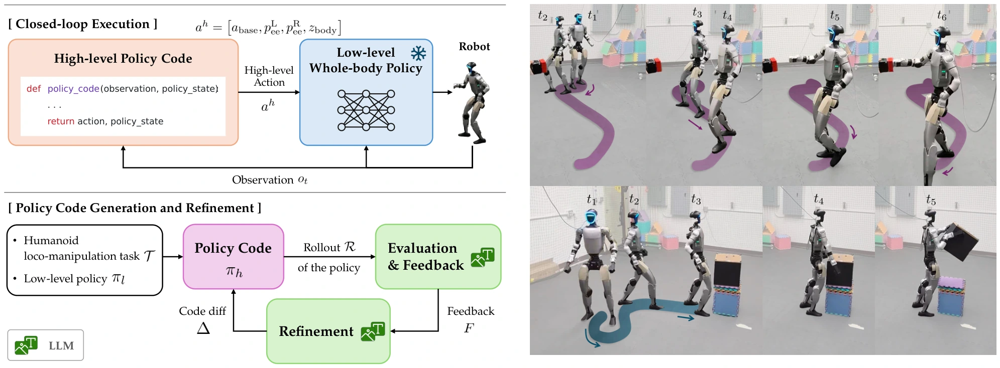

<!-- Generated by scripts/generate.py; edit data/works.json and data/media.json. -->

[← Back to the Awesome index](../../../README.md) · [Interactive website](https://chang-xinhai.github.io/Awesome-RGBDT-Manipulation/?collection=policy&item=hugo#library)

# HuGo

HuGo: LLMs as Whole-Body Policy Code Designers for Humanoid Loco-Manipulation

**2026-09-24 · Preprint · University of California, Berkeley; ShanghaiTech University; Google DeepMind; Nomagic**

**[Paper](https://arxiv.org/abs/2609.30594)** · [Project](https://iconlab.negarmehr.com/HuGo/) · [Code](https://github.com/labicon/HuGo)

Generates and iteratively refines high-level whole-body policy code over a frozen humanoid controller using numerical rollouts and selected video evidence.

*HuGo authors · [Figure source](https://arxiv.org/abs/2609.30594) · Original rights retained.*

| Field | Reported value and source scope |
| :-- | :-- |
| Record type | policy |
| Policy family | Robot agent [1](https://arxiv.org/abs/2609.30594)  |
| Base model and architecture | GPT-5.4 code designer / evaluator over frozen rl_isaac or SONIC 3-Point VR whole-body policies. [1](https://arxiv.org/abs/2609.30594)  |
| Model size and component | Not reported [1](https://arxiv.org/abs/2609.30594)  |
| Deployment inputs | Task and robot / interface specifications; high-level code receives numerical state. Refinement uses trajectories, internal code state and ten selected video frames per rollout. [1](https://arxiv.org/abs/2609.30594)  |
| Action outputs and horizon | Closed-loop policy code producing base motion, end-effector targets and torso / pelvis-height commands. [1](https://arxiv.org/abs/2609.30594)  |
| Training method | Frozen LLM and low-level controller weights; feedback-driven code diffs refine the high-level policy, including directly from physical rollouts. [1](https://arxiv.org/abs/2609.30594)  |
| Training data | No task-specific demonstrations or example policy programs; executed simulation / physical trajectories provide refinement evidence. Low-level policies are pretrained separately. [1](https://arxiv.org/abs/2609.30594)  |
| Training duration | Not reported [1](https://arxiv.org/abs/2609.30594)  |
| Training hardware | IsaacSim experiments use a single NVIDIA L40S GPU; hosted LLM inference is separate. [1](https://arxiv.org/abs/2609.30594)  |
| Inference and control rates | Generated high-level policy code runs at 50 Hz with rl_isaac and 10 Hz with SONIC. [1](https://arxiv.org/abs/2609.30594)  |
| Evaluation scope | Five Unitree G1 simulated tasks, including pushing / lifting, and physical Lift Box / Push Button transfer with fifteen trials per selected policy. [1](https://arxiv.org/abs/2609.30594)  |
| Observations / modalities | RGB · Proprioception · Language |
| Evaluation domain | Simulation · Real world |
| Embodiment | Humanoid |
| Release: code | Not released [2](https://raw.githubusercontent.com/labicon/HuGo/main/README.md)  |
| Release: weights | Not applicable |
| Release: data | Not verified |
| Release: license | Not verified |
| Release: notes | Author repository is a placeholder; substantive implementation is not released in its current README. The frozen agent itself has no separately trained method-specific checkpoint; upstream model access has its own terms. [2](https://raw.githubusercontent.com/labicon/HuGo/main/README.md)  |

**Scope and qualifications**

- Physical state observations are constructed with motion capture; this is not camera-only state estimation.
- Video is used for policy-code refinement, while the generated online controller consumes the specified numerical state.
- Reported results use best-of-N policy selection and task-specific hints for the physical Lift Box setting.

**Primary evidence**

1. [Original primary paper and appendix](https://arxiv.org/abs/2609.30594) — Survey citation is used only for discovery. Method and deployment facts come from the original paper; the date is its first submission where available. Affiliations are transcribed from the PDF author block / footnotes; LMPC affiliation is confirmed by its official project page.
2. [Author repository README](https://raw.githubusercontent.com/labicon/HuGo/main/README.md) — Author repository is a placeholder; substantive implementation is not released in its current README.
