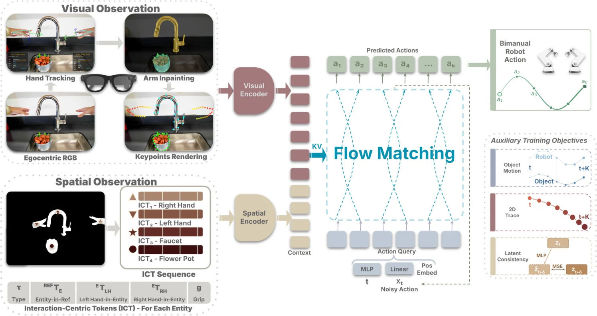

<!-- Generated by scripts/generate.py; edit data/works.json and data/media.json. -->

[← Back to the Awesome index](../../../README.md) · [Interactive website](https://chang-xinhai.github.io/Awesome-RGBDT-Manipulation/?collection=policy&item=humanego#library)

# HumanEgo

HumanEgo: Zero-Shot Robot Learning from Minutes of Human Egocentric Videos

**2026-05-24 · arXiv preprint · University of Maryland**

**[Paper](https://arxiv.org/abs/2605.24934)** · [Project](https://humanego-ai.github.io/) · [Code](https://github.com/TX-Leo/HumanEgo) · [Data](https://huggingface.co/datasets/Leo-TX/HumanEgo)

Converts egocentric human demonstrations into interaction-centric tokens for zero-shot robot manipulation.

*HumanEgo authors · [Figure source](https://arxiv.org/html/2605.24934v1) · Original rights retained.*

| Field | Reported value and source scope |
| :-- | :-- |
| Record type | policy |
| Policy family | Flow-matching policy [1](https://arxiv.org/html/2605.24934v1)  |
| Base model and architecture | Not reported [1](https://arxiv.org/html/2605.24934v1)  |
| Model size and component | Not reported [1](https://arxiv.org/html/2605.24934v1)  |
| Deployment inputs | Robot RGB observations and interaction-centric hand/object tokens derived by the visual pipeline. [1](https://arxiv.org/html/2605.24934v1)  |
| Action outputs and horizon | Robot action chunks for task manipulation. [1](https://arxiv.org/html/2605.24934v1)  |
| Training method | Human-only flow matching with dense auxiliary supervision; no robot demonstration training. [1](https://arxiv.org/html/2605.24934v1)  |
| Training data | Human egocentric videos; 15 or 30 minutes per task in reported comparison. [1](https://arxiv.org/html/2605.24934v1)  |
| Training duration | Not reported [1](https://arxiv.org/html/2605.24934v1)  |
| Training hardware | Not reported [1](https://arxiv.org/html/2605.24934v1)  |
| Inference and control rates | Not reported [1](https://arxiv.org/html/2605.24934v1)  |
| Evaluation scope | Four real tasks on Trossen WidowX, with separate cross-robot and camera tests. [1](https://arxiv.org/html/2605.24934v1)  |
| Observations / modalities | RGB |
| Evaluation domain | Real world |
| Embodiment | Parallel-jaw gripper · Bimanual |
| Release: code | Available — preprocessing, training and inference [2](https://humanego-ai.github.io/) [3](https://github.com/TX-Leo/HumanEgo) [4](https://huggingface.co/datasets/Leo-TX/HumanEgo)  |
| Release: weights | Not verified [2](https://humanego-ai.github.io/) [3](https://github.com/TX-Leo/HumanEgo) [4](https://huggingface.co/datasets/Leo-TX/HumanEgo)  |
| Release: data | Available — human demonstrations and processed data [2](https://humanego-ai.github.io/) [3](https://github.com/TX-Leo/HumanEgo) [4](https://huggingface.co/datasets/Leo-TX/HumanEgo)  |
| Release: license | PolyForm Noncommercial 1.0 code; CC BY-NC 4.0 dataset card [2](https://humanego-ai.github.io/) [3](https://github.com/TX-Leo/HumanEgo) [4](https://huggingface.co/datasets/Leo-TX/HumanEgo)  |
| Release: notes | 126 source files and real human tracking CSV verified; separate hardware/software dependencies have their own terms. [2](https://humanego-ai.github.io/) [3](https://github.com/TX-Leo/HumanEgo) [4](https://huggingface.co/datasets/Leo-TX/HumanEgo)  |

**Scope and qualifications**

- Human egocentric data and actual robot training/deployment observations are separate stages.
- Do not infer a measured depth policy input from camera hardware, reconstruction, or data generation alone.

**Primary evidence**

1. [Author manuscript and initial submission](https://arxiv.org/html/2605.24934v1) — Original manuscript distinguishes human capture, training labels and deployment observations.
2. [Official project and release evidence](https://humanego-ai.github.io/) — Current repository contents and access are assessed independently of paper claims.
3. [Official code and release evidence](https://github.com/TX-Leo/HumanEgo) — Current repository contents and access are assessed independently of paper claims.
4. [Official data and release evidence](https://huggingface.co/datasets/Leo-TX/HumanEgo) — Current repository contents and access are assessed independently of paper claims.
