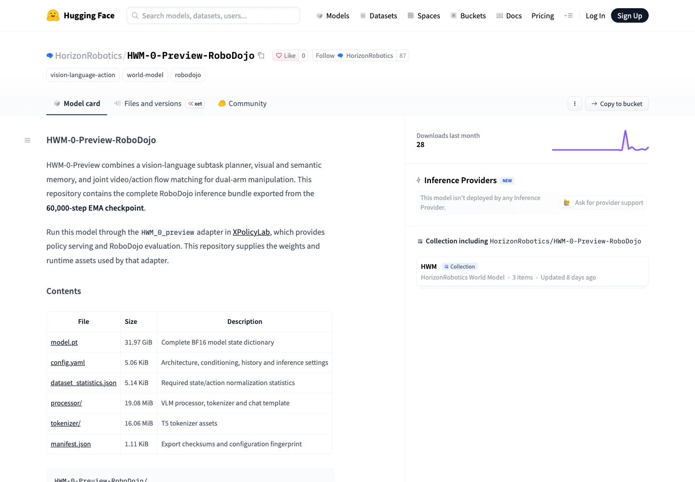

<!-- Generated by scripts/generate.py; edit data/works.json and data/media.json. -->

[← Back to the Awesome index](../../../README.md) · [Interactive website](https://chang-xinhai.github.io/Awesome-RGBDT-Manipulation/?collection=policy&item=hwm-0-preview#library)

# HWM-0 Preview

HWM-0 Preview

**Undated · Leaderboard / preview · Horizon Robotics**

**[Project](https://robodojo-benchmark.com/leaderboard?bench=sim)** · [Weights](https://huggingface.co/HorizonRobotics/HWM-0-Preview-RoboDojo)

A vision-language subtask planner with visual and semantic memory and joint video/action flow matching for dual-arm manipulation.

*Horizon Robotics · [Figure source](https://huggingface.co/HorizonRobotics/HWM-0-Preview-RoboDojo) · Original rights retained.*

| Field | Reported value and source scope |
| :-- | :-- |
| Record type | policy |
| Policy family | World-action model [1](https://huggingface.co/HorizonRobotics/HWM-0-Preview-RoboDojo)  |
| Base model and architecture | VLM planner with video and action flow-matching components [1](https://huggingface.co/HorizonRobotics/HWM-0-Preview-RoboDojo)  |
| Model size and component | 17,162,844,810 stored tensor elements; 60,000-step EMA checkpoint [1](https://huggingface.co/HorizonRobotics/HWM-0-Preview-RoboDojo)  |
| Deployment inputs | Head and two wrist RGB views, state and task instruction. [1](https://huggingface.co/HorizonRobotics/HWM-0-Preview-RoboDojo)  |
| Action outputs and horizon | 48 absolute joint-position targets; model card reports 30 execution steps per replan. [1](https://huggingface.co/HorizonRobotics/HWM-0-Preview-RoboDojo)  |
| Training method | Not reported [1](https://huggingface.co/HorizonRobotics/HWM-0-Preview-RoboDojo)  |
| Training data | Not reported [1](https://huggingface.co/HorizonRobotics/HWM-0-Preview-RoboDojo)  |
| Training duration | Not reported [1](https://huggingface.co/HorizonRobotics/HWM-0-Preview-RoboDojo)  |
| Training hardware | Not reported [1](https://huggingface.co/HorizonRobotics/HWM-0-Preview-RoboDojo)  |
| Inference and control rates | Not reported [1](https://huggingface.co/HorizonRobotics/HWM-0-Preview-RoboDojo)  |
| Evaluation scope | Official RoboDojo simulation 30 October snapshot: score 32.81; success 27.17%. [1](https://huggingface.co/HorizonRobotics/HWM-0-Preview-RoboDojo) [2](https://robodojo-benchmark.com/data/leaderboard.generated.json)  |
| Observations / modalities | RGB · Proprioception · Language |
| Evaluation domain | Simulation |
| Embodiment | Bimanual · Parallel-jaw gripper |
| Release: code | Not verified [1](https://huggingface.co/HorizonRobotics/HWM-0-Preview-RoboDojo)  |
| Release: weights | Available — RoboDojo inference checkpoint and assets [1](https://huggingface.co/HorizonRobotics/HWM-0-Preview-RoboDojo)  |
| Release: data | Not verified [1](https://huggingface.co/HorizonRobotics/HWM-0-Preview-RoboDojo)  |
| Release: license | Not verified [1](https://huggingface.co/HorizonRobotics/HWM-0-Preview-RoboDojo)  |
| Release: notes | Model card lists 34,326,694,240-byte model.pt; a byte-range request returned HTTP 206. Card references XPolicyLab HWM_0_preview adapter, but this directory returned 404 in the current default branch. No root LICENSE was found in the model inventory. [1](https://huggingface.co/HorizonRobotics/HWM-0-Preview-RoboDojo)  |

**Scope and qualifications**

- Checkpoint tensor count is not a verified trainable-parameter count.
- Do not infer an implementation license from model-card tags; the linked integration was not available at the expected main-branch path.

**Primary evidence**

1. [Official model card and inference assets](https://huggingface.co/HorizonRobotics/HWM-0-Preview-RoboDojo) — Model inventory and first 100 checkpoint bytes verified; actual runtime integration was not established.
2. [Official simulation results](https://robodojo-benchmark.com/data/leaderboard.generated.json) — The leaderboard app labels this system VLA + VLM, separate from Agent track.
