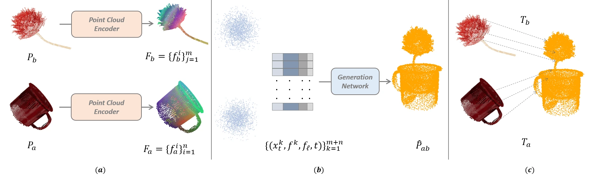

<!-- Generated by scripts/generate.py; edit data/works.json and data/media.json. -->

[← Back to the Awesome index](../../../README.md) · [Interactive website](https://chang-xinhai.github.io/Awesome-RGBDT-Manipulation/?collection=policy&item=imagination-policy#library)

# Imagination Policy

Imagination Policy: Using Generative Point Cloud Models for Learning Manipulation Policies

**2024-06-17 · CoRL 2024 · Northeastern University; Worcester Polytechnic Institute; Brown University; Boston Dynamics AI Institute**

**[Paper](https://arxiv.org/abs/2406.11740)** · [Project](https://haojhuang.github.io/imagine_page/) · [Code](https://github.com/HaojHuang/imagination-policy-cor24)

Generates desired object point clouds and converts their rigid transformation into precise keyframe actions.

*Imagination Policy authors · [Figure source](https://arxiv.org/html/2406.11740) · Original rights retained.*

| Field | Reported value and source scope |
| :-- | :-- |
| Record type | policy |
| Policy family | Flow matching [1](https://arxiv.org/abs/2406.11740)  |
| Base model and architecture | PVCNN point encoders, CLIP language encoder and rectified-flow point generation. [1](https://arxiv.org/abs/2406.11740)  |
| Model size and component | Not reported in the inspected primary-source sections [1](https://arxiv.org/abs/2406.11740)  |
| Deployment inputs | Segmented RGB-D point clouds, language and gripper geometry. [1](https://arxiv.org/abs/2406.11740)  |
| Action outputs and horizon | Rigidly estimated pick/place keyframe poses. [1](https://arxiv.org/abs/2406.11740)  |
| Training method | Task-conditioned local point generation rather than direct action regression. [1](https://arxiv.org/abs/2406.11740)  |
| Training data | Few-demonstration RLBench/real pick-place datasets; exact subsets follow original protocol. [1](https://arxiv.org/abs/2406.11740)  |
| Training duration | 200K training steps, approximately seven hours [1](https://arxiv.org/abs/2406.11740)  |
| Training hardware | Single RTX 4090 [1](https://arxiv.org/abs/2406.11740)  |
| Inference and control rates | Approximately 20 s per generated batch with 1,000 integration steps in reported implementation. [1](https://arxiv.org/abs/2406.11740)  |
| Evaluation scope | RLBench precision tasks including charger/knife insertion and real manipulation. [1](https://arxiv.org/abs/2406.11740)  |
| Observations / modalities | RGB · Depth · Point cloud · Language |
| Evaluation domain | Simulation · Real world |
| Embodiment | Parallel-jaw gripper |
| Release: code | Available [2](https://haojhuang.github.io/imagine_page/) [3](https://github.com/HaojHuang/imagination-policy-cor24) [5](https://github.com/HaojHuang/imagination-policy-cor24/tree/main)  |
| Release: weights | Not verified [2](https://haojhuang.github.io/imagine_page/) [3](https://github.com/HaojHuang/imagination-policy-cor24)  |
| Release: data | Not verified [2](https://haojhuang.github.io/imagine_page/) [3](https://github.com/HaojHuang/imagination-policy-cor24)  |
| Release: license | MIT for repository code; pretrained models, data and figure rights remain separate [2](https://haojhuang.github.io/imagine_page/) [3](https://github.com/HaojHuang/imagination-policy-cor24) [4](https://github.com/HaojHuang/imagination-policy-cor24/blob/main/LICENSE)  |
| Release: notes | Code, data and weights are checked independently; an upstream pretrained model is not a released task policy. [2](https://haojhuang.github.io/imagine_page/) [3](https://github.com/HaojHuang/imagination-policy-cor24)  |

**Scope and qualifications**

- Object/target segmentation and downstream action execution are separate from the point generator.

**Primary evidence**

1. [Original manuscript and first submission history](https://arxiv.org/abs/2406.11740) — Full author HTML method/evaluation/appendix inspected; depth observations, pseudo-labels and generated outputs retain distinct roles.
2. [Official author project](https://haojhuang.github.io/imagine_page/) — Public author-linked project; figure and downstream scope verified separately.
3. [Official implementation and release scope](https://github.com/HaojHuang/imagination-policy-cor24) — Availability of research implementation does not establish public task-policy checkpoints.
4. [Actual license file in released source](https://github.com/HaojHuang/imagination-policy-cor24/blob/main/LICENSE) — Only source code covered by this file; not a blanket license for paper figures or upstream weights.
5. [Actual repository content inventory](https://github.com/HaojHuang/imagination-policy-cor24/tree/main) — 6704 tracked paths inspected; code release is distinguished from a README/project/figure-only repository.
