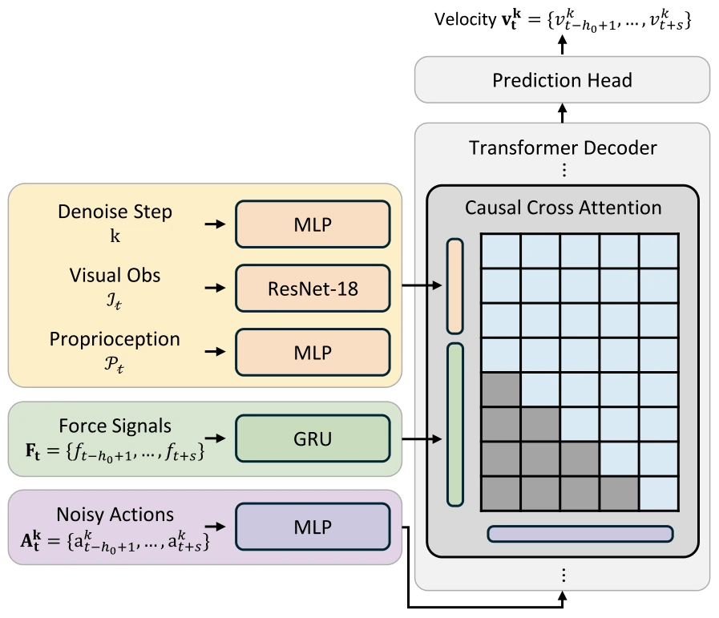

<!-- Generated by scripts/generate.py; edit data/works.json and data/media.json. -->

[← Back to the Awesome index](../../../README.md) · [Interactive website](https://chang-xinhai.github.io/Awesome-RGBDT-Manipulation/?collection=policy&item=implicitrdp#library)

# ImplicitRDP

ImplicitRDP: An End-to-End Visual-Force Diffusion Policy with Structural Slow-Fast Learning

**2025-12-11 · IEEE RA-L 2026 · Shanghai Jiao Tong University / Shanghai Innovation Institute / Noematrix Ltd.**

**[Paper](https://arxiv.org/abs/2512.10946)** · [Project](https://implicit-rdp.github.io/) · [Code](https://github.com/Chen-Wendi/ImplicitRDP) · [Data](https://huggingface.co/datasets/WendiChen/ImplicitRDP_dataset) · [Weights](https://huggingface.co/WendiChen/ImplicitRDP_model)

A causal diffusion Transformer performs action-rate force correction while caching slower visual observations.

*ImplicitRDP: An End-to-End Visual-Force Diffusion Policy with Structural Slow-Fast Learning authors · [Figure source](https://arxiv.org/abs/2512.10946) · Original rights retained.*

| Field | Reported value and source scope |
| :-- | :-- |
| Record type | policy |
| Policy family | Diffusion [1](https://arxiv.org/abs/2512.10946)  |
| Base model and architecture | Transformer Diffusion Policy with ResNet-18, causal GRU force encoder and deterministic DDIM inference. [1](https://arxiv.org/abs/2512.10946)  |
| Model size and component | Not reported. [1](https://arxiv.org/abs/2512.10946)  |
| Deployment inputs | Wrist RGB and proprioceptive state cached at the slow rate; current/past wrist six-axis F/T samples supplied within each chunk. [1](https://arxiv.org/abs/2512.10946)  |
| Action outputs and horizon | Relative Cartesian actions; auxiliary virtual-target and adaptive-stiffness dimensions are discarded before execution. [1](https://arxiv.org/abs/2512.10946)  |
| Training method | End-to-end velocity-prediction diffusion with causal action-force attention, fixed chunk noise and virtual-target representation regularization. Future logged force is masked to prevent leakage. [1](https://arxiv.org/abs/2512.10946)  |
| Training data | Three real tasks with 40 kinesthetic demonstrations each: Box Flipping, Switch Toggling and Hole Inserting. [1](https://arxiv.org/abs/2512.10946)  |
| Training duration | Not reported in the paper. [1](https://arxiv.org/abs/2512.10946)  |
| Training hardware | Not reported for training; RTX 4090 / i9-13900K is the measured inference machine. [1](https://arxiv.org/abs/2512.10946)  |
| Inference and control rates | Force-responsive action loop 10 Hz; slow visual/proprioceptive encoding refreshed every 0.6 s. Paper reports &lt;30 ms fast-step model inference on RTX 4090. [1](https://arxiv.org/abs/2512.10946)  |
| Evaluation scope | Flexiv Rizon 4s, wrist webcam, six-axis F/T and custom compliant fingertip; 20 binary trials/task. Box flipping has a 14 N limit; hole insertion has 1 mm margin. [1](https://arxiv.org/abs/2512.10946)  |
| Observations / modalities | RGB · Force/Torque · Proprioception |
| Evaluation domain | Real world |
| Embodiment | Robot arm with task-specific tool |
| Release: code | Available [2](https://implicit-rdp.github.io/) [3](https://github.com/Chen-Wendi/ImplicitRDP)  |
| Release: weights | Available [2](https://implicit-rdp.github.io/) [3](https://github.com/Chen-Wendi/ImplicitRDP)  |
| Release: data | Partial [2](https://implicit-rdp.github.io/) [3](https://github.com/Chen-Wendi/ImplicitRDP)  |
| Release: license | MIT root LICENSE; third-party components retain their licenses. [2](https://implicit-rdp.github.io/) [3](https://github.com/Chen-Wendi/ImplicitRDP)  |
| Release: notes | Code and checkpoint files for flip/toggle verified. Public data inventory contains flip/toggle archives; insertion data/checkpoints not present in inspected inventory. Current released hardware README mentions an external USB camera, while paper describes a wrist camera. [2](https://implicit-rdp.github.io/) [3](https://github.com/Chen-Wendi/ImplicitRDP)  |

**Scope and qualifications**

- Force feedback uses a wrist F/T sensor, not cutaneous tactile skin.
- Auxiliary stiffness is a training regularizer; it is not executed as a predicted impedance-control parameter.
- Custom compliant fingertips and tuned low-level position tracking are part of the reported setup.

**Primary evidence**

1. [Original paper and reviewed full text](https://arxiv.org/abs/2512.10946) — Full primary text, including available supplementary implementation details; first public date retained separately from reviewed revision.
2. [Official author project](https://implicit-rdp.github.io/) — Current project links and release claims checked independently of paper prose.
3. [Official implementation and repository files](https://github.com/Chen-Wendi/ImplicitRDP) — Training/deployment implementation, README and actual LICENSE inspected where present.
