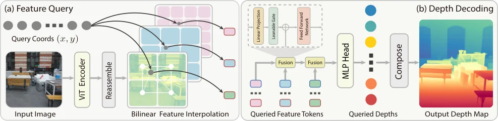

<!-- Generated by scripts/generate.py; edit data/works.json and data/media.json. -->

[← Back to the Awesome index](../../../README.md) · [Interactive website](https://chang-xinhai.github.io/Awesome-RGBDT-Manipulation/?collection=policy&item=infinidepth#library)

# InfiniDepth

InfiniDepth: Arbitrary-Resolution and Fine-Grained Depth Estimation with Neural Implicit Fields

**2026-01-06 · CVPR 2026 · Zhejiang University and Li Auto**

**[Paper](https://arxiv.org/abs/2601.03252)** · [Project](https://zju3dv.github.io/InfiniDepth/) · [Code](https://github.com/zju3dv/InfiniDepth) · [Weights](https://huggingface.co/ritianyu/InfiniDepth/tree/main)

An implicit decoder queries depth continuously. RGB-only decoding and optional sensor-guided metric reconstruction are separate operating modes.

*Hao Yu and coauthors · [Figure source](https://arxiv.org/html/2601.03252v1) · Original rights retained.*

| Field | Reported value and source scope |
| :-- | :-- |
| Record type | model |
| Model role and downstream interface | Geometry perception model [1](https://arxiv.org/html/2601.03252v1)  |
| Model family | Continuous implicit depth and sensor augmentation [1](https://arxiv.org/html/2601.03252v1)  |
| Model architecture | Multiscale image features, local implicit decoder and optional Gaussian head. [1](https://arxiv.org/html/2601.03252v1)  |
| Model size and component | Not reported [1](https://arxiv.org/html/2601.03252v1)  |
| Model inputs | RGB image and continuous spatial coordinates; optional observed depth in the separately trained sensor variant. [1](https://arxiv.org/html/2601.03252v1) [3](https://github.com/zju3dv/InfiniDepth)  |
| Model outputs | Depth query at arbitrary coordinates, optional metric depth augmentation and 3D Gaussian export. [1](https://arxiv.org/html/2601.03252v1)  |
| Training method | Train an implicit local query decoder and optional heads with densely supervised samples and depth-sensor priors per variant. [1](https://arxiv.org/html/2601.03252v1)  |
| Training data and scale | Paper appendix describes RGB-only and sensor depth sources; the Synth4K test set is a separate evaluation resource. [1](https://arxiv.org/html/2601.03252v1)  |
| Training duration | Not reported [1](https://arxiv.org/html/2601.03252v1)  |
| Training hardware | Not reported [1](https://arxiv.org/html/2601.03252v1)  |
| Inference setting and runtime | The arbitrary-resolution query trades sample count against runtime. Optional sensor or external monocular scale anchors differ by mode. [1](https://arxiv.org/html/2601.03252v1) [3](https://github.com/zju3dv/InfiniDepth) [5](https://github.com/zju3dv/InfiniDepth/blob/main/INSTALL.md)  |
| Downstream evaluation and scope | Relative depth evaluated on Synth4K and real images; metric sensor augmentation and large viewpoint changes use separately stated protocols. [1](https://arxiv.org/html/2601.03252v1)  |
| Observations / modalities | RGB · Depth |
| Evaluation domain | Simulation · Real world |
| Embodiment |  |
| Release: code | Available — author inference, training and evaluation source. [2](https://zju3dv.github.io/InfiniDepth/) [3](https://github.com/zju3dv/InfiniDepth)  |
| Release: weights | Available — linked relative-depth, sensor-guided and Gaussian checkpoints. [2](https://zju3dv.github.io/InfiniDepth/) [3](https://github.com/zju3dv/InfiniDepth) [5](https://github.com/zju3dv/InfiniDepth/blob/main/INSTALL.md)  |
| Release: data | Synth4K benchmark protocol and files for local evaluation are documented; a stand-alone complete Synth4K download was not verified. [2](https://zju3dv.github.io/InfiniDepth/)  |
| Release: license | Source uses the Project Registration License v1.0. Weight bundle and dependencies should be checked independently. [2](https://zju3dv.github.io/InfiniDepth/) [4](https://github.com/zju3dv/InfiniDepth/blob/main/LICENSE)  |
| Release: notes | The author CLI uses a separate MoGe-2 checkpoint to recover metric scale for RGB-only geometry exports. [2](https://zju3dv.github.io/InfiniDepth/)  |

**Scope and qualifications**

- A continuous RGB-only result does not provide measured range. The included sensor path takes actual depth input.

**Primary evidence**

1. [Original author paper or dataset description](https://arxiv.org/html/2601.03252v1)
2. [Author source and artifact entry points](https://zju3dv.github.io/InfiniDepth/)
3. [Author checkpoints and mode-specific CLI instructions](https://github.com/zju3dv/InfiniDepth)
4. [Actual source registration license](https://github.com/zju3dv/InfiniDepth/blob/main/LICENSE)
5. [Official model zoo and checkpoint combinations](https://github.com/zju3dv/InfiniDepth/blob/main/INSTALL.md)
