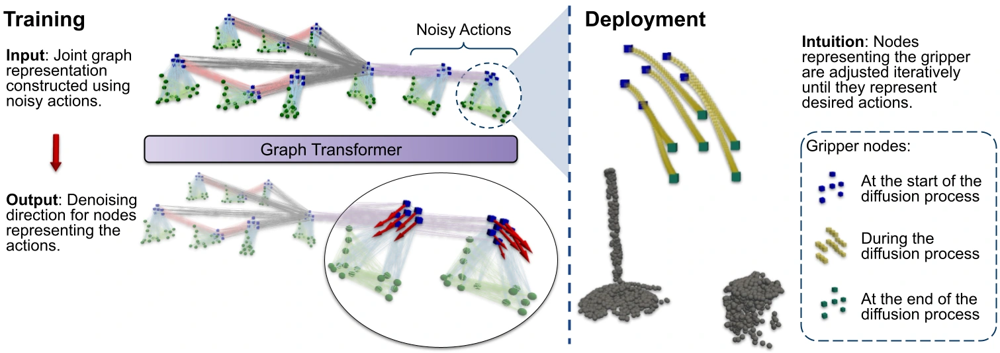

<!-- Generated by scripts/generate.py; edit data/works.json and data/media.json. -->

[← Back to the Awesome index](../../../README.md) · [Interactive website](https://chang-xinhai.github.io/Awesome-RGBDT-Manipulation/?collection=policy&item=instant-policy#library)

# Instant Policy

Instant Policy: In-Context Imitation Learning via Graph Diffusion

**2024-11-19 · ICLR 2025 · Not reported**

**[Paper](https://arxiv.org/abs/2411.12633)** · [Project](https://www.robot-learning.uk/instant-policy) · [Code](https://github.com/vv19/instant_policy)

A graph-based diffusion model adapts manipulation behavior from one or two demonstration trajectories using segmented point-cloud geometry.

*Instant Policy authors · [Figure source](https://arxiv.org/abs/2411.12633) · Original rights retained.*

| Field | Reported value and source scope |
| :-- | :-- |
| Record type | policy |
| Policy family | Diffusion [1](https://arxiv.org/abs/2411.12633)  |
| Base model and architecture | Graph diffusion network with a pretrained local-geometry encoder; no language backbone. [1](https://arxiv.org/abs/2411.12633)  |
| Model size and component | Scaling study: 69M, 117M and 178M trainable parameters, with the geometry encoder treated separately. [1](https://arxiv.org/abs/2411.12633)  |
| Deployment inputs | One or two demonstrations, current end-effector / gripper state and segmented object point clouds downsampled to 2,048 points in the end-effector frame. [1](https://arxiv.org/abs/2411.12633)  |
| Action outputs and horizon | Denoised SE(3) end-effector actions and binary gripper commands. [1](https://arxiv.org/abs/2411.12633)  |
| Training method | Offline graph-diffusion training on synthetic pseudo-demonstrations; target demonstrations condition inference without weight updates. [1](https://arxiv.org/abs/2411.12633)  |
| Training data | Continuously generated simulated pseudo-demonstrations, including geometric motion and common trajectory templates; no target-task demonstration training is required. [1](https://arxiv.org/abs/2411.12633)  |
| Training duration | 2.5 million optimization steps, approximately five days, followed by a 50,000-step learning-rate cooldown. [1](https://arxiv.org/abs/2411.12633)  |
| Training hardware | One NVIDIA GeForce RTX 3080 Ti for the reported training run. [1](https://arxiv.org/abs/2411.12633)  |
| Inference and control rates | Demonstrations are recorded at 25 Hz in simulation and 10 Hz in the real world; these are recording rates rather than an asserted neural inference rate. [1](https://arxiv.org/abs/2411.12633)  |
| Evaluation scope | 24 unseen RLBench tasks and 16 real-world manipulation tasks. [1](https://arxiv.org/abs/2411.12633)  |
| Observations / modalities | Depth · Proprioception |
| Evaluation domain | Simulation · Real world |
| Embodiment | Parallel-jaw gripper |
| Release: code | Partial — deployment code and compiled model [2](https://github.com/vv19/instant_policy)  |
| Release: weights | Not verified [2](https://github.com/vv19/instant_policy)  |
| Release: data | Not verified [2](https://github.com/vv19/instant_policy)  |
| Release: license | PolyForm Noncommercial 1.0.0 [2](https://github.com/vv19/instant_policy)  |
| Release: notes | Repository provides deployment utilities and instant_policy.so/pyi; this is not a complete source/training release and has noncommercial terms. [2](https://github.com/vv19/instant_policy)  |

**Scope and qualifications**

- Point clouds contain segmented objects of interest; robots, tables and distractors are excluded by the observation pipeline.
- Real-world segmentation failures are a documented limitation.
- RLBench simulation uses ground-truth object segmentation; real-world segmentation is a separate perception procedure.

**Primary evidence**

1. [Primary paper, full text](https://arxiv.org/abs/2411.12633) — Publication date is the first arXiv submission. Policy fields distinguish model calls, controller execution and learning.
2. [Official implementation, README and file/license inspection on 19 October 2026](https://github.com/vv19/instant_policy) — Repository provides deployment utilities and instant_policy.so/pyi; this is not a complete source/training release and has noncommercial terms. PolyForm Noncommercial 1.0.0.
