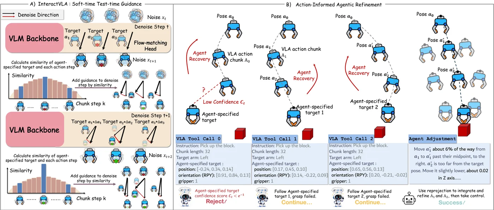

<!-- Generated by scripts/generate.py; edit data/works.json and data/media.json. -->

[← Back to the Awesome index](../../../README.md) · [Interactive website](https://chang-xinhai.github.io/Awesome-RGBDT-Manipulation/?collection=policy&item=interactvla#library)

# InteractVLA

InteractVLA: Turning VLAs into Interactive Tools for Agentic Robotic Manipulation

**2026-11-17 · Preprint · Renmin University of China and Meituan**

**[Paper](https://arxiv.org/abs/2611.22584)** · [Project](https://lingwupro.github.io/InteractVLA/) · [Code](https://github.com/LingwuPro/InteractVLA)

A reasoning agent steers a frozen VLA toward a target pose and inspects each proposed action chunk in calibrated camera views.

*InteractVLA authors · [Figure source](https://arxiv.org/html/2611.22584v1) · Original rights retained.*

| Field | Reported value and source scope |
| :-- | :-- |
| Record type | policy |
| Policy family | Agent + geometrically guided VLA [1](https://arxiv.org/html/2611.22584)  |
| Base model and architecture | MR-0; GPT-6 Astra or GPT-6.1 Sol, depending on evaluation [1](https://arxiv.org/html/2611.22584)  |
| Model size and component | Not reported [1](https://arxiv.org/html/2611.22584)  |
| Deployment inputs | Language, task and camera observations, robot state, target end-effector poses and optional calibrated RGB-D back-projections. [1](https://arxiv.org/html/2611.22584)  |
| Action outputs and horizon | Guided VLA action chunks, optional segment edits and subsequent revised targets. [1](https://arxiv.org/html/2611.22584)  |
| Training method | Frozen VLA steered via gradients in action sampling and soft temporal alignment. The RSI loop refines targets/execution across rollouts. [1](https://arxiv.org/html/2611.22584)  |
| Training data | Uses existing pretrained VLA; no new weight-training corpus specified for the guidance procedure. [1](https://arxiv.org/html/2611.22584)  |
| Training duration | Not reported [1](https://arxiv.org/html/2611.22584)  |
| Training hardware | Not reported [1](https://arxiv.org/html/2611.22584)  |
| Inference and control rates | Not reported [1](https://arxiv.org/html/2611.22584)  |
| Evaluation scope | Author-reported 99.4% on LIBERO-Plus, 48.62% on RoboDojo and 89.4% on RoboCasa365. Four physical bimanual tasks are reported separately. [1](https://arxiv.org/html/2611.22584)  |
| Observations / modalities | RGB · Depth · Proprioception · Language |
| Evaluation domain | Simulation · Real world |
| Embodiment | Bimanual manipulation platform |
| Release: code | Available — PyTorch and JAX steering implementations [2](https://lingwupro.github.io/InteractVLA/) [3](https://github.com/LingwuPro/InteractVLA)  |
| Release: weights | No new checkpoint verified; compatible upstream VLA checkpoints required [2](https://lingwupro.github.io/InteractVLA/) [3](https://github.com/LingwuPro/InteractVLA)  |
| Release: data | Not verified [2](https://lingwupro.github.io/InteractVLA/) [3](https://github.com/LingwuPro/InteractVLA)  |
| Release: license | No root license verified; the bundled StarVLA component carries its own license [2](https://lingwupro.github.io/InteractVLA/) [3](https://github.com/LingwuPro/InteractVLA)  |
| Release: notes | Public code includes the steering package, tool interface and task configurations. Reported agent evaluations also require external models and environments. [2](https://lingwupro.github.io/InteractVLA/) [3](https://github.com/LingwuPro/InteractVLA)  |

**Scope and qualifications**

- The 3D interface uses optional RGB-D back-projection and calibrated reprojection where available. The paper comparison should not be interpreted as a claim that the official RoboDojo Agent track permits simulator depth.
- Sampling gradients act on action generation, not model parameters. The agent may revise target pose or a motion segment; this is distinct from training a new VLA.

**Primary evidence**

1. [Primary paper and evaluated setting](https://arxiv.org/html/2611.22584)
2. [Author project and artifact status](https://lingwupro.github.io/InteractVLA/)
3. [Official repository and public artifact inventory](https://github.com/LingwuPro/InteractVLA) — Verified package source, benchmark configurations, OpenPI backend and third-party notice. Root license was not located.
