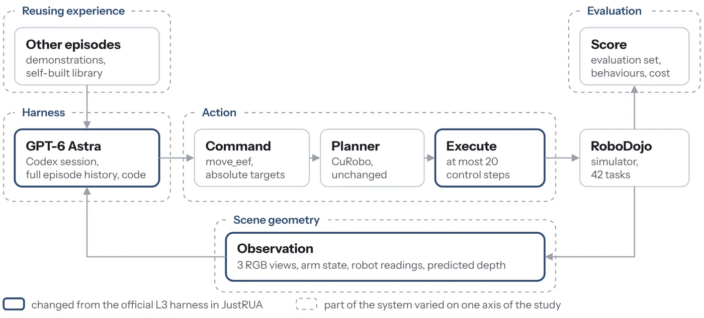

<!-- Generated by scripts/generate.py; edit data/works.json and data/media.json. -->

[← Back to the Awesome index](../../../README.md) · [Interactive website](https://chang-xinhai.github.io/Awesome-RGBDT-Manipulation/?collection=policy&item=justrua#library)

# JustRUA

JustRUA: A Controlled Study of GPT-6 Robot-Use Agents

**2026-11-11 · Preprint · Tsinghua University and collaborators**

**[Paper](https://arxiv.org/abs/2611.16009)** · [Project](https://zefanw.github.io/JustRUA/) · [Code](https://github.com/ZefanW/JustRUA) · [Replays](https://huggingface.co/spaces/ZefanW/robodojo-replay-explorer)

Tests how episode history, capped motions, gripper feedback and RGB-predicted depth change a direct robot-use agent.

*JustRUA authors · [Figure source](https://arxiv.org/html/2611.16009v1) · Original rights retained.*

| Field | Reported value and source scope |
| :-- | :-- |
| Record type | policy |
| Policy family | Direct robot-use agent and controlled harness study [1](https://arxiv.org/html/2611.16009)  |
| Base model and architecture | GPT-6 Astra; Apple Depth Pro in the predicted-depth branch [1](https://arxiv.org/html/2611.16009)  |
| Model size and component | Not reported [1](https://arxiv.org/html/2611.16009)  |
| Deployment inputs | Three RGB views, camera calibration, state, finger/wrist feedback, history and optional RGB-derived depth. [1](https://arxiv.org/html/2611.16009)  |
| Action outputs and horizon | Absolute end-effector and gripper commands through the fixed simulator planner. [1](https://arxiv.org/html/2611.16009)  |
| Training method | Frozen model and planner; no training, self-improvement or task-specific tuning in the released policy. The study separately tests experience reuse. [1](https://arxiv.org/html/2611.16009)  |
| Training data | Not applicable for the final fixed harness. [1](https://arxiv.org/html/2611.16009)  |
| Training duration | Not reported [1](https://arxiv.org/html/2611.16009)  |
| Training hardware | Not reported [1](https://arxiv.org/html/2611.16009)  |
| Inference and control rates | Not reported [1](https://arxiv.org/html/2611.16009)  |
| Evaluation scope | Score rises from 29.7 to 50.3 on the authors’ fixed 111-episode set. Capped 20-step motions and denser feedback are evaluated independently. [1](https://arxiv.org/html/2611.16009)  |
| Observations / modalities | RGB · Proprioception · Force · Language |
| Evaluation domain | Simulation |
| Embodiment | Dual-arm ARX X5 (simulation) |
| Release: code | Available — deployable RoboDojo/XPolicyLab adapter [2](https://zefanw.github.io/JustRUA/) [3](https://github.com/ZefanW/JustRUA)  |
| Release: weights | External GPT-6 Astra access; Depth Pro is an external model [2](https://zefanw.github.io/JustRUA/) [3](https://github.com/ZefanW/JustRUA)  |
| Release: data | Public episode replay explorer; full corpus scope not verified [2](https://zefanw.github.io/JustRUA/) [3](https://github.com/ZefanW/JustRUA)  |
| Release: license | Apache-2.0 original adapter; MIT for noted measurement code; external components retain their terms [2](https://zefanw.github.io/JustRUA/) [3](https://github.com/ZefanW/JustRUA)  |
| Release: notes | The author repo contains deployment, observation, agent and planner integration source. [2](https://zefanw.github.io/JustRUA/) [3](https://github.com/ZefanW/JustRUA)  |

**Scope and qualifications**

- Depth Pro predicts metric depth from RGB; simulator depth is tested separately as an ablation. Gripper and wrist readings here are measured inside simulation.
- The 50.3 score is for 111 author-selected episodes covering all 42 tasks, with additional layouts on high-variance tasks. It is not a full official leaderboard result.

**Primary evidence**

1. [Primary paper and evaluated setting](https://arxiv.org/html/2611.16009)
2. [Author project and artifact status](https://zefanw.github.io/JustRUA/)
3. [Official repository and public artifact inventory](https://github.com/ZefanW/JustRUA) — Verified policy/ source, adapter instructions and Apache-2.0 LICENSE.
