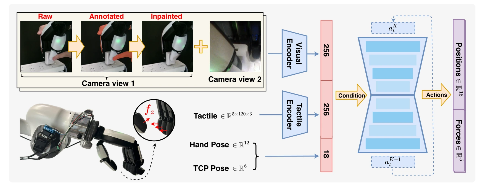

<!-- Generated by scripts/generate.py; edit data/works.json and data/media.json. -->

[← Back to the Awesome index](../../../README.md) · [Interactive website](https://chang-xinhai.github.io/Awesome-RGBDT-Manipulation/?collection=policy&item=kinedex#library)

# KineDex

KineDex: Learning Tactile-Informed Visuomotor Policies via Kinesthetic Teaching for Dexterous Manipulation

**2025-05-04 · Preprint · Tongji University / Tsinghua University / Shanghai Jiao Tong University / University of Hong Kong / Shanghai Qi Zhi Institute / Shanghai AI Lab**

**[Paper](https://arxiv.org/abs/2505.01974)** · [Project](https://dinomini00.github.io/KineDex/) · [Code](https://github.com/DinoMini00/KineDex_code)

Hand-over-hand demonstrations train a tactile diffusion policy that predicts joint positions and normal fingertip forces for dexterous control.

*KineDex authors · [Figure source](https://arxiv.org/abs/2505.01974) · Original rights retained.*

| Field | Reported value and source scope |
| :-- | :-- |
| Record type | policy |
| Policy family | Diffusion [1](https://arxiv.org/abs/2505.01974)  |
| Base model and architecture | U-Net Diffusion Policy with multi-view image encoding, shared per-finger 1D convolutional tactile encoder and force-informed controller. [1](https://arxiv.org/abs/2505.01974)  |
| Model size and component | Not reported. [1](https://arxiv.org/abs/2505.01974)  |
| Deployment inputs | Front and wrist RGB, robot state and 5×120×3 tactile force readings from XHand1. Human-body masks and inpainting modify training images, not runtime sensing. [1](https://arxiv.org/abs/2505.01974)  |
| Action outputs and horizon | 16-step chunks of 23-dimensional actions: six end-effector pose dimensions, twelve hand joint angles and five target normal fingertip forces. [1](https://arxiv.org/abs/2505.01974)  |
| Training method | Task-specific diffusion imitation from kinesthetic demonstrations; Grounded-SAM and ProPainter remove demonstrator occlusion before training. Force targets modify finger position setpoints during deployment. [1](https://arxiv.org/abs/2505.01974)  |
| Training data | Nine real tasks. Appendix B reports approximately 100 demonstrations/task for simpler picking, plugging and insertion, and around 150 for more challenging tasks such as toothpaste squeezing and syringe pressing; exact total Not reported. [1](https://arxiv.org/abs/2505.01974)  |
| Training duration | 500 epochs per task; wall-clock time Not reported. [1](https://arxiv.org/abs/2505.01974)  |
| Training hardware | Not reported. [1](https://arxiv.org/abs/2505.01974)  |
| Inference and control rates | Interpolation controller: arm 100 Hz and hand 50 Hz. Learned policy refresh frequency Not reported; 16-step chunks and eight-step temporal ensembling. [1](https://arxiv.org/abs/2505.01974)  |
| Evaluation scope | Franka Panda / 12-DoF XHand1: Bottle Picking, Cup Picking, Egg Picking, Cap Twisting, Nut Tightening, Peg Insertion, Charger Plugging, Toothpaste Squeezing and Syringe Pressing; 20 trials/task. Inspire Hand is used separately for collection-efficiency comparisons. [1](https://arxiv.org/abs/2505.01974)  |
| Observations / modalities | RGB · Tactile · Proprioception |
| Evaluation domain | Real world |
| Embodiment | Dexterous hand |
| Release: code | Available [2](https://dinomini00.github.io/KineDex/) [3](https://github.com/DinoMini00/KineDex_code)  |
| Release: weights | Not verified [2](https://dinomini00.github.io/KineDex/) [3](https://github.com/DinoMini00/KineDex_code)  |
| Release: data | Not verified [2](https://dinomini00.github.io/KineDex/) [3](https://github.com/DinoMini00/KineDex_code)  |
| Release: license | MIT (actual repository LICENSE); third-party components retain their own licenses. [2](https://dinomini00.github.io/KineDex/) [3](https://github.com/DinoMini00/KineDex_code)  |
| Release: notes | Collection, task-specific policy training and evaluation source verified. README explicitly excludes inpainting implementation and refers users to external tools. Public checkpoints/dataset downloads not verified. [2](https://dinomini00.github.io/KineDex/) [3](https://github.com/DinoMini00/KineDex_code)  |

**Scope and qualifications**

- Predicts five normal-force targets although tactile observations contain three-axis forces; no wrist six-axis F/T stream is claimed.
- The force-informed controller adjusts finger targets using fixed stiffness coefficients; it is distinct from direct torque-action learning.
- Hardware for the nine-task policy evaluation is XHand1; collection-efficiency/user studies use an Inspire Hand setup.
- Arm/hand interpolation rates are not the learned-policy inference frequency.

**Primary evidence**

1. [Original paper, §§3–4 and Appendices A–D](https://arxiv.org/abs/2505.01974) — Original XHand1 policy: 120 three-axis taxels/finger. Benchmark-specific resampling and adapter dimensions do not redefine this interface.
2. [Official author project](https://dinomini00.github.io/KineDex/) — Author-linked implementation identity and artifact links reviewed.
3. [Official implementation, README and LICENSE](https://github.com/DinoMini00/KineDex_code) — Collection/training/evaluation code and MIT LICENSE inspected; inpainting step explicitly not included.
