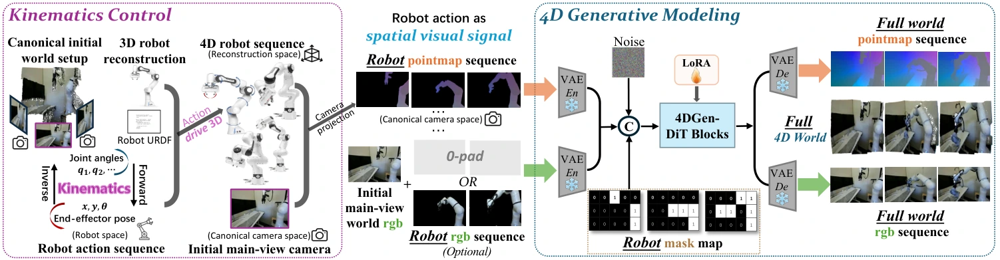

<!-- Generated by scripts/generate.py; edit data/works.json and data/media.json. -->

[← Back to the Awesome index](../../../README.md) · [Interactive website](https://chang-xinhai.github.io/Awesome-RGBDT-Manipulation/?collection=policy&item=kinema4d#library)

# Kinema4D

Kinema4D: Kinematic 4D World Modeling for Spatiotemporal Embodied Simulation

**2026-03-17 · arXiv preprint · S-Lab, Nanyang Technological University; CUHK Shenzhen**

**[Paper](https://arxiv.org/abs/2603.16669)** · [Project](https://mutianxu.github.io/Kinema4D-project-page/) · [Code](https://github.com/mutianxu/Kinema4D) · [Data](https://huggingface.co/datasets/Minoday/Robo4D-200k) · [Weights](https://huggingface.co/Minoday/Kinema4D)

A neural simulator combines exact robot kinematics with generative 4D environmental reactions.

*Kinema4D authors · [Figure source](https://arxiv.org/html/2603.16669) · Original rights retained.*

| Field | Reported value and source scope |
| :-- | :-- |
| Record type | model |
| Model role and downstream interface | Kinematically controlled 4D neural simulator [1](https://arxiv.org/abs/2603.16669)  |
| Model family | Predictive world model [1](https://arxiv.org/abs/2603.16669)  |
| Model architecture | URDF-driven robot pointmap control and Wan2.1/4DNeX-derived RGB/pointmap generative backbone. [1](https://arxiv.org/abs/2603.16669)  |
| Model size and component | Not reported in the inspected primary-source sections [1](https://arxiv.org/abs/2603.16669)  |
| Model inputs | Robot kinematics, candidate actions, reconstructed robot geometry and initial scene. [1](https://arxiv.org/abs/2603.16669)  |
| Model outputs | Synchronized future RGB and pointmap sequences. [1](https://arxiv.org/abs/2603.16669)  |
| Training method | Action-conditioned generative world modeling on 4D-annotated simulation/robot interaction episodes. [1](https://arxiv.org/abs/2603.16669)  |
| Training data and scale | Robo4D-200K: 201,426 episodes; 2% held out for validation. [1](https://arxiv.org/abs/2603.16669)  |
| Training duration | Not reported in the inspected primary-source sections [1](https://arxiv.org/abs/2603.16669)  |
| Training hardware | Not reported in the inspected primary-source sections [1](https://arxiv.org/abs/2603.16669)  |
| Inference setting and runtime | Not reported in the inspected primary-source sections [1](https://arxiv.org/abs/2603.16669)  |
| Downstream evaluation and scope | Generated reaction accuracy and policy-evaluation comparisons for three simulation/three real scenarios. [1](https://arxiv.org/abs/2603.16669)  |
| Observations / modalities | RGB · Proprioception |
| Evaluation domain | Simulation · Real world |
| Embodiment |  |
| Release: code | Available [2](https://github.com/mutianxu/Kinema4D)  |
| Release: weights | Available [2](https://github.com/mutianxu/Kinema4D) [3](https://huggingface.co/Minoday/Kinema4D)  |
| Release: data | Available [2](https://github.com/mutianxu/Kinema4D) [4](https://huggingface.co/datasets/Minoday/Robo4D-200k)  |
| Release: license | Apache-2.0 repository, model and dataset cards; upstream pretrained backbones retain separate terms [2](https://github.com/mutianxu/Kinema4D)  |
| Release: notes | Official repository includes training, inference and preprocessing. Kinema4D checkpoint files and Robo4D-200k dataset shards were verified independently. [2](https://github.com/mutianxu/Kinema4D)  |

**Scope and qualifications**

- A separate Diffusion Policy supplies actions; Kinema4D predicts outcomes rather than selecting actions.
- Real OOD predicted success remains higher than observed robot success, limiting simulator calibration.

**Primary evidence**

1. [Original manuscript and first submission history](https://arxiv.org/abs/2603.16669) — Full author HTML method/evaluation/appendix inspected; depth observations, pseudo-labels and generated outputs retain distinct roles.
2. [Official implementation, README and file/license inspection on 19 October 2026](https://github.com/mutianxu/Kinema4D) — Official repository includes training, inference and preprocessing. Kinema4D checkpoint files and Robo4D-200k dataset shards were verified independently. Apache-2.0 repository, model and dataset cards; upstream pretrained backbones retain separate terms.
3. [Official released artifact inventory and model/dataset card](https://huggingface.co/Minoday/Kinema4D) — File inventory and artifact-specific terms checked independently; no upstream artifact is counted as this work’s trained release.
4. [Official released artifact inventory and model/dataset card](https://huggingface.co/datasets/Minoday/Robo4D-200k) — File inventory and artifact-specific terms checked independently; no upstream artifact is counted as this work’s trained release.
