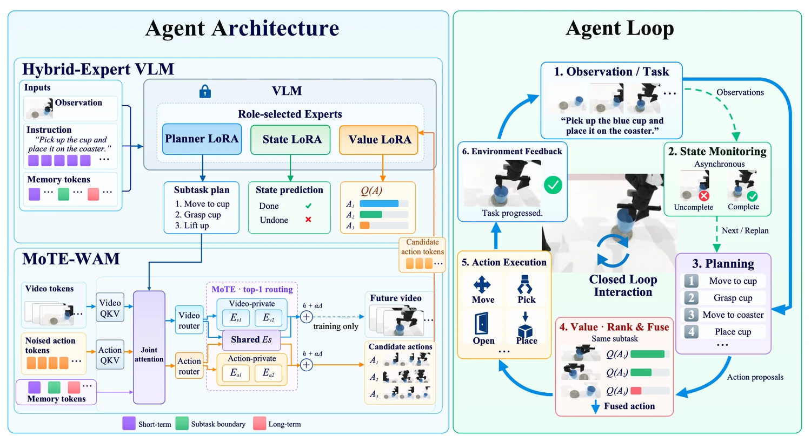

<!-- Generated by scripts/generate.py; edit data/works.json and data/media.json. -->

[← Back to the Awesome index](../../../README.md) · [Interactive website](https://chang-xinhai.github.io/Awesome-RGBDT-Manipulation/?collection=policy&item=law#library)

# LAW

LAW: Unifying Language, Action, and World Modeling for Agentic Physical Intelligence

**2026-10-16 · Preprint · Peking University**

**[Paper](https://arxiv.org/abs/2610.23334)** · [Project](https://hey-cjj.github.io/LAW-project/) · [Code](https://github.com/hey-cjj/LAW) · [Data](https://huggingface.co/datasets/KAITANG2003/LAW-RoboTwin-WAM-Training) · [Weights](https://huggingface.co/KAITANG2003/LAW-OpenWAM) · [Data-Vlm](https://huggingface.co/datasets/KAITANG2003/LAW-RoboTwin-VLM-Training) · [Weights-Fastwam](https://huggingface.co/KAITANG2003/LAW-FastWAM) · [Weights-Vlm](https://huggingface.co/KAITANG2003/LAW-VLM-OpenWAM) · [Weights-Vlm-Fastwam](https://huggingface.co/KAITANG2003/LAW-VLM-FastWAM)

A hybrid-expert VLM plans subtasks, assesses progress and values candidate WAM actions while dual-stream memory maintains the execution history.

*LAW authors; original rights retained · [Figure source](https://arxiv.org/abs/2610.23334) · Original rights retained.*

| Field | Reported value and source scope |
| :-- | :-- |
| Record type | policy |
| Policy family | Hybrid [1](https://arxiv.org/html/2610.23334)  |
| Base model and architecture | Qwen3-VL-2B-Instruct frozen base with planner/state/value LoRA; FastWAM or OpenWAM-α action backbone. [1](https://arxiv.org/html/2610.23334)  |
| Model size and component | 2B VLM backbone plus distinct WAM and adapters; combined total not reported. [1](https://arxiv.org/html/2610.23334)  |
| Deployment inputs | Task, three RGB views, robot state, short-term visual history and persistent long-term memory. [1](https://arxiv.org/html/2610.23334)  |
| Action outputs and horizon | Subtask plans, asynchronous state checks and value-ranked/fused continuous WAM action chunks. [1](https://arxiv.org/html/2610.23334)  |
| Training method | Train subtask planner/state/value experts, MoTE video-action WAM and subtask-local values; freeze backbone parameters where specified. At inference, feedback updates memory and subtask plans rather than performing online weight updates. [1](https://arxiv.org/html/2610.23334)  |
| Training data | RoboTwin 50 clean/randomized demonstrations; separate RoboDojo and physical data protocols. Q1/Q2/Q3 annotation packages are released for RoboTwin. [1](https://arxiv.org/html/2610.23334)  |
| Training duration | Planner 3k, state 50k, WAM 30k, value 50k steps; wall-clock not reported. [1](https://arxiv.org/html/2610.23334)  |
| Training hardware | 16 GPUs for VLM experts; 32 for WAM in paper Table 1. [1](https://arxiv.org/html/2610.23334)  |
| Inference and control rates | Not reported [1](https://arxiv.org/html/2610.23334)  |
| Evaluation scope | RoboTwin 50 clean/randomized average 94.21% with FastWAM, 95.56% with OpenWAM; three real long-horizon tasks, 65% mean. Paper RoboDojo comparison is not official-board membership. [1](https://arxiv.org/html/2610.23334)  |
| Observations / modalities | RGB · Proprioception · Language |
| Evaluation domain | Simulation · Real world |
| Embodiment | Bimanual · Parallel-jaw gripper |
| Release: code | Available — RoboTwin FastWAM/OpenWAM pipelines [2](https://github.com/hey-cjj/LAW) [3](https://huggingface.co/KAITANG2003/LAW-OpenWAM) [4](https://huggingface.co/KAITANG2003/LAW-FastWAM)  |
| Release: weights | Available — four WAM/VLM checkpoint inventories [2](https://github.com/hey-cjj/LAW) [3](https://huggingface.co/KAITANG2003/LAW-OpenWAM) [4](https://huggingface.co/KAITANG2003/LAW-FastWAM)  |
| Release: data | Partial — RoboTwin WAM data and Q1/Q2/Q3 annotation packages [2](https://github.com/hey-cjj/LAW) [3](https://huggingface.co/KAITANG2003/LAW-OpenWAM) [4](https://huggingface.co/KAITANG2003/LAW-FastWAM)  |
| Release: license | MIT original/root code; Apache-2.0 LAW-authored weights/adapters; CC BY 4.0 author annotations. Source videos, images, meshes and upstream assets retain separate rights. [2](https://github.com/hey-cjj/LAW) [3](https://huggingface.co/KAITANG2003/LAW-OpenWAM) [4](https://huggingface.co/KAITANG2003/LAW-FastWAM)  |
| Release: notes | Actual training/inference modules and four HF checkpoint repositories are public. HF annotation license tags do not relicense source videos or assets. Released RoboTwin pipelines do not establish all physical-robot and RoboDojo reproduction artifacts. [2](https://github.com/hey-cjj/LAW) [3](https://huggingface.co/KAITANG2003/LAW-OpenWAM) [4](https://huggingface.co/KAITANG2003/LAW-FastWAM)  |

**Scope and qualifications**

- The 2B label is the VLM backbone, not the full combined WAM agent parameter total.
- This agent trains planner/state/value LoRA experts and a WAM; it is not a wholly frozen zero-training harness.
- Three RGB views are the physical observation contract; no measured depth or tactile deployment channel is claimed.

**Primary evidence**

1. [Original full paper, methods and evaluation](https://arxiv.org/html/2610.23334) — Publication date is arXiv v1; implementation and deployment observations are distinguished from training supervision, generated geometry and base-model identity.
2. [Official artifact: actual source files, inventory and license](https://github.com/hey-cjj/LAW) — 1231 actual files and MIT root LICENSE; four HF model siblings and two dataset shard inventories inspected. Website’s old CogWAM code URL redirects to this work, distinct from HorizonRobotics/CogWAM.
3. [Official artifact inventory / model or dataset card](https://huggingface.co/KAITANG2003/LAW-OpenWAM) — Actual file inventory and artifact-specific terms checked independently; upstream checkpoints and equivalent dataset layouts are not double-counted.
4. [Official artifact inventory / model or dataset card](https://huggingface.co/KAITANG2003/LAW-FastWAM) — Actual file inventory and artifact-specific terms checked independently; upstream checkpoints and equivalent dataset layouts are not double-counted.
5. [Official artifact inventory / model or dataset card](https://huggingface.co/KAITANG2003/LAW-VLM-OpenWAM) — Actual file inventory and artifact-specific terms checked independently; upstream checkpoints and equivalent dataset layouts are not double-counted.
6. [Official artifact inventory / model or dataset card](https://huggingface.co/KAITANG2003/LAW-VLM-FastWAM) — Actual file inventory and artifact-specific terms checked independently; upstream checkpoints and equivalent dataset layouts are not double-counted.
7. [Official artifact inventory / model or dataset card](https://huggingface.co/datasets/KAITANG2003/LAW-RoboTwin-WAM-Training) — Actual file inventory and artifact-specific terms checked independently; upstream checkpoints and equivalent dataset layouts are not double-counted.
8. [Official artifact inventory / model or dataset card](https://huggingface.co/datasets/KAITANG2003/LAW-RoboTwin-VLM-Training) — Actual file inventory and artifact-specific terms checked independently; upstream checkpoints and equivalent dataset layouts are not double-counted.
