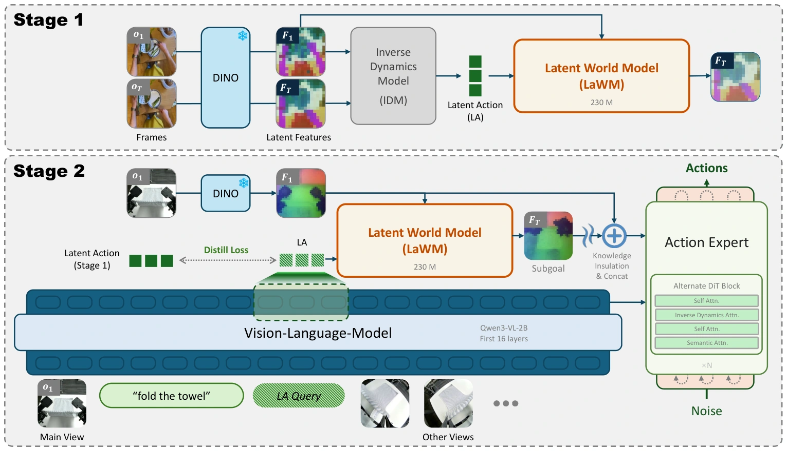

<!-- Generated by scripts/generate.py; edit data/works.json and data/media.json. -->

[← Back to the Awesome index](../../../README.md) · [Interactive website](https://chang-xinhai.github.io/Awesome-RGBDT-Manipulation/?collection=policy&item=lawam#library)

# LaWAM

LaWAM: Latent World Action Models for Efficient Dynamics-Aware Robot Policies

**2026-06-14 · CoRL 2026 · Jilin University / Tsinghua University / Zhongguancun Academy**

**[Paper](https://arxiv.org/abs/2606.15768)** · [Project](https://rlinf.github.io/LaWAM/) · [Code](https://github.com/RLinf/LaWAM) · [Data](https://huggingface.co/datasets/jialei02/robotwin_merged) · [Weights](https://huggingface.co/collections/jialei02/lawam-checkpoints)

Predicts compact future visual subgoals in a learned latent world model rather than synthesizing future pixels, then generates conditioned actions.

*LaWAM authors · [Figure source](https://arxiv.org/html/2606.15768) · Original rights retained.*

| Field | Reported value and source scope |
| :-- | :-- |
| Record type | policy |
| Policy family | World-action model [1](https://arxiv.org/abs/2606.15768)  |
| Base model and architecture | Qwen3-VL-2B policy, 230M latent world/action module, DINOv3 features and action expert. [1](https://arxiv.org/abs/2606.15768)  |
| Model size and component | 2.3B reported model, including 230M LaWM. WAM comparison counts exclude video VAE/text encoder where applicable. [1](https://arxiv.org/abs/2606.15768)  |
| Deployment inputs | RGB, language and state; predicted latent actions/subgoals are internal, not measured depth. [1](https://arxiv.org/abs/2606.15768)  |
| Action outputs and horizon | Embodiment-specific action chunks aligned by physical time; future latent predicted in one forward pass. [1](https://arxiv.org/abs/2606.15768)  |
| Training method | Latent world/action pretraining, latent-action distillation and future-feature supervision; fixed physical-time alignment across control rates. [1](https://arxiv.org/abs/2606.15768)  |
| Training data | LaWM: approximately 3,000 robot-video hours plus 1,500 egocentric human-video hours. Policy integration uses language-labeled robot trajectories only. [1](https://arxiv.org/abs/2606.15768)  |
| Training duration | LaWM: 100k steps. Policy integration: 200k. RoboTwin posttraining: 100k steps, approximately 20 hours; not full training duration. [1](https://arxiv.org/abs/2606.15768)  |
| Training hardware | 16 H100 GPUs for LaWM; 64 H100 for policy integration and RoboTwin posttraining. [1](https://arxiv.org/abs/2606.15768)  |
| Inference and control rates | 187 ms per action chunk on A100, averaged over 1,000 calls with ten denoising steps; excludes robot/environment execution. [1](https://arxiv.org/abs/2606.15768)  |
| Evaluation scope | LIBERO, RoboTwin 2.0 and physical pick/place, drawer opening and towel folding; latent-dynamics and mixed-frequency controls. [1](https://arxiv.org/abs/2606.15768)  |
| Observations / modalities | RGB · Proprioception · Language |
| Evaluation domain | Simulation · Real world |
| Embodiment | Parallel-jaw gripper · Bimanual |
| Release: code | Available [2](https://github.com/RLinf/LaWAM) [3](https://rlinf.github.io/LaWAM/)  |
| Release: weights | Available [2](https://github.com/RLinf/LaWAM) [3](https://rlinf.github.io/LaWAM/)  |
| Release: data | Partial [2](https://github.com/RLinf/LaWAM) [3](https://rlinf.github.io/LaWAM/)  |
| Release: license | Not verified; pretrained backbones and data retain separate terms [2](https://github.com/RLinf/LaWAM) [3](https://rlinf.github.io/LaWAM/)  |
| Release: notes | Availability concerns author-linked artifacts; no training or installation reproduced. [2](https://github.com/RLinf/LaWAM) [3](https://rlinf.github.io/LaWAM/)  |

**Scope and qualifications**

- Human video informs the dynamics prior; policy integration uses instruction-labeled robot data.
- 187 ms is action-chunk latency, not a servo interval.

**Primary evidence**

1. [Author manuscript and submission history](https://arxiv.org/abs/2606.15768) — Read full manuscript; first arXiv submission retained separately from current revision. Numeric costs and observations have setting-specific scope.
2. [Official implementation](https://github.com/RLinf/LaWAM) — Author-linked code and artifact instructions; current release may differ from the original manuscript.
3. [Official project](https://rlinf.github.io/LaWAM/) — Author project and links; scientific figure keeps original rights.
