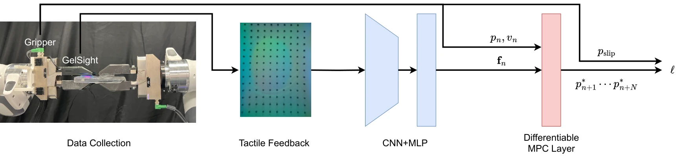

<!-- Generated by scripts/generate.py; edit data/works.json and data/media.json. -->

[← Back to the Awesome index](../../../README.md) · [Interactive website](https://chang-xinhai.github.io/Awesome-RGBDT-Manipulation/?collection=policy&item=letac-mpc#library)

# LeTac-MPC

LeTac-MPC: Learning Model Predictive Control for Tactile-reactive Grasping

**2024-03-07 · IEEE Transactions on Robotics 2024 · Purdue University**

**[Paper](https://arxiv.org/abs/2403.04934)** · [Code](https://github.com/ZhengtongXu/LeTac-MPC) · [Data](https://github.com/ZhengtongXu/LeTac-MPC/tree/main/LeTac-MPC/dataset)

A learned tactile embedding and differentiable MPC layer provide reactive grasp regulation across object properties.

*LeTac-MPC: Learning Model Predictive Control for Tactile-reactive Grasping authors · [Figure source](https://arxiv.org/abs/2403.04934) · Original rights retained.*

| Field | Reported value and source scope |
| :-- | :-- |
| Record type | policy |
| Policy family | Model-based planning [1](https://arxiv.org/abs/2403.04934)  |
| Base model and architecture | Pretrained Res Net 152 tactile encoder, MLP and differentiable MPC output layer. [1](https://arxiv.org/abs/2403.04934)  |
| Model size and component | Not reported [1](https://arxiv.org/abs/2403.04934)  |
| Deployment inputs | Gel Sight tactile images and gripper state. [1](https://arxiv.org/abs/2403.04934)  |
| Action outputs and horizon | Gripper motions for reactive force/contact regulation. [1](https://arxiv.org/abs/2403.04934)  |
| Training method | End-to-end tactile feature/differentiable MPC learning. [1](https://arxiv.org/abs/2403.04934)  |
| Training data | Automated real tactile grasp interaction data; exact corpus count Not reported in inspected text. [1](https://arxiv.org/abs/2403.04934)  |
| Training duration | Not reported [1](https://arxiv.org/abs/2403.04934)  |
| Training hardware | Not reported [1](https://arxiv.org/abs/2403.04934)  |
| Inference and control rates | 25 Hz real-time controller. [1](https://arxiv.org/abs/2403.04934)  |
| Evaluation scope | Dynamic andforce-interactive grasping of daily rigid/deformable objects. [1](https://arxiv.org/abs/2403.04934)  |
| Observations / modalities | Tactile · Proprioception |
| Evaluation domain | Real world |
| Embodiment | Parallel-jaw gripper |
| Release: code | Available [3](https://github.com/ZhengtongXu/LeTac-MPC) [4](https://github.com/ZhengtongXu/LeTac-MPC/tree/main/LeTac-MPC/dataset)  |
| Release: weights | Not verified [3](https://github.com/ZhengtongXu/LeTac-MPC) [4](https://github.com/ZhengtongXu/LeTac-MPC/tree/main/LeTac-MPC/dataset)  |
| Release: data | Available — bundled tactile-image dataset [3](https://github.com/ZhengtongXu/LeTac-MPC) [4](https://github.com/ZhengtongXu/LeTac-MPC/tree/main/LeTac-MPC/dataset)  |
| Release: license | Not verified; no unambiguous repository license identified. [3](https://github.com/ZhengtongXu/LeTac-MPC) [4](https://github.com/ZhengtongXu/LeTac-MPC/tree/main/LeTac-MPC/dataset)  |
| Release: notes | Actual nested LeTac-MPC/scripts/training.py is retrievable; the repository also contains the named tactile-image dataset directory and files. Large recursive listings can truncate before implementation paths. No unambiguous repository license or separate pretrained checkpoint release was verified; code/data availability does not imply either. [3](https://github.com/ZhengtongXu/LeTac-MPC) [4](https://github.com/ZhengtongXu/LeTac-MPC/tree/main/LeTac-MPC/dataset)  |

**Scope and qualifications**

- Controller frequency does not measure training cost.

**Primary evidence**

1. [Original paper and supplementary implementation details](https://arxiv.org/abs/2403.04934) — Primary full text reviewed; dataset, deployment modalities and training-only privileges are scoped separately.
2. [Official released implementation and LICENSE](https://github.com/ZhengtongXu/LeTac-MPC) — Research/project provenance; current artifact availability and licensing are superseded by the separately cited 2026-10-19 file inventories.
3. [Current artifact inventory and release scope](https://github.com/ZhengtongXu/LeTac-MPC) — 2026-10-19 current file-tree/implementation/model-data inventory audit; release scope and licensing are independent. Not a runtime reproduction.
4. [Current artifact inventory and release scope](https://github.com/ZhengtongXu/LeTac-MPC/tree/main/LeTac-MPC/dataset) — 2026-10-19 current file-tree/implementation/model-data inventory audit; release scope and licensing are independent. Not a runtime reproduction.
