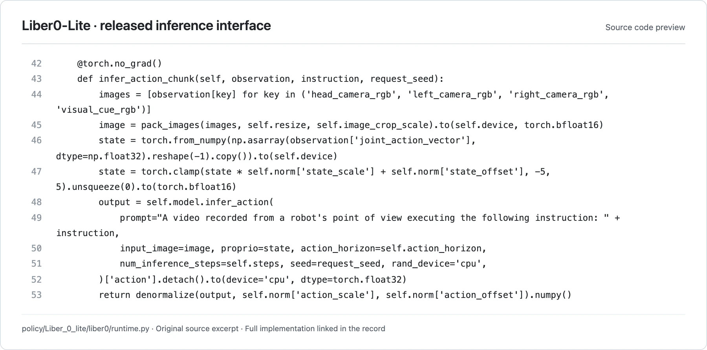

<!-- Generated by scripts/generate.py; edit data/works.json and data/media.json. -->

[← Back to the Awesome index](../../../README.md) · [Interactive website](https://chang-xinhai.github.io/Awesome-RGBDT-Manipulation/?collection=policy&item=liber0-lite#library)

# Liber0-Lite

Liber0-Lite RoboDojo policy

**Undated · Official project / technical release · LiberAI**

**[Project](https://github.com/XPolicyLab/XPolicyLab/tree/main/policy/Liber_0_lite)** · [Code](https://github.com/XPolicyLab/XPolicyLab/tree/main/policy/Liber_0_lite) · [Weights](https://huggingface.co/LiberAI/Liber0-Lite-Robodojo)

Releases an author-contributed checkpoint and self-contained inference backend for bimanual RoboDojo evaluation.

*LiberAI / XPolicyLab contributors · [Figure source](https://github.com/XPolicyLab/XPolicyLab/blob/94dbf9505f2f87cf59c3ee8ba5912cd236781771/policy/Liber_0_lite/liber0/runtime.py#L42-L53) · Original rights retained.*

**Preview scope:** Exact contiguous source excerpt (lines 42–53), rendered for legibility. This is a released implementation interface preview; an original architecture figure was not located in the reviewed sources. Source rights remain with the original authors.

| Field | Reported value and source scope |
| :-- | :-- |
| Record type | policy |
| Policy family | VLA [1](https://github.com/XPolicyLab/XPolicyLab/tree/main/policy/Liber_0_lite)  |
| Base model and architecture | Vision encoder and denoising action decoder; precise foundation/backbone identity not disclosed [1](https://github.com/XPolicyLab/XPolicyLab/tree/main/policy/Liber_0_lite)  |
| Model size and component | Not disclosed; 53 GB download footprint is not a model parameter count [1](https://github.com/XPolicyLab/XPolicyLab/tree/main/policy/Liber_0_lite)  |
| Deployment inputs | RGB views, language and ARX X5 joint-state context; maintains first-frame cue and per-environment episode state [1](https://github.com/XPolicyLab/XPolicyLab/tree/main/policy/Liber_0_lite) [2](https://github.com/XPolicyLab/XPolicyLab/tree/main/policy/Liber_0_lite)  |
| Action outputs and horizon | Dual-arm joint-action chunks under ARX X5 contract; checkpoint configuration governs horizon/normalization [1](https://github.com/XPolicyLab/XPolicyLab/tree/main/policy/Liber_0_lite) [2](https://github.com/XPolicyLab/XPolicyLab/tree/main/policy/Liber_0_lite)  |
| Training method | Inference implementation and checkpoint only; paper/training release announced [1](https://github.com/XPolicyLab/XPolicyLab/tree/main/policy/Liber_0_lite)  |
| Training data | Not disclosed; training code pending [1](https://github.com/XPolicyLab/XPolicyLab/tree/main/policy/Liber_0_lite)  |
| Training duration | Not reported [1](https://github.com/XPolicyLab/XPolicyLab/tree/main/policy/Liber_0_lite)  |
| Training hardware | Not reported [1](https://github.com/XPolicyLab/XPolicyLab/tree/main/policy/Liber_0_lite)  |
| Inference and control rates | Not reported [1](https://github.com/XPolicyLab/XPolicyLab/tree/main/policy/Liber_0_lite)  |
| Evaluation scope | Official RoboDojo Liber-0 Lite submission; batched inference support separate from quality equivalence [1](https://github.com/XPolicyLab/XPolicyLab/tree/main/policy/Liber_0_lite)  |
| Observations / modalities | RGB · Proprioception · Language |
| Evaluation domain | Simulation |
| Embodiment | Parallel-jaw gripper · Bimanual |
| Release: code | Partial [1](https://github.com/XPolicyLab/XPolicyLab/tree/main/policy/Liber_0_lite) [2](https://github.com/XPolicyLab/XPolicyLab/tree/main/policy/Liber_0_lite)  |
| Release: weights | Available [1](https://github.com/XPolicyLab/XPolicyLab/tree/main/policy/Liber_0_lite)  |
| Release: data | Not verified [1](https://github.com/XPolicyLab/XPolicyLab/tree/main/policy/Liber_0_lite)  |
| Release: license | Apache-2.0 for repository code, verified from LICENSE; pretrained models, datasets, dependencies and figure rights retain separate terms. [1](https://github.com/XPolicyLab/XPolicyLab/tree/main/policy/Liber_0_lite) [3](https://github.com/XPolicyLab/XPolicyLab/blob/main/LICENSE)  |
| Release: notes | Public project and model release; undisclosed training details remain explicitly unknown. A manuscript is not required to identify the released policy. [1](https://github.com/XPolicyLab/XPolicyLab/tree/main/policy/Liber_0_lite)  |

**Scope and qualifications**

- Liber-0 Preview and Liber-0 Lite are separately scored assets; identity/architecture equivalence not established.
- No manuscript or original architecture figure verified.

**Primary evidence**

1. [Official model project / technical release](https://github.com/XPolicyLab/XPolicyLab/tree/main/policy/Liber_0_lite) — Research-report facts and current executable release are scoped separately; undated releases retain an unknown publication date.
2. [Official implementation / author-contributed adapter](https://github.com/XPolicyLab/XPolicyLab/tree/main/policy/Liber_0_lite) — Actual deployment contract is checked; adapter presence alone is not evidence of benchmark participation.
3. [Actual repository code license](https://github.com/XPolicyLab/XPolicyLab/blob/main/LICENSE) — 2026-10-19 actual file inspection; applies to repository code, not a blanket grant over models/data/third-party assets.
