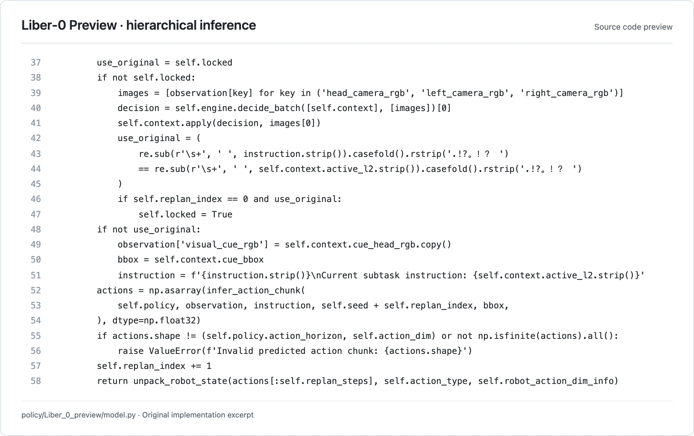

<!-- Generated by scripts/generate.py; edit data/works.json and data/media.json. -->

[← Back to the Awesome index](../../../README.md) · [Interactive website](https://chang-xinhai.github.io/Awesome-RGBDT-Manipulation/?collection=policy&item=liber0-preview#library)

# Liber-0 Preview

Liber-0 Preview hierarchical RoboDojo policy

**Undated · Official project / technical release · LiberAI**

**[Project](https://github.com/XPolicyLab/XPolicyLab/tree/main/policy/Liber_0_preview)** · [Code](https://github.com/XPolicyLab/XPolicyLab/tree/main/policy/Liber_0_preview) · [Weights](https://huggingface.co/LiberAI/Liber0-Preview-Robodojo)

Adds a learned visual-language subtask controller and episodic visual cues to the released Liber inference backend for bimanual manipulation.

*LiberAI / XPolicyLab contributors · [Figure source](https://github.com/XPolicyLab/XPolicyLab/blob/94dbf9505f2f87cf59c3ee8ba5912cd236781771/policy/Liber_0_preview/model.py#L37-L58) · Original rights retained.*

**Preview scope:** Exact source lines 37–58 rendered for legibility. This is an implementation/interface preview, not an author-provided neural architecture figure. Original source rights retained.

| Field | Reported value and source scope |
| :-- | :-- |
| Record type | policy |
| Policy family | VLA [1](https://github.com/XPolicyLab/XPolicyLab/tree/94dbf9505f2f87cf59c3ee8ba5912cd236781771/policy/Liber_0_preview)  |
| Base model and architecture | Qwen3-VL context model plus a Qwen3-VL-derived shared visual/action flow backend loaded through the Liber-0 Lite runtime; HiDream-O1-Image base assets. [1](https://github.com/XPolicyLab/XPolicyLab/tree/94dbf9505f2f87cf59c3ee8ba5912cd236781771/policy/Liber_0_preview) [2](https://huggingface.co/LiberAI/Liber0-Preview-Robodojo/tree/2773a04e3b8f09096ec7beb6105bd6ed80c91da8)  |
| Model size and component | Complete parameter count Not reported; checkpoint byte sizes are not parameter counts. [1](https://github.com/XPolicyLab/XPolicyLab/tree/94dbf9505f2f87cf59c3ee8ba5912cd236781771/policy/Liber_0_preview)  |
| Deployment inputs | Head and two wrist RGB views, language and 14-dimensional ARX X5 state; maintains subtask hierarchy, episode context and a visual cue image. [1](https://github.com/XPolicyLab/XPolicyLab/tree/94dbf9505f2f87cf59c3ee8ba5912cd236781771/policy/Liber_0_preview) [2](https://huggingface.co/LiberAI/Liber0-Preview-Robodojo/tree/2773a04e3b8f09096ec7beb6105bd6ed80c91da8)  |
| Action outputs and horizon | 32-step chunks of 14-dimensional dual-arm joint/gripper actions; default executes 16 steps before replanning. [1](https://github.com/XPolicyLab/XPolicyLab/tree/94dbf9505f2f87cf59c3ee8ba5912cd236781771/policy/Liber_0_preview) [2](https://huggingface.co/LiberAI/Liber0-Preview-Robodojo/tree/2773a04e3b8f09096ec7beb6105bd6ed80c91da8)  |
| Training method | Released inference runs a learned context controller to select a current subtask and visual cue, then a conditioned flow action backend. Training code is pending. [1](https://github.com/XPolicyLab/XPolicyLab/tree/94dbf9505f2f87cf59c3ee8ba5912cd236781771/policy/Liber_0_preview)  |
| Training data | Not disclosed; this is an evaluation-only release. [1](https://github.com/XPolicyLab/XPolicyLab/tree/94dbf9505f2f87cf59c3ee8ba5912cd236781771/policy/Liber_0_preview)  |
| Training duration | Not reported [1](https://github.com/XPolicyLab/XPolicyLab/tree/94dbf9505f2f87cf59c3ee8ba5912cd236781771/policy/Liber_0_preview)  |
| Training hardware | Not reported [1](https://github.com/XPolicyLab/XPolicyLab/tree/94dbf9505f2f87cf59c3ee8ba5912cd236781771/policy/Liber_0_preview)  |
| Inference and control rates | Default ten flow-integration steps and 16 executed actions per replan; physical control rate Not reported. [1](https://github.com/XPolicyLab/XPolicyLab/tree/94dbf9505f2f87cf59c3ee8ba5912cd236781771/policy/Liber_0_preview)  |
| Evaluation scope | RoboDojo ARX X5 joint-control adapter and a separately released Preview checkpoint; batched evaluation is explicitly unsupported. [1](https://github.com/XPolicyLab/XPolicyLab/tree/94dbf9505f2f87cf59c3ee8ba5912cd236781771/policy/Liber_0_preview)  |
| Observations / modalities | RGB · Proprioception · Language |
| Evaluation domain | Simulation |
| Embodiment | Parallel-jaw gripper · Bimanual |
| Release: code | Partial [1](https://github.com/XPolicyLab/XPolicyLab/tree/94dbf9505f2f87cf59c3ee8ba5912cd236781771/policy/Liber_0_preview)  |
| Release: weights | Available [1](https://github.com/XPolicyLab/XPolicyLab/tree/94dbf9505f2f87cf59c3ee8ba5912cd236781771/policy/Liber_0_preview) [2](https://huggingface.co/LiberAI/Liber0-Preview-Robodojo/tree/2773a04e3b8f09096ec7beb6105bd6ed80c91da8)  |
| Release: data | Not verified [1](https://github.com/XPolicyLab/XPolicyLab/tree/94dbf9505f2f87cf59c3ee8ba5912cd236781771/policy/Liber_0_preview)  |
| Release: license | XPolicyLab adapter under Apache-2.0; shared Liber vendor components retain MIT/Apache notices. Preview weight license Not reported in the inspected model card/repository. [1](https://github.com/XPolicyLab/XPolicyLab/tree/94dbf9505f2f87cf59c3ee8ba5912cd236781771/policy/Liber_0_preview) [3](https://github.com/XPolicyLab/XPolicyLab/blob/94dbf9505f2f87cf59c3ee8ba5912cd236781771/policy/Liber_0_lite/NOTICE.md)  |
| Release: notes | Public checkpoint revision 2773a04e3b8f09096ec7beb6105bd6ed80c91da8 includes model.pt, configuration/statistics and a separate context/ model. It reuses the Lite runtime but requires its own Preview checkpoint and context model. Training is not released. [1](https://github.com/XPolicyLab/XPolicyLab/tree/94dbf9505f2f87cf59c3ee8ba5912cd236781771/policy/Liber_0_preview)  |

**Scope and qualifications**

- Preview and Lite are separate scored assets and separate checkpoints; shared inference code does not make the methods identical.
- Full training procedure, corpus and compute are not disclosed.
- An original method diagram was not located in the reviewed sources; the cover is an explicitly labeled excerpt from the released implementation.

**Primary evidence**

1. [Author-contributed Preview adapter and source](https://github.com/XPolicyLab/XPolicyLab/tree/94dbf9505f2f87cf59c3ee8ba5912cd236781771/policy/Liber_0_preview) — Inspected README, model.py, runtime.py, generation.py, deploy.yml and downloader at a fixed XPolicyLab commit. No manuscript or explicit first public policy-release date is supplied.
2. [Actual released Preview artifact inventory and configs](https://huggingface.co/LiberAI/Liber0-Preview-Robodojo/tree/2773a04e3b8f09096ec7beb6105bd6ed80c91da8) — Verified public ungated repository file inventory, manifest, config.yaml and context/config.json. No weights downloaded or executed; no total model size inferred from storage bytes.
3. [Shared runtime component notices](https://github.com/XPolicyLab/XPolicyLab/blob/94dbf9505f2f87cf59c3ee8ba5912cd236781771/policy/Liber_0_lite/NOTICE.md) — Preview README explicitly reuses the Lite runtime; root Apache-2.0 and third-party component notices do not establish a license for Preview weights.
