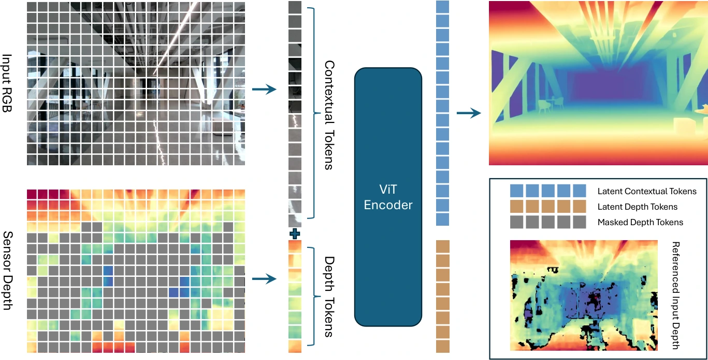

<!-- Generated by scripts/generate.py; edit data/works.json and data/media.json. -->

[← Back to the Awesome index](../../../README.md) · [Interactive website](https://chang-xinhai.github.io/Awesome-RGBDT-Manipulation/?collection=policy&item=lingbot-depth#library)

# LingBot-Depth

Masked Depth Modeling for Spatial Perception

**2026-01-25 · ECCV 2026 · Robbyant, Ant Group**

**[Paper](https://arxiv.org/abs/2601.17895)** · [Project](https://technology.robbyant.com/lingbot-depth) · [Code](https://github.com/Robbyant/lingbot-depth) · [Data](https://huggingface.co/datasets/robbyant/mdm_depth) · [Weights](https://huggingface.co/robbyant/lingbot-depth-pretrain-vitl-14-v0.5)

Masked RGB-D modeling completes and refines sensor depth for metric manipulation perception.

*LingBot-Depth authors · [Figure source](https://arxiv.org/html/2601.17895) · Original rights retained.*

| Field | Reported value and source scope |
| :-- | :-- |
| Record type | model |
| Model role and downstream interface | Sensor depth completion/refinement for downstream robot perception [1](https://arxiv.org/abs/2601.17895)  |
| Model family | Depth estimation [1](https://arxiv.org/abs/2601.17895)  |
| Model architecture | DINOv2 ViT-L/14 RGB-depth joint encoder and multiscale depth decoder. [1](https://arxiv.org/abs/2601.17895)  |
| Model size and component | Not reported in the inspected primary-source sections [1](https://arxiv.org/abs/2601.17895)  |
| Model inputs | RGB, incomplete/noisy measured depth and optional intrinsics. [1](https://arxiv.org/abs/2601.17895)  |
| Model outputs | Completed metric depth and back-projected point clouds. [1](https://arxiv.org/abs/2601.17895)  |
| Training method | Masked depth reconstruction using real missingness and synthetic corruption. [1](https://arxiv.org/abs/2601.17895)  |
| Training data and scale | Public release: 3,019,200 RGB-D samples; paper describes larger synthetic curation separately. [1](https://arxiv.org/abs/2601.17895)  |
| Training duration | 250K iterations, approximately 7.5 days [1](https://arxiv.org/abs/2601.17895)  |
| Training hardware | 128 GPUs; model not specified in inspected training paragraph [1](https://arxiv.org/abs/2601.17895)  |
| Inference setting and runtime | Not reported in the inspected primary-source sections [1](https://arxiv.org/abs/2601.17895)  |
| Downstream evaluation and scope | Depth completion, 4D tracking and downstream dexterous grasping demonstrations. [1](https://arxiv.org/abs/2601.17895)  |
| Observations / modalities | RGB · Depth |
| Evaluation domain | Simulation · Real world |
| Embodiment |  |
| Release: code | Available [2](https://technology.robbyant.com/lingbot-depth) [3](https://github.com/Robbyant/lingbot-depth) [5](https://github.com/Robbyant/lingbot-depth/tree/main)  |
| Release: weights | Available [2](https://technology.robbyant.com/lingbot-depth) [3](https://github.com/Robbyant/lingbot-depth) [6](https://huggingface.co/robbyant/lingbot-depth-pretrain-vitl-14-v0.5)  |
| Release: data | Available [2](https://technology.robbyant.com/lingbot-depth) [3](https://github.com/Robbyant/lingbot-depth) [7](https://huggingface.co/datasets/robbyant/mdm_depth)  |
| Release: license | Apache-2.0 for repository code; pretrained models, data and figure rights remain separate [2](https://technology.robbyant.com/lingbot-depth) [3](https://github.com/Robbyant/lingbot-depth) [4](https://github.com/Robbyant/lingbot-depth/blob/main/LICENSE)  |
| Release: notes | Code, data and weights are checked independently; an upstream pretrained model is not a released task policy. [2](https://technology.robbyant.com/lingbot-depth) [3](https://github.com/Robbyant/lingbot-depth)  |

**Scope and qualifications**

- This is a depth estimator with downstream demonstrations, not an executable manipulation policy.
- Release v0.5 fixes a v0.1 bug; public dataset size is not the total rendered training-candidate pool.

**Primary evidence**

1. [Original manuscript and first submission history](https://arxiv.org/abs/2601.17895) — Full author HTML method/evaluation/appendix inspected; depth observations, pseudo-labels and generated outputs retain distinct roles.
2. [Official author project](https://technology.robbyant.com/lingbot-depth) — Public author-linked project; figure and downstream scope verified separately.
3. [Official implementation and release scope](https://github.com/Robbyant/lingbot-depth) — Availability of research implementation does not establish public task-policy checkpoints.
4. [Actual license file in released source](https://github.com/Robbyant/lingbot-depth/blob/main/LICENSE) — Only source code covered by this file; not a blanket license for paper figures or upstream weights.
5. [Actual repository content inventory](https://github.com/Robbyant/lingbot-depth/tree/main) — 99 tracked paths inspected; code release is distinguished from a README/project/figure-only repository.
6. [Official weights release destination](https://huggingface.co/robbyant/lingbot-depth-pretrain-vitl-14-v0.5) — Destination linked by the official project/repository; component release scope is retained in release notes.
7. [Official data release destination](https://huggingface.co/datasets/robbyant/mdm_depth) — Destination linked by the official project/repository; component release scope is retained in release notes.
