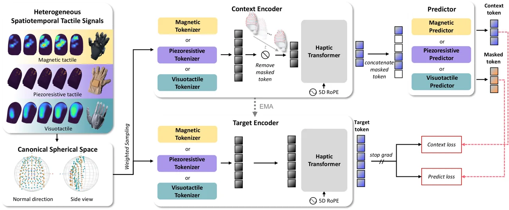

<!-- Generated by scripts/generate.py; edit data/works.json and data/media.json. -->

[← Back to the Awesome index](../../../README.md) · [Interactive website](https://chang-xinhai.github.io/Awesome-RGBDT-Manipulation/?collection=policy&item=lingbot-touch#library)

# LingBot-Touch

Learning Heterogeneous Tactile Representation for General Dexterous Manipulation

**2026-11-09 · Preprint · Robbyant**

**[Paper](https://arxiv.org/abs/2611.12806)** · [Project](https://technology.robbyant.com/lingbot-touch) · [Code](https://github.com/Robbyant/lingbot-touch) · [Weights](https://huggingface.co/robbyant/lingbot-touch-tiny)

A shared haptic transformer learns sensor-agnostic tactile features for downstream policies.

*LingBot-Touch authors · [Figure source](https://technology.robbyant.com/lingbot-touch) · Original rights retained.*

| Field | Reported value and source scope |
| :-- | :-- |
| Record type | model |
| Model role and downstream interface | Tactile representation encoder for downstream robot policies [1](https://arxiv.org/abs/2611.12806)  |
| Model family | Heterogeneous tactile representation [1](https://arxiv.org/abs/2611.12806)  |
| Model architecture | Haptic Transformer / JEPA [1](https://arxiv.org/abs/2611.12806)  |
| Model size and component | Tiny: 5.46M parameters; Small also provided [1](https://arxiv.org/abs/2611.12806)  |
| Model inputs | Normalized magnetic, piezoresistive or processed visuotactile signals with calibrated taxel positions; not raw RGB. [1](https://arxiv.org/abs/2611.12806)  |
| Model outputs | Spatiotemporal tactile token features consumed by downstream policies. [1](https://arxiv.org/abs/2611.12806)  |
| Training method | JEPA masked latent prediction from nearly 5,000 h of heterogeneous tactile recordings. [1](https://arxiv.org/abs/2611.12806)  |
| Training data and scale | 4,983 h of human and robot tactile recordings reported by the author project; publicly released corpus not verified. [1](https://arxiv.org/abs/2611.12806)  |
| Training duration | Not reported [1](https://arxiv.org/abs/2611.12806)  |
| Training hardware | Not reported [1](https://arxiv.org/abs/2611.12806)  |
| Inference setting and runtime | Frozen target encoder and downstream trainable readouts. [1](https://arxiv.org/abs/2611.12806)  |
| Downstream evaluation and scope | Offline tactile tasks, simulation and 26 real manipulation tasks with frozen encoder integrated into four policy families. [1](https://arxiv.org/abs/2611.12806)  |
| Observations / modalities | Tactile |
| Evaluation domain | Simulation · Real world |
| Embodiment |  |
| Release: code | Available — inference target encoder and utilities [2](https://github.com/Robbyant/lingbot-touch) [3](https://huggingface.co/robbyant/lingbot-touch-tiny)  |
| Release: weights | Available — Tiny checkpoint verified by HTTP range 206 [2](https://github.com/Robbyant/lingbot-touch) [3](https://huggingface.co/robbyant/lingbot-touch-tiny)  |
| Release: data | Not verified [2](https://github.com/Robbyant/lingbot-touch) [3](https://huggingface.co/robbyant/lingbot-touch-tiny)  |
| Release: license | Apache-2.0 source and Tiny model card; third-party dependencies have separate terms. [2](https://github.com/Robbyant/lingbot-touch) [3](https://huggingface.co/robbyant/lingbot-touch-tiny)  |
| Release: notes | The official release supplies inference and sensor-interface code; complete pretraining pipeline and corpus were not established as public. [2](https://github.com/Robbyant/lingbot-touch) [3](https://huggingface.co/robbyant/lingbot-touch-tiny)  |

**Scope and qualifications**

- This is a tactile encoder, not an executable robot policy. Robot and glove data are mixed; cross-sensor transfer requires geometry normalization and task-policy adaptation.

**Primary evidence**

1. [Primary paper and first submission](https://arxiv.org/abs/2611.12806)
2. [Official source and release](https://github.com/Robbyant/lingbot-touch)
3. [Official model and checkpoint](https://huggingface.co/robbyant/lingbot-touch-tiny)
