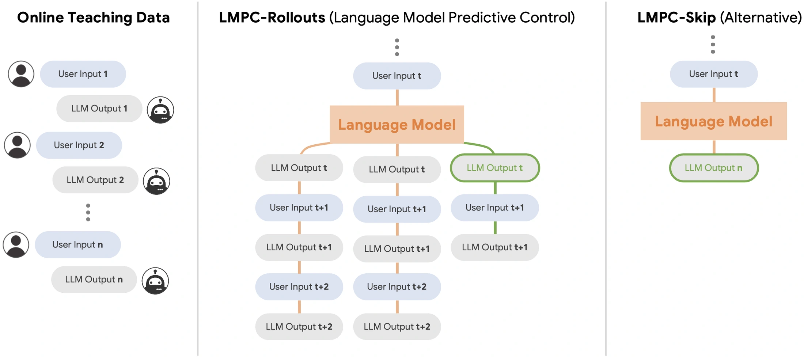

<!-- Generated by scripts/generate.py; edit data/works.json and data/media.json. -->

[← Back to the Awesome index](../../../README.md) · [Interactive website](https://chang-xinhai.github.io/Awesome-RGBDT-Manipulation/?collection=policy&item=lmpc#library)

# Language Model Predictive Control (LMPC)

Learning to Learn Faster from Human Feedback with Language Model Predictive Control

**2024-02-18 · Preprint · Google DeepMind**

**[Paper](https://arxiv.org/abs/2402.11450)** · [Project](https://robot-teaching.github.io/)

Learns to predict future human–robot teaching interactions, then searches imagined interaction rollouts to choose code responses that require fewer corrections.

*Language Model Predictive Control (LMPC) authors · [Figure source](https://arxiv.org/abs/2402.11450) · Original rights retained.*

| Field | Reported value and source scope |
| :-- | :-- |
| Record type | policy |
| Policy family | Hybrid [1](https://arxiv.org/abs/2402.11450)  |
| Base model and architecture | PaLM 2-S code-writing language model; LMPC-Rollouts and LMPC-Skip are fine-tuned variants, coupled to MuJoCo MPC / MJPC execution. [1](https://arxiv.org/abs/2402.11450)  |
| Model size and component | Not reported [1](https://arxiv.org/abs/2402.11450)  |
| Deployment inputs | Multi-turn human language feedback, previous reward-code responses and robot / task context; physical motion planning uses estimated object state. [1](https://arxiv.org/abs/2402.11450)  |
| Action outputs and horizon | Robot reward code interpreted by model-predictive control; inference can sample predicted future feedback / code sequences before selecting the next response. [1](https://arxiv.org/abs/2402.11450)  |
| Training method | Offline LLM fine-tuning improves teachability, followed by online in-context human feedback and rollout-based inference search. [1](https://arxiv.org/abs/2402.11450)  |
| Training data | Approximately three million tokens of augmented / original human teaching interactions; around 350 evaluation chat sessions across embodiments. [1](https://arxiv.org/abs/2402.11450)  |
| Training duration | Not reported [1](https://arxiv.org/abs/2402.11450)  |
| Training hardware | Not reported [1](https://arxiv.org/abs/2402.11450)  |
| Inference and control rates | Not reported [1](https://arxiv.org/abs/2402.11450)  |
| Evaluation scope | Five embodiments including robot dog, mobile manipulator, ALOHA, bimanual KUKA and KUKA with hand; selected real mobile-manipulation / robot-dog tasks. [1](https://arxiv.org/abs/2402.11450)  |
| Observations / modalities | RGB · Proprioception · Language |
| Evaluation domain | Simulation · Real world |
| Embodiment | Parallel-jaw gripper · Bimanual · Dexterous hand · Mobile manipulator · Legged robot |
| Release: code | Not verified |
| Release: weights | Not verified |
| Release: data | Not verified |
| Release: license | Not verified |
| Release: notes | The original paper is public; code, model and dataset release scopes are verified separately where established. |

**Scope and qualifications**

- This updates the language-model weights during preparation; it is not purely a frozen-model context method.
- MPC converts generated rewards into motion, and some physical settings use an external object-state estimation pipeline.

**Primary evidence**

1. [Original primary paper and appendix](https://arxiv.org/abs/2402.11450) — Survey citation is used only for discovery. Method and deployment facts come from the original paper; the date is its first submission where available. Affiliations are transcribed from the PDF author block / footnotes; LMPC affiliation is confirmed by its official project page.
2. [LMPC official project author affiliation](https://robot-teaching.github.io/) — The author list on the project page explicitly identifies Google DeepMind.
