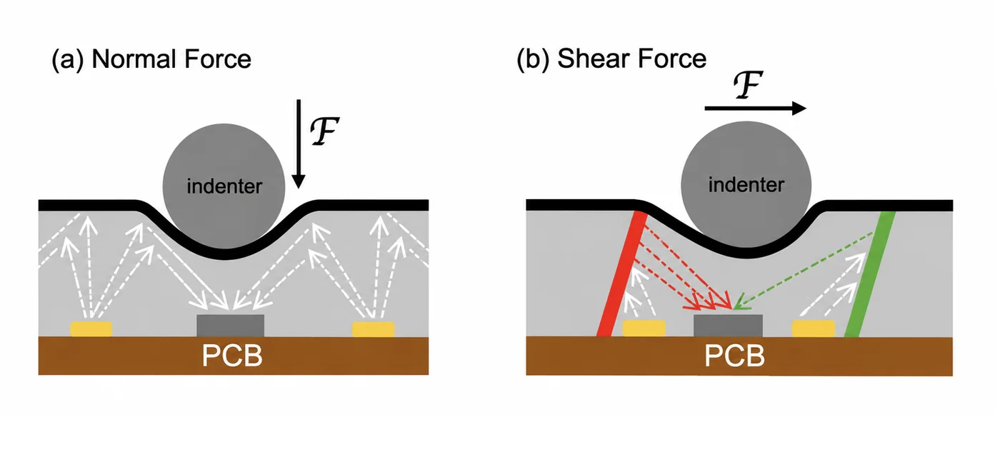

<!-- Generated by scripts/generate.py; edit data/works.json and data/media.json. -->

[← Back to the Awesome index](../../../README.md) · [Interactive website](https://chang-xinhai.github.io/Awesome-RGBDT-Manipulation/?collection=policy&item=luxtac#library)

# LuxTac

LuxTac: A Flexible, Scalable, and Open-Source Optical Taxel Array with Distributed Three-Axis Force Sensing for Tactile Robot Learning

**2026-11-17 · Preprint · Purdue University**

**[Paper](https://arxiv.org/abs/2611.23575)** · [Project](https://luxtac.github.io/) · [Code](https://github.com/AdeeshDesai/LuxTac-Sim) · [Pcb-Design](https://luxtac.github.io/assets/downloads/LuxTac_4x4.zip)

A camera-free optical taxel array estimates local pressure and shear. A peg-in-hole ACT experiment evaluates pressure as closed-loop feedback.

*LuxTac authors · [Figure source](https://arxiv.org/html/2611.23575v1) · Original rights retained.*

| Field | Reported value and source scope |
| :-- | :-- |
| Record type | policy |
| Policy family | Visuo-tactile behavior cloning [1](https://arxiv.org/html/2611.23575)  |
| Base model and architecture | Action Chunking Transformer [1](https://arxiv.org/html/2611.23575)  |
| Model size and component | Not reported [1](https://arxiv.org/html/2611.23575)  |
| Deployment inputs | Vision, robot state and LuxTac pressure. [1](https://arxiv.org/html/2611.23575)  |
| Action outputs and horizon | Peg-in-hole robot actions. [1](https://arxiv.org/html/2611.23575)  |
| Training method | Imitation learning with a controlled tactile-versus-vision-only comparison. [1](https://arxiv.org/html/2611.23575)  |
| Training data | Task-specific demonstrations. [1](https://arxiv.org/html/2611.23575)  |
| Training duration | Not reported [1](https://arxiv.org/html/2611.23575)  |
| Training hardware | Not reported [1](https://arxiv.org/html/2611.23575)  |
| Inference and control rates | Not reported [1](https://arxiv.org/html/2611.23575)  |
| Evaluation scope | Physical peg-in-hole comparison; separately reported sensor bench tests include nine held-out shear calibration sessions. [1](https://arxiv.org/html/2611.23575)  |
| Observations / modalities | RGB · Tactile · Proprioception |
| Evaluation domain | Real world |
| Embodiment |  |
| Release: code | Available — board files and tactile simulation source; paper policy implementation not verified [2](https://luxtac.github.io/) [3](https://github.com/AdeeshDesai/LuxTac-Sim) [4](https://luxtac.github.io/assets/downloads/LuxTac_4x4.zip)  |
| Release: weights | Not verified [2](https://luxtac.github.io/) [3](https://github.com/AdeeshDesai/LuxTac-Sim) [4](https://luxtac.github.io/assets/downloads/LuxTac_4x4.zip)  |
| Release: data | Not verified [2](https://luxtac.github.io/) [3](https://github.com/AdeeshDesai/LuxTac-Sim) [4](https://luxtac.github.io/assets/downloads/LuxTac_4x4.zip)  |
| Release: license | Project materials published under CC BY-NC-SA 4.0; simulator source and bundled components carry separate notices [2](https://luxtac.github.io/) [3](https://github.com/AdeeshDesai/LuxTac-Sim) [4](https://luxtac.github.io/assets/downloads/LuxTac_4x4.zip)  |
| Release: notes | The hardware project links PCB/Gerber archives and a simulator. The physical ACT comparison uses pressure, independent of the three-axis bench calibration. [2](https://luxtac.github.io/) [3](https://github.com/AdeeshDesai/LuxTac-Sim) [4](https://luxtac.github.io/assets/downloads/LuxTac_4x4.zip)  |

**Scope and qualifications**

- Each taxel uses an RGBC detector rather than an imaging camera. Indentation and local shear are inferred from changing optical intensity/color.
- Three-axis sensing results come from calibration. The peg experiment tests pressure only.

**Primary evidence**

1. [Primary paper and evaluated setting](https://arxiv.org/html/2611.23575)
2. [Author project and artifact status](https://luxtac.github.io/)
3. [Official repository and public artifact inventory](https://github.com/AdeeshDesai/LuxTac-Sim) — Actual simulation code includes sensor modules, assets and task/environment scripts.
4. [Official 4×4 PCB fabrication archive](https://luxtac.github.io/assets/downloads/LuxTac_4x4.zip) — Verified ZIP contents: placement file, bill of materials and nested Gerber archive.
