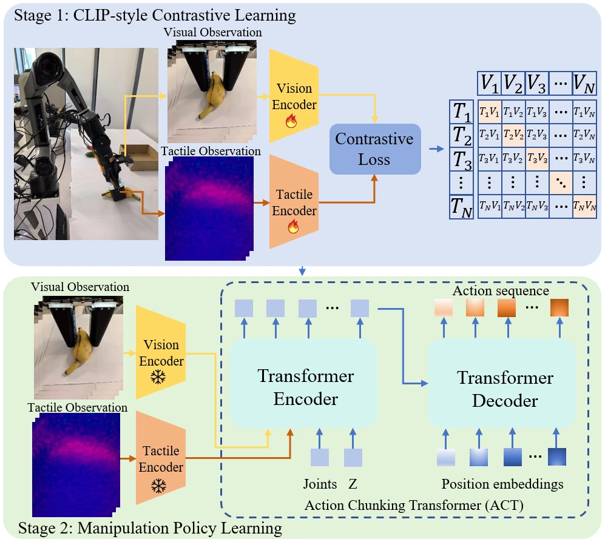

<!-- Generated by scripts/generate.py; edit data/works.json and data/media.json. -->

[← Back to the Awesome index](../../../README.md) · [Interactive website](https://chang-xinhai.github.io/Awesome-RGBDT-Manipulation/?collection=policy&item=lvtg-contrastive-act#library)

# LVTG — contrastive ACT

Cross-Modal Visuo-Tactile Representation Learning with Action Chunking Transformers for Contact-Rich Manipulation

**2026-01-31 · Preprint · Not reported**

**[Paper](https://arxiv.org/abs/2602.00514)**

Cross-modal RGB/tactile contrastive pretraining improves ACT control on a low-cost tactile gripper.

*Cross-Modal Visuo-Tactile Representation Learning with Action Chunking Transformers for Contact-Rich Manipulation authors · [Figure source](https://arxiv.org/abs/2602.00514) · Original rights retained.*

| Field | Reported value and source scope |
| :-- | :-- |
| Record type | policy |
| Policy family | ACT [1](https://arxiv.org/abs/2602.00514)  |
| Base model and architecture | CLIP-style ResNet 18 visual/tactile embedding alignment plus ACT. [1](https://arxiv.org/abs/2602.00514)  |
| Model size and component | Not reported [1](https://arxiv.org/abs/2602.00514)  |
| Deployment inputs | External RGB, calibrated LVTG tactile images and robot state. [1](https://arxiv.org/abs/2602.00514)  |
| Action outputs and horizon | Action chunks for contact-rich gripper manipulation. [1](https://arxiv.org/abs/2602.00514)  |
| Training method | Frozen visual backbone/tactile contrastive adaptation, then ACT imitation. [1](https://arxiv.org/abs/2602.00514)  |
| Training data | 1,000 teleoperated trajectories/task across five tasks=5,000 trajectories; paired frames for contrastive pretraining use the same pool. [1](https://arxiv.org/abs/2602.00514)  |
| Training duration | Not reported [1](https://arxiv.org/abs/2602.00514)  |
| Training hardware | Single NVIDIA RTX4090accelerates representation/policy training and inference. [1](https://arxiv.org/abs/2602.00514)  |
| Inference and control rates | RGB/touch 30 Hz; inference&lt;20 ms average. [1](https://arxiv.org/abs/2602.00514)  |
| Evaluation scope | COBOTMagic Robot with LVTG; five representative contact tasks including Plate Wiping. [1](https://arxiv.org/abs/2602.00514)  |
| Observations / modalities | RGB · Tactile · Proprioception |
| Evaluation domain | Real world |
| Embodiment | Parallel-jaw gripper |
| Release: code | Not verified |
| Release: weights | Not verified |
| Release: data | Not verified |
| Release: license | Not verified |
| Release: notes | Original paper reviewed; claimed future releases are not treated as currently available. |

**Scope and qualifications**

- Current paper title differs from the original hardware-focused title in Awesome-Touch; samear Xiv ID retained.
- Do not add frame-pair pretraining examples to trajectory counts as separate episodes.

**Primary evidence**

1. [Original paper and supplementary implementation details](https://arxiv.org/abs/2602.00514) — Primary full text reviewed; dataset, deployment modalities and training-only privileges are scoped separately.
