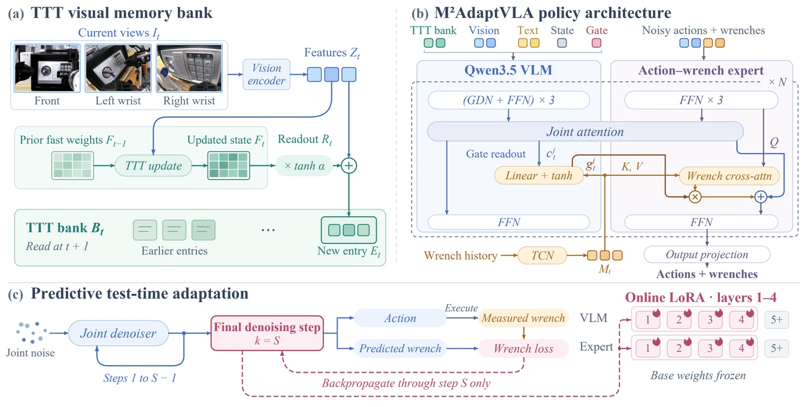

<!-- Generated by scripts/generate.py; edit data/works.json and data/media.json. -->

[← Back to the Awesome index](../../../README.md) · [Interactive website](https://chang-xinhai.github.io/Awesome-RGBDT-Manipulation/?collection=policy&item=m2-adaptvla#library)

# M²AdaptVLA

M²AdaptVLA: Multimodal Memory-Augmented Vision-Language-Action Model with Predictive Test-Time Adaptation

**2026-11-25 · Preprint · Not reported**

**[Paper](https://arxiv.org/abs/2611.34560)** · [Project](https://tlf-tlf.github.io/M2AdaptVLAPage/)

Uses visual fast-weight memory and wrist-wrench history, and predicts future wrenches to self-supervise online adapter updates under contact shifts.

*Liufan Tan and coauthors · [Figure source](https://tlf-tlf.github.io/M2AdaptVLAPage/) · Original rights retained.*

| Field | Reported value and source scope |
| :-- | :-- |
| Record type | policy |
| Policy family | M²AdaptVLA [1](https://arxiv.org/html/2611.34560v1)  |
| Base model and architecture | WALL-X with Qwen3.5 vision-language backbone [1](https://arxiv.org/html/2611.34560v1)  |
| Model size and component | Not reported [1](https://arxiv.org/html/2611.34560v1)  |
| Deployment inputs | Front and dual wrist RGB, proprioception, six-axis wrist wrenches and language. The robot measures wrench history during deployment. [1](https://arxiv.org/html/2611.34560v1)  |
| Action outputs and horizon | Joint future action and wrench sequence; measured wrench targets update selected low-rank policy adapters while running. [1](https://arxiv.org/html/2611.34560v1)  |
| Training method | WALL-X visual memory with gated delta updates, action/wrench flow matching and final-denoising-step test-time LoRA adaptation. [1](https://arxiv.org/html/2611.34560v1)  |
| Training data | Not reported [1](https://arxiv.org/html/2611.34560v1)  |
| Training duration | Not reported [1](https://arxiv.org/html/2611.34560v1)  |
| Training hardware | NVIDIA A800 training; RTX 5090 in deployment. [1](https://arxiv.org/html/2611.34560v1)  |
| Inference and control rates | Four-layer adaptation averages 159.5 ms on one RTX 5090 (adapter update only; excludes sensing, action execution and generation). [1](https://arxiv.org/html/2611.34560v1)  |
| Evaluation scope | Eight tasks on TeleTwin Desktop and Tianji. Open Safe uses 30 trials per policy for whole-task results, and the other seven whole-task tests use 20 each. [1](https://arxiv.org/html/2611.34560v1)  |
| Observations / modalities | RGB · Force/Torque · Proprioception · Language |
| Evaluation domain | Real world |
| Embodiment | Bimanual · Parallel-jaw gripper |
| Release: code | Not verified |
| Release: weights | Not verified |
| Release: data | Not verified |
| Release: license | Not verified |
| Release: notes | Public paper verified. Code, task weights and data are tracked separately. |

**Scope and qualifications**

- Wrist force/torque is an actual input. A distributed fingertip tactile stream or measured depth stream is not part of the reported policy inputs.

**Primary evidence**

1. [Original author paper with methods, evaluation and scope](https://arxiv.org/html/2611.34560v1)
2. [Public author project with method and evaluation examples](https://tlf-tlf.github.io/M2AdaptVLAPage/)
