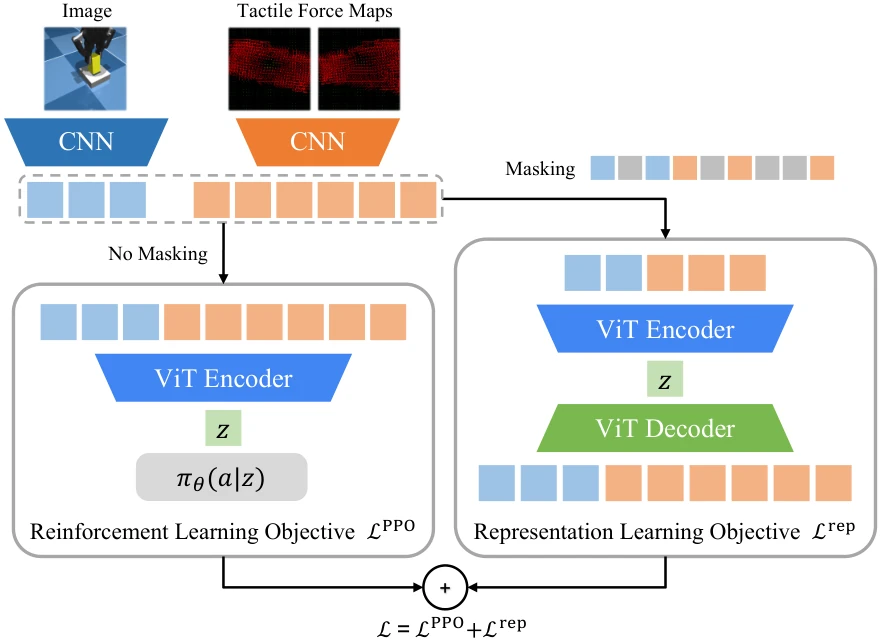

<!-- Generated by scripts/generate.py; edit data/works.json and data/media.json. -->

[← Back to the Awesome index](../../../README.md) · [Interactive website](https://chang-xinhai.github.io/Awesome-RGBDT-Manipulation/?collection=policy&item=m3l#library)

# M3L — Power of the Senses

The Power of the Senses: Generalizable Manipulation from Vision and Touch through Masked Multimodal Learning

**2023-11-02 · Preprint · University of California, Berkeley / KAIST**

**[Paper](https://arxiv.org/abs/2311.00924)**

Masked multimodal learning jointly trains visual-tactile representations and manipulation policies, including vision-only deployment transfer.

*The Power of the Senses: Generalizable Manipulation from Vision and Touch through Masked Multimodal Learning authors · [Figure source](https://arxiv.org/abs/2311.00924) · Original rights retained.*

| Field | Reported value and source scope |
| :-- | :-- |
| Record type | policy |
| Policy family | RL [1](https://arxiv.org/abs/2311.00924)  |
| Base model and architecture | Masked multi modal auto encoder coupled to RL policy. [1](https://arxiv.org/abs/2311.00924)  |
| Model size and component | Not reported [1](https://arxiv.org/abs/2311.00924)  |
| Deployment inputs | Visual/tactile observations during training; configured vision-only or visual-tactile deployments. [1](https://arxiv.org/abs/2311.00924)  |
| Action outputs and horizon | Manipulation actions. [1](https://arxiv.org/abs/2311.00924)  |
| Training method | Joint masked representation learning and policy optimization. [1](https://arxiv.org/abs/2311.00924)  |
| Training data | Robot manipulation RL interactions; exact training budget Not reported in inspected text. [1](https://arxiv.org/abs/2311.00924)  |
| Training duration | Not reported [1](https://arxiv.org/abs/2311.00924)  |
| Training hardware | Not reported [1](https://arxiv.org/abs/2311.00924)  |
| Inference and control rates | Not reported [1](https://arxiv.org/abs/2311.00924)  |
| Evaluation scope | Generalization across visual/contact conditions and vision-only ablation. [1](https://arxiv.org/abs/2311.00924)  |
| Observations / modalities | RGB · Tactile · Proprioception |
| Evaluation domain | Simulation · Real world |
| Embodiment | Parallel-jaw gripper |
| Release: code | Not verified |
| Release: weights | Not verified |
| Release: data | Not verified |
| Release: license | Not verified |
| Release: notes | Original paper reviewed; claimed future releases are not treated as currently available. |

**Scope and qualifications**

- Modality availability differs between full visual-tactile and vision-only evaluation variants.

**Primary evidence**

1. [Original paper and supplementary implementation details](https://arxiv.org/abs/2311.00924) — Primary full text reviewed; dataset, deployment modalities and training-only privileges are scoped separately.
