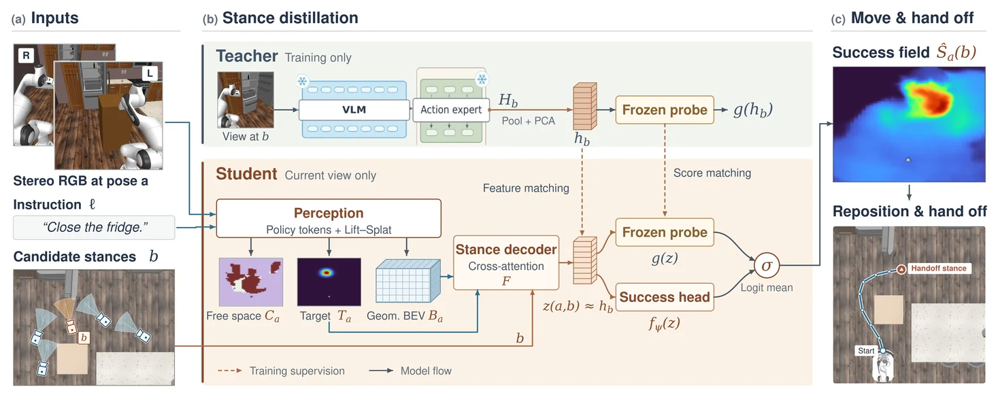

<!-- Generated by scripts/generate.py; edit data/works.json and data/media.json. -->

[← Back to the Awesome index](../../../README.md) · [Interactive website](https://chang-xinhai.github.io/Awesome-RGBDT-Manipulation/?collection=policy&item=m4m#library)

# M4M

Learning to Move from and for Manipulation Policies: Spatializing Latent Action Representations for Goal-Pose-Free Mobile Manipulation

**2026-11-19 · Preprint · University of Michigan**

**[Paper](https://arxiv.org/abs/2611.25366)**

Learns where to move before acting by predicting a frozen manipulation policy’s success at unseen stances using calibrated stereo.

*Siyuan Zheng, Zhong Cao and Henry X. Liu · [Figure source](https://arxiv.org/html/2611.25366v1) · Original rights retained.*

| Field | Reported value and source scope |
| :-- | :-- |
| Record type | policy |
| Policy family | Stereo-guided mobile manipulation handoff [1](https://arxiv.org/html/2611.25366v1)  |
| Base model and architecture | Frozen π0.5 policy plus stereo BEV geometry, a learned stance score and a learned handoff. [1](https://arxiv.org/html/2611.25366v1)  |
| Model size and component | Not reported [1](https://arxiv.org/html/2611.25366v1)  |
| Deployment inputs | Calibrated stereo RGB, language and robot state during manipulation. No measured depth stream is reported for the policy. [1](https://arxiv.org/html/2611.25366v1)  |
| Action outputs and horizon | Base approach actions and handoff to the frozen action policy. [1](https://arxiv.org/html/2611.25366v1)  |
| Training method | Distill latent action representations observed at candidate stances and fit a success head using limited outcomes. Learn navigation and handoff around the frozen VLA. [1](https://arxiv.org/html/2611.25366v1)  |
| Training data | Simulated training kitchen stances and policy rollouts; evaluate on held-out kitchen layouts. [1](https://arxiv.org/html/2611.25366v1)  |
| Training duration | Not reported [1](https://arxiv.org/html/2611.25366v1)  |
| Training hardware | Not reported [1](https://arxiv.org/html/2611.25366v1)  |
| Inference and control rates | Not reported [1](https://arxiv.org/html/2611.25366v1)  |
| Evaluation scope | Eight articulated-object tasks in held-out RoboCasa kitchens, 47.0% mean task success against 26.5% for the strongest paper baseline and 19.2% direct execution. [1](https://arxiv.org/html/2611.25366v1)  |
| Observations / modalities | RGB · Language · Proprioception |
| Evaluation domain | Simulation |
| Embodiment |  |
| Release: code | Not verified |
| Release: weights | Not verified |
| Release: data | Not verified |
| Release: license | Not verified |
| Release: notes | Paper states that code and videos are intended for the project page. Public repository, checkpoints and data files were not independently verified. |

**Scope and qualifications**

- Stereo-specific learned geometry is not direct measured depth. The manuscript explicitly leaves physical robot testing to future work.

**Primary evidence**

1. [Original author paper or dataset description](https://arxiv.org/html/2611.25366v1)
