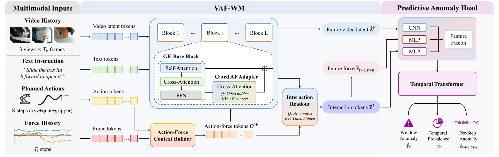

<!-- Generated by scripts/generate.py; edit data/works.json and data/media.json. -->

[← Back to the Awesome index](../../../README.md) · [Interactive website](https://chang-xinhai.github.io/Awesome-RGBDT-Manipulation/?collection=policy&item=maia#library)

# MAIA / VAF-WM

MAIA: Anticipating Interaction Anomalies in Contact-Rich Manipulation via Multimodal World Models

**2026-10-15 · arXiv preprint · Shanghai Jiao Tong University**

**[Paper](https://arxiv.org/abs/2610.21686)**

A visual–action–force world model predicts contact anomalies; its scores can rerank action chunks from a separate frozen π0.5 policy.

*maia authors; original research figure · [Figure source](https://arxiv.org/html/2610.21686#S4.F3) · Original rights retained.*

| Field | Reported value and source scope |
| :-- | :-- |
| Record type | model |
| Model role and downstream interface | Predictive interaction/anomaly model. A downstream wrapper selects among8 proposed π0.5 action chunks; MAIA is not itself a direct action generator. [1](https://arxiv.org/html/2610.21686)  |
| Model family | Predictive contact model [1](https://arxiv.org/html/2610.21686)  |
| Model architecture | GE-Base video backbone, gated action–force cross-attention adapters, TCN wrench-history encoder, interaction readout and temporal anomaly transformer. [1](https://arxiv.org/html/2610.21686)  |
| Model size and component | Total parameters not reported; anomaly fusion width128, two temporal transformer layers/four heads. [1](https://arxiv.org/html/2610.21686)  |
| Model inputs | Recent multi-view RGB and wrist six-axis wrench history, language task instruction and planned future action sequence supplied by another policy. Depth camera hardware is not a measured-depth input. [1](https://arxiv.org/html/2610.21686)  |
| Model outputs | Future visual latents and50-step wrench rollout; window anomaly probability, prevalence and auxiliary step scores. [1](https://arxiv.org/html/2610.21686)  |
| Training method | Nominal-dynamics flow matching plus force prediction; freeze world model for supervised anomaly-head learning; freeze video backbone during limited-data joint pathway/head adaptation. [1](https://arxiv.org/html/2610.21686)  |
| Training data and scale | CRIA2,852 trajectories over18 tasks, with2,328 anomaly events. At least150 trajectories/task;13 seen tasks for main training,5 novel tasks held out;10 adaptation trajectories/novel task. Nominal, anomalous human demonstrations and π0.5 rollouts are distinct sources. [1](https://arxiv.org/html/2610.21686)  |
| Training duration | 30k world-model steps;5k anomaly-head steps;2k adaptation steps. Wall-clock time not reported. [1](https://arxiv.org/html/2610.21686)  |
| Training hardware | 4 NVIDIA A100 GPUs for all reported training stages. [1](https://arxiv.org/html/2610.21686)  |
| Inference setting and runtime | 30Hz alignment;128-step sample/50-step future, one world-model inference step for head features. Downstream wrapper scores8 chunks, executes20 actions and computes asynchronously; this is not a claimed30Hz model inference rate. [1](https://arxiv.org/html/2610.21686)  |
| Downstream evaluation and scope | Offline anomaly AUPRC,bACC,anticipation rate/lead time on13 seen+5 novel tasks. Real frozen-policy reranking:18 tasks×30 trials/method; mean success52.6%→61.5%. Novel-task results use adaptation, not zero-shot operation. [1](https://arxiv.org/html/2610.21686)  |
| Observations / modalities | RGB · Force/Torque · Language |
| Evaluation domain | Real world |
| Embodiment | Parallel-jaw gripper |
| Release: code | Not verified |
| Release: weights | Not verified |
| Release: data | Not verified |
| Release: license | Not verified; source figures retain original rights |
| Release: notes | The manuscript points to https://joringell.github.io/MAIA/ but it returned404 at review; omitted as a usable Project artifact. Code, CRIA downloads, weights and license are not independently verified. |

**Scope and qualifications**

- Wrist force/torque is not cutaneous tactile; three RealSense D435i cameras supply RGB, not depth in the reported model interface.
- CRIA has2,852 collected trajectories; experimental100/20/30 per-task split budgets are distinct from all collected corpus totals.
- No explicit end-to-end inference latency is reported. The30Hz control-aligned data timeline and50-step prediction horizon do not establish model refresh frequency.
- The world-model video transformer is trained in stage1, then frozen for anomaly-head training and novel-task adaptation.

**Primary evidence**

1. [Original full manuscript and appendices](https://arxiv.org/html/2610.21686) — Full method, all18 task definitions, per-task corpus statistics, implementation appendix and online reranking evaluation inspected. Predictor and downstream action sampler are separate.
