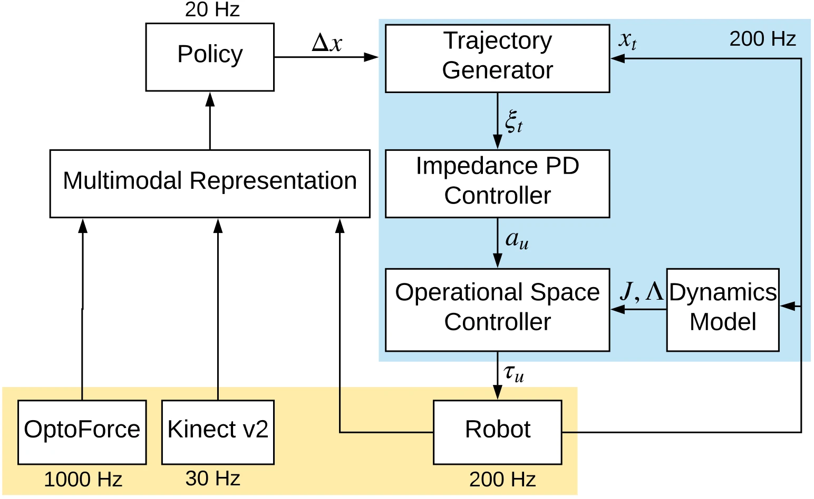

<!-- Generated by scripts/generate.py; edit data/works.json and data/media.json. -->

[← Back to the Awesome index](../../../README.md) · [Interactive website](https://chang-xinhai.github.io/Awesome-RGBDT-Manipulation/?collection=policy&item=making-sense-vision-touch#library)

# Making Sense of Vision and Touch

Making Sense of Vision and Touch: Self-Supervised Learning of Multimodal Representations for Contact-Rich Tasks

**2018-10-24 · ICRA 2019 · Stanford University; NVIDIA**

**[Paper](https://arxiv.org/abs/1810.10191)** · [Project](https://sites.google.com/view/visionandtouch) · [Code](https://github.com/stanford-iprl-lab/multimodal_representation) · [Data](https://downloads.cs.stanford.edu/juno/triangle_real_data.zip) · [Extended](https://arxiv.org/abs/1907.13098)

Self-supervised RGB/wrist-force fusion supports a complete learned peg-insertion controller, connecting low-rate Cartesian policy actions to compliant torque control.

*Making Sense of Vision and Touch authors · [Figure source](https://arxiv.org/abs/1810.10191) · Original rights retained.*

| Field | Reported value and source scope |
| :-- | :-- |
| Record type | policy |
| Policy family | RL [1](https://arxiv.org/abs/1810.10191)  |
| Base model and architecture | Six-layer visual CNN, causal convolutional wrist-F/T encoder and proprioceptive MLP fused into a 128D representation; two-layer TRPO policy with an interpolating impedance/operational-space controller. [1](https://arxiv.org/abs/1810.10191)  |
| Model size and component | Modality encoders: approximately 0.5M learnable parameters; total controller count not reported. [1](https://arxiv.org/abs/1810.10191)  |
| Deployment inputs | Fixed-camera RGB, 32-sample six-axis wrist F/T history, end-effector position/velocity. Kinect depth is not a deployed input in this manuscript. [1](https://arxiv.org/abs/1810.10191)  |
| Action outputs and horizon | 3D Cartesian end-effector displacement from policy; compliant hierarchy converts interpolated trajectories to joint torques. [1](https://arxiv.org/abs/1810.10191)  |
| Training method | Action-conditioned optical-flow/contact prediction and temporal-alignment pretraining; freeze representation, then learn task policy with TRPO. [1](https://arxiv.org/abs/1810.10191)  |
| Training data | Representation: 100K sampled states collected in 90–120 minutes. Simulation policies: 1,200 episodes × 500 steps. Real policies: 300 episodes × 1,000 steps. [1](https://arxiv.org/abs/1810.10191)  |
| Training duration | Representation: 20 epochs; elapsed time not reported. Real robot policy training: approximately five hours. [1](https://arxiv.org/abs/1810.10191)  |
| Training hardware | NVIDIA Titan V for representation training; real KUKA LBR iiwa for interaction. Other compute not reported. [1](https://arxiv.org/abs/1810.10191)  |
| Inference and control rates | 20 Hz Cartesian policy; 200 Hz interpolation/compliant joint-torque controller. [1](https://arxiv.org/abs/1810.10191)  |
| Evaluation scope | Peg insertion in SAI 2.0/CHAI3D simulation and on KUKA iiwa; shape/clearance transfer and external perturbations. Real haptics use an OptoForce wrist sensor, not skin tactile. [1](https://arxiv.org/abs/1810.10191)  |
| Observations / modalities | RGB · Force/Torque · Proprioception |
| Evaluation domain | Simulation · Real robot |
| Embodiment | Arm-mounted peg |
| Release: code | Partial [2](https://sites.google.com/view/visionandtouch) [3](https://github.com/stanford-iprl-lab/multimodal_representation/tree/master)  |
| Release: weights | Not verified [2](https://sites.google.com/view/visionandtouch) [3](https://github.com/stanford-iprl-lab/multimodal_representation/tree/master)  |
| Release: data | Available [2](https://sites.google.com/view/visionandtouch) [5](https://github.com/stanford-iprl-lab/multimodal_representation/blob/master/multimodal/dataset/download_data.sh)  |
| Release: license | MIT for repository code; data and figure rights remain separate [2](https://sites.google.com/view/visionandtouch) [3](https://github.com/stanford-iprl-lab/multimodal_representation/tree/master) [4](https://github.com/stanford-iprl-lab/multimodal_representation/blob/master/LICENSE)  |
| Release: notes | Actual source release covers representation training and provides a public dataset download script; no full TRPO/real-robot controller package or trained policy checkpoint was verified. Dataset archive endpoint responds successfully; archive was not downloaded. [2](https://sites.google.com/view/visionandtouch)  |

**Scope and qualifications**

- Wrist F/T feedback is distinct from fingertip/skin tactile sensing; no measured scene-depth input is used by this policy.
- The 2019 extended manuscript is linked separately; quantitative fields here follow the original ICRA manuscript, whose first public submission was in 2018.

**Primary evidence**

1. [Original manuscript and first public submission history](https://arxiv.org/abs/1810.10191) — Full author method, evaluation and appendix reviewed; downstream controller probes are distinguished from the reusable model.
2. [Official author project and current artifact destinations](https://sites.google.com/view/visionandtouch) — A project button or advertised artifact does not establish a downloadable release; paper-version differences are retained.
3. [Actual public repository content inventory](https://github.com/stanford-iprl-lab/multimodal_representation/tree/master) — 36 tracked paths reviewed; representation code, action-policy code and README placeholders are distinguished.
4. [Actual MIT license file](https://github.com/stanford-iprl-lab/multimodal_representation/blob/master/LICENSE) — Applies to released repository code, not a blanket license for paper figures or upstream assets.
5. [Original data download script and checked public archive endpoint](https://github.com/stanford-iprl-lab/multimodal_representation/blob/master/multimodal/dataset/download_data.sh) — Script names the triangle_real_data.zip archive; its HTTPS endpoint returned 200 on review, without downloading the large archive.
